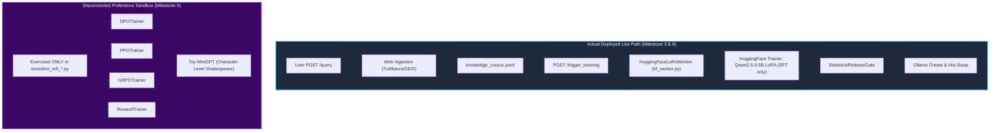

# GAP-06: The RLHF vs Production Serving Pipeline Disconnect

## 1. Architectural Summary & The Central Pipeline Gap

The repository claims in [`README.md`](file:///Users/jayesh/Documents/RLHF/README.md), [`milestone.md`](file:///Users/jayesh/Documents/RLHF/milestone.md), and [`docs/research.md`](file:///Users/jayesh/Documents/RLHF/docs/research.md) to implement a complete **Autonomous Continual Learning LLM Post-Training Pipeline** spanning SFT, Bradley-Terry Reward Modeling, DPO, PPO, and DeepSeek-R1 style GRPO.

However, a code-level audit of the serving gateway and training workers reveals a **fundamental architectural bifurcation**:

> **The "RLHF" code never reaches the served model.**
> All preference learning algorithms (Bradley-Terry Reward Modeling, DPO, PPO, GRPO) in Milestone 5 are implemented exclusively for the **toy character-level MiniGPT architecture** (`MiniGPT` trained on TinyShakespeare).
> The live continuous post-training loop (`apps/server.py`, `apps/learning_jobs.py`, and `training/m3_sft/hf_worker.py`) exclusively runs **basic LoRA Supervised Fine-Tuning (SFT)** on `Qwen/Qwen2.5-0.5B-Instruct`.
> **Zero preference alignment, zero reward modeling, and zero reinforcement learning is executed in the live deployed loop.**

---

## 2. Evidence from the Codebase

### Universe 1: The Offline Toy Preference Sandbox (`training/m5_preference/`)
- Contains implementations of:
  - `RewardModel` & `BradleyTerryLoss` ([`reward_model.py`](file:///Users/jayesh/Documents/RLHF/training/m5_preference/reward_model.py))
  - `DPOTrainer` & `DPOLoss` ([`dpo_trainer.py`](file:///Users/jayesh/Documents/RLHF/training/m5_preference/dpo_trainer.py), [`dpo_loss.py`](file:///Users/jayesh/Documents/RLHF/training/m5_preference/dpo_loss.py))
  - `PPOTrainer` & `CriticModel` ([`ppo_trainer.py`](file:///Users/jayesh/Documents/RLHF/training/m5_preference/ppo_trainer.py), [`critic.py`](file:///Users/jayesh/Documents/RLHF/training/m5_preference/critic.py))
  - `GRPOTrainer` & `VerifiableRewardEngine` ([`grpo_trainer.py`](file:///Users/jayesh/Documents/RLHF/training/m5_preference/grpo_trainer.py), [`grpo_loss.py`](file:///Users/jayesh/Documents/RLHF/training/m5_preference/grpo_loss.py))
  - `AlignmentEngine` factory ([`alignment_engine.py`](file:///Users/jayesh/Documents/RLHF/training/m5_preference/alignment_engine.py))
- **Backbone**: These all take `MiniGPT` (`training/m1_transformer/model.py`) with `CharTokenizer`.
- **Usage**: Grep across the entire project demonstrates that these classes are **ONLY** invoked inside unit tests (`tests/test_m5_*.py`).

### Universe 2: The Live Continual Serving Loop (`apps/` & `training/m3_sft/`)
- In [`apps/server.py`](file:///Users/jayesh/Documents/RLHF/apps/server.py#L90-L95):
  ```python
  def submit_training_job() -> tuple[str, bool]:
      if worker is None or jobs is None:
          raise RuntimeError("The Hugging Face training worker is not configured.")
      return jobs.submit(worker.train_evaluate_and_package, promote_ollama_candidate)
  ```
- The worker is `HuggingFaceLoRAWorker` in [`training/m3_sft/hf_worker.py`](file:///Users/jayesh/Documents/RLHF/training/m3_sft/hf_worker.py#L58-L86).
- Looking inside `HuggingFaceLoRAWorker.train_evaluate_and_package()`:
  ```python
  model = AutoModelForCausalLM.from_pretrained(self.base_model)  # Qwen/Qwen2.5-0.5B-Instruct
  model = get_peft_model(model, LoraConfig(...))
  training_args = TrainingArguments(
      output_dir=str(run_dir / "trainer"),
      max_steps=max_steps,
      ...
  )
  trainer = Trainer(model=model, args=training_args, train_dataset=dataset, ...)
  trainer.train()  # Plain cross-entropy SFT!
  ```
- After training, it evaluates the candidate against Ollama using `StatisticalReleaseGate` and packages it into an Ollama model tag via `ollama create`.
- **Where is DPO, PPO, GRPO, or the Reward Model?**
  **Nowhere.** There is no code path anywhere connecting `hf_worker.py` or the FastAPI server to any preference learning module in `m5_preference`.

---

## 3. Disconnect Diagram



---

## 4. Why This Disconnect Matters

1. **False Sense of Alignment**: The documentation (`docs/research.md`) implies that the deployed model undergoes continual alignment with human preferences and verifiable rewards. In reality, the deployed model only undergoes basic LoRA fine-tuning on scraped web excerpts.
2. **Missing Safety Boundaries**: Because the deployed model never undergoes preference optimization (DPO/PPO), it lacks the preference boundaries and safety alignment demonstrated in the Milestone 5 unit tests.
3. **Double Maintenance Burden**: Two completely incompatible training infrastructures exist side-by-side: a PyTorch character-level transformer implementation for alignment research, and a Hugging Face / PEFT / Ollama pipeline for serving.

