# Autonomous Continual Learning & Post-Training Alignment
## A Mathematical Monograph & Engineering Specification

> **Abstract**: This volume presents a complete mathematical derivation, theoretical foundation, and production engineering specification for autonomous, continual-learning Large Language Models. Organized into seven thematic parts across eleven chapters, this treatise details the full continuum from computational graphs and causal self-attention to web corpus curation, parameter-efficient fine-tuning (LoRA), preference optimization (Bradley-Terry, DPO, IPO), reinforcement learning (PPO, GAE, DeepSeek GRPO), non-parametric statistical hypothesis release gating, and zero-downtime experience replay orchestration.

---

# Table of Contents

### Part I: System Architecture & Computational Foundations
1. [Chapter 1: System Architecture & Continual Learning Topology](#chapter-1-system-architecture--continual-learning-topology)
2. [Chapter 2: Hardware Acceleration Strategy & Typed Data Contracts](#chapter-2-hardware-acceleration-strategy--typed-data-contracts)

### Part II: Transformer Internals & Deep Learning from Scratch
3. [Chapter 3: Reverse-Mode Automatic Differentiation & Computational Graphs](#chapter-3-reverse-mode-automatic-differentiation--computational-graphs)
4. [Chapter 4: Statistical Language Modeling & Optimization Dynamics](#chapter-4-statistical-language-modeling--optimization-dynamics)
5. [Chapter 5: Causal Multi-Head Self-Attention & Algorithmic KV-Caching](#chapter-5-causal-multi-head-self-attention--algorithmic-kv-caching)
6. [Chapter 6: Generative Pre-LayerNorm Transformer Architecture](#chapter-6-generative-pre-layernorm-transformer-architecture)

### Part III: Corpus Engineering & Distributional Stability
7. [Chapter 7: Web Ingestion, MinHash LSH Deduplication, & Model Collapse Prevention](#chapter-7-web-ingestion-minhash-lsh-deduplication--model-collapse-prevention)

### Part IV: Supervised Adaptation & Parameter Efficiency
8. [Chapter 8: Supervised Fine-Tuning (SFT) & Low-Rank Adaptation (LoRA)](#chapter-8-supervised-fine-tuning-sft--low-rank-adaptation-lora)

### Part V: Multi-Metric Evaluation & Statistical Release Gating
9. [Chapter 9: Benchmark Evaluation, Citation Faithfulness, & Autonomous Release Gating](#chapter-9-benchmark-evaluation-citation-faithfulness--autonomous-release-gating)

### Part VI: Preference Learning & Reinforcement Learning Alignment
10. [Chapter 10: Preference Learning, Direct Preference Optimization (DPO), & Reinforcement Learning (PPO & GRPO)](#chapter-10-preference-learning-direct-preference-optimization-dpo--reinforcement-learning-ppo--grpo)

### Part VII: Production Orchestration & Serving
11. [Chapter 11: Continual Learning Loop Orchestration, Hybrid Retrieval, & Zero-Downtime Serving](#chapter-11-continual-learning-loop-orchestration-hybrid-retrieval--serving-gateway)

### Appendices
12. [Appendix A: Empirical Verification & Implementation Status](#appendix-a-empirical-verification--implementation-status)

---

# Chapter 1: System Architecture & Continual Learning Topology

### 0.1 End-to-End Dataflow Topology
```
[User Query] ──► [FastAPI Gateway] ──► [Hybrid Retrieval: BM25 + Dense] ──► [Ollama Serving]
                         │                                                   ▲
                         ▼                                                   │ (Hot-swap)
                  [Task Trigger]                                      [Release Gate]
                         │                                                   ▲
                         ▼                                                   │
                  [Web Ingestion]                                     [Evaluation Engine]
                (Trafilatura/DDG)                                            ▲
                         │                                                   │
                         ▼                                            [Post-Training]
                  [Quality Filters] ──► [Experience Replay Buffer] ──► (LoRA SFT / GRPO)
                  (MinHash LSH 80%)     (70% Anchor / 30% Web)
```

### 0.2 Hybrid Retrieval Mathematics
For query $q$ and document $d \in \mathcal{D}$, an optional convex score fusion can combine lexical BM25 and cosine similarity:

$$
S_{\text{hybrid}}(q, d) = \alpha \cdot \hat{S}_{\text{BM25}}(q, d) + (1 - \alpha) \cdot \hat{S}_{\text{dense}}(q, d), \quad \alpha \in [0, 1]
$$

where scores are min-max normalized over candidate pool $\mathcal{C}$:

$$
\hat{S}(q, d) = \frac{S(q, d) - \min_{c \in \mathcal{C}} S(q, c)}{\max_{c \in \mathcal{C}} S(q, c) - \min_{c \in \mathcal{C}} S(q, c) + \epsilon}
$$

The current implementation combines BM25 and deterministic character n-gram hash cosine rankings using Reciprocal Rank Fusion (RRF); it does not use the min-max interpolation above or a pretrained dense embedding model. RRF provides rank-based combination:

$$
\text{RRF}(d) = \sum_{m \in \{\text{lexical}, \text{dense}\}} \frac{1}{k + \text{rank}_m(d)}, \quad k = 60
$$

### 0.3 Model Promotion: Current Python Path and Ollama Gap
The default gateway now collects/curates web documents on `/query`, persists them in `data/knowledge_corpus.jsonl`, indexes them for retrieval, and invokes the active Ollama model with citation instructions. `POST /trigger_learning` queues a separate Hugging Face PEFT/LoRA SFT worker. It evaluates the candidate against the Ollama anchor using the golden suite and `StatisticalReleaseGate`; only `PROCEED_DEPLOY` candidates are merged, passed to `ollama create`, and hot-swapped while in-flight gateway readers finish. Job state is process-local and available at `GET /learning/jobs/{job_id}`.

This is a prototype path, not a production guarantee: source retrieval and answer quality still depend on live sources and the model; the statistical gate uses lexical benchmark metrics; model downloads/training/evaluation can be expensive on CPU; and the Ollama `FROM`-Safetensors packaging path must be exercised on the target Ollama build. Job state is not durable across server restarts, and the API has no authentication.

---

# Chapter 2: Hardware Acceleration Strategy & Typed Data Contracts

### 1.1 Hardware Strategy Formulation
The host hardware detection layer dynamically determines optimal compute precision and execution parameters:
- **Apple Silicon (Mac M-series MPS)**:
  - Backing: Metal Performance Shaders with Unified Memory Architecture (UMA).
  - The hardware strategy currently selects `torch.bfloat16`; support depends on the installed PyTorch/MPS version and device, and should be validated before training.
  - Gradient Accumulation: $B_{\text{effective}} = B_{\text{micro}} \times K_{\text{accum}}$.
- **NVIDIA CUDA**: Selects `bfloat16` when supported and otherwise `float16`; TF32 and FlashAttention-2 are not enabled by the hardware strategy.
- **CPU (Cloud Shell / Codespaces)**: Sets PyTorch's thread count to $\max(1, N_{\text{cores}} - 1)$.

### 1.2 Schema Contracts (Pydantic V2)
Strict data integrity contracts govern every transition:
- `ScrapedDocumentSchema`: Raw HTML extraction payload with URL, text, and SHA-256 provenance hash.
- `CleanedDocumentSchema`: Filtered text, language tag, shingle hashes, and quality scores.
- `TrainingSampleSchema`: ChatML format (`{"messages": [{"role": "user", "content": ...}, {"role": "assistant", "content": ...}]}`).
- `EvaluationReportSchema`: Citation faithfulness, regression delta ($\Delta \mathcal{L} \le 0.05$), and gate decision (`PASS`/`FAIL`).

---

# Chapter 3: Reverse-Mode Automatic Differentiation & Computational Graphs

### 2.1 Landmark Research Papers Behind Autograd
1. **Linnainmaa, S. (1970)**: *The representation of the cumulative rounding error of an algorithm as a Taylor expansion of the local rounding errors*. Master's thesis, Univ. of Helsinki. (Invented reverse-mode automatic differentiation).
2. **Baur, W., & Strassen, V. (1983)**: *The complexity of partial derivatives*. Theoretical Computer Science, 22(3), 317-330.
   - **Baur-Strassen Theorem**: For any computational graph evaluating $f(x_1, \dots, x_n)$ in $C$ elementary operations, all $n$ partial derivatives $\nabla f$ can be evaluated in:

$$
\text{Cost}(\nabla f) \le 5 \times \text{Cost}(f)
$$

   - This single theorem makes modern LLM training computationally feasible. Forward-mode would require $\mathcal{O}(n \cdot \text{Cost}(f))$, taking millennia for billions of parameters.
3. **Rumelhart, D. E., Hinton, G. E., & Williams, R. J. (1986)**: *Learning representations by back-propagating errors*. Nature, 323, 533-536.

### 2.2 Reverse DAG Traversal & The Multivariate Adjoint Equation
A scalar computation $\mathcal{L} = f(x_1, \dots, x_n)$ forms a Directed Acyclic Graph (DAG) with nodes $\mathcal{V}$ and edges $\mathcal{E}$.
For any node $v \in \mathcal{V}$, its adjoint $\bar{v} = \frac{\partial \mathcal{L}}{\partial v}$ is:

$$
\bar{v} = \sum_{u \in \text{children}(v)} \bar{u} \cdot \frac{\partial u}{\partial v}
$$

To evaluate $\bar{v}$ correctly, all children $u$ must evaluate before $v$. This necessitates processing nodes in **reverse topological order**, established via Depth-First Search (DFS).

### 2.3 Elementary Operation Adjoints
| Operation | Forward Pass | Adjoint $\bar{x} = \frac{\partial \mathcal{L}}{\partial x}$ | Adjoint $\bar{y} = \frac{\partial \mathcal{L}}{\partial y}$ |
| :--- | :--- | :--- | :--- |
| **Addition** | $z = x + y$ | $\bar{z}$ | $\bar{z}$ |
| **Multiplication** | $z = x \cdot y$ | $\bar{z} \cdot y$ | $\bar{z} \cdot x$ |
| **Power** | $z = x^c$ ($c \in \mathbb{R}$) | $\bar{z} \cdot c x^{c-1}$ | — |
| **ReLU** | $z = \max(0, x)$ | $\bar{z} \cdot \mathbb{I}(x > 0)$ | — |
| **Tanh** | $z = \tanh(x)$ | $\bar{z} \cdot (1 - z^2)$ | — |
| **Exponential** | $z = \exp(x)$ | $\bar{z} \cdot z$ | — |
| **Natural Log** | $z = \ln(x)$ | $\bar{z} \cdot \frac{1}{x}$ | — |

### 2.4 Taylor Series Central Difference Bound ($\mathcal{O}(h^2)$)
To verify analytical gradients against numerical approximation:

$$
f'(x) \approx \frac{f(x + h) - f(x - h)}{2h}
$$

#### Proof of $\mathcal{O}(h^2)$ Truncation Bound:
Expanding $f(x \pm h)$ around $x$:

$$
f(x + h) = f(x) + h f'(x) + \frac{h^2}{2} f''(x) + \frac{h^3}{6} f'''(\xi_1)
$$

$$
f(x - h) = f(x) - h f'(x) + \frac{h^2}{2} f''(x) - \frac{h^3}{6} f'''(\xi_2)
$$

Subtracting yields:

$$
f(x + h) - f(x - h) = 2h f'(x) + \frac{h^3}{6}(f'''(\xi_1) + f'''(\xi_2))
$$

$$
\left| \frac{f(x + h) - f(x - h)}{2h} - f'(x) \right| = \frac{h^2}{6} |f'''(\xi)| = \mathcal{O}(h^2)
$$

For step size $h = 10^{-5}$, truncation error is bounded by $\mathcal{O}(10^{-10})$. We verify analytical gradients with strict tolerance:

$$
\epsilon_{\text{rel}} = \frac{|\nabla_{\text{analytical}} - \nabla_{\text{numerical}}|}{\max(|\nabla_{\text{analytical}}|, |\nabla_{\text{numerical}}|, 10^{-8})} < 10^{-5}
$$

---

# Chapter 4: Statistical Language Modeling & Optimization Dynamics

### 3.1 Bigram Statistical Baseline & Maximum Likelihood Estimation (MLE)
Given a sequence of discrete tokens $(w_1, \dots, w_N) \in \mathbb{V}^N$, the first-order Markov bigram assumption is:

$$
P(w_1, \dots, w_N) = \prod_{t=1}^N P(w_t \mid w_{t-1})
$$

The empirical transition probability under MLE is:

$$
\hat{P}_{\text{MLE}}(w_t = j \mid w_{t-1} = i) = \frac{C(i, j)}{\sum_{k=1}^V C(i, k)}
$$

where $C(i, j)$ is the count of pair $(i, j)$ in the corpus.

#### Empirical Cross-Entropy & Perplexity:

$$
H_{\text{corpus}} = -\frac{1}{N} \sum_{t=1}^N \ln \hat{P}_{\text{MLE}}(w_t \mid w_{t-1})
$$

$$
\text{Perplexity} = \exp(H_{\text{corpus}})
$$

For character-level TinyShakespeare, the empirical statistical bigram entropy is **$1.7524$ nats** ($\text{PPL} \approx 5.77$).

### 3.2 Log-Sum-Exp Trick for Softmax Stability
Unnormalized logits $z \in \mathbb{R}^V$ evaluate probability:

$$
P_i = \frac{e^{z_i}}{\sum_{j=1}^V e^{z_j}}
$$

Direct calculation overflows in float32 when $z_i > 88.7$. By factoring $m = \max_k z_k$:

$$
\ln\left(\sum_{j=1}^V e^{z_j}\right) = m + \ln\left(\sum_{j=1}^V e^{z_j - m}\right)
$$

$$
\text{CrossEntropy}(z, y) = m + \ln\left(\sum_{j=1}^V e^{z_j - m}\right) - z_y
$$

Since $z_j - m \le 0$, $e^{z_j - m} \in (0, 1]$, making overflow impossible.

### 3.3 Analytical Logit Gradient

$$
\frac{\partial \mathcal{L}}{\partial z_i} = P_i - \mathbb{I}(i = y)
$$

- Target logit ($i = y$): $\frac{\partial \mathcal{L}}{\partial z_y} = P_y - 1 \le 0$ (gradient descent pushes logit up).
- Non-target logit ($i \ne y$): $\frac{\partial \mathcal{L}}{\partial z_i} = P_i \ge 0$ (gradient descent pushes logit down).

---

# Chapter 5: Causal Multi-Head Self-Attention & Algorithmic KV-Caching

### 4.1 Scaled Dot-Product Attention Equation

$$
\text{Attention}(Q, K, V) = \text{softmax}\left(\frac{Q K^T}{\sqrt{d_k}} + M\right) V
$$

where $Q, K, V \in \mathbb{R}^{B \times T \times d_k}$ and $M \in \mathbb{R}^{T \times T}$ is the causal lower-triangular mask.

### 4.2 Proof: Variance Preservation under Scaling Factor $\frac{1}{\sqrt{d_k}}$
Let $q, k \in \mathbb{R}^{d_k}$ be independent zero-mean vectors with unit variance components:

$$
\mathbb{E}[q_i] = \mathbb{E}[k_i] = 0, \quad \text{Var}(q_i) = \text{Var}(k_i) = 1, \quad \forall i \in \{1, \dots, d_k\}
$$

The inner product is $S = q^T k = \sum_{i=1}^{d_k} q_i k_i$.
1. $\mathbb{E}[S] = \sum_{i=1}^{d_k} \mathbb{E}[q_i] \mathbb{E}[k_i] = 0$.
2. Because $q_i, k_i$ are independent:

$$
\text{Var}(q_i k_i) = \mathbb{E}[(q_i k_i)^2] - (\mathbb{E}[q_i k_i])^2 = \mathbb{E}[q_i^2]\mathbb{E}[k_i^2] - 0 = 1 \cdot 1 = 1
$$

$$
\text{Var}(S) = \text{Var}\left(\sum_{i=1}^{d_k} q_i k_i\right) = \sum_{i=1}^{d_k} \text{Var}(q_i k_i) = d_k
$$

Without scaling, $\text{Var}(S) = d_k$. For $d_k = 64$, $\sigma = 8$. Softmax on values with standard deviation 8 saturates at 0 and 1, extinguishing gradients.
Scaling by $\frac{1}{\sqrt{d_k}}$ ensures:

$$
\text{Var}\left(\frac{S}{\sqrt{d_k}}\right) = \frac{1}{d_k} \text{Var}(S) = \frac{d_k}{d_k} = 1 \quad \blacksquare
$$

### 4.3 Causal Masking Tensor Algebra

$$
M_{ij} = \begin{cases}
  0 & \text{if } j \le i \\
  -\infty & \text{if } j > i
\end{cases}
$$

When passed through softmax:

$$
\lim_{M_{ij} \to -\infty} \frac{\exp(A_{ij} + M_{ij})}{\sum_k \exp(A_{ik} + M_{ik})} = 0, \quad \forall j > i
$$

### 4.4 KV-Cache Algorithmic Optimization
In autoregressive decoding, token $T+1$ only requires computing query $Q_{T+1} \in \mathbb{R}^{1 \times d_k}$. Keys and values for tokens $1 \dots T$ remain unchanged because causal masking prevents future tokens from altering past keys.
- **Naive Full Recomputation**: $\sum_{t=1}^N \mathcal{O}(t \cdot d) = \mathcal{O}(N^2 d)$ operations.
- **KV-Cached Incremental Step**: $\mathcal{O}(1 \cdot d)$ per step, total $\mathcal{O}(N \cdot d)$ operations.
- **Empirical Speedup**: **15.49x speedup** with max numerical error $4 \times 10^{-8}$ (exact IEEE 754 parity).

---

# Chapter 6: Generative Pre-LayerNorm Transformer Architecture

### 5.1 Pre-LayerNorm Gradient Highway Theorem (Xiong et al., 2020)
In Pre-LayerNorm:

$$
x_l = x_{l-1} + f_l(\text{LN}(x_{l-1}))
$$

Expanding the recursion from layer $0$ to layer $L$:

$$
x_L = x_0 + \sum_{l=1}^L f_l(\text{LN}(x_{l-1}))
$$

Differentiating with respect to $x_0$:

$$
\frac{\partial x_L}{\partial x_0} = I + \sum_{l=1}^L \frac{\partial f_l(\text{LN}(x_{l-1}))}{\partial x_0}
$$

The presence of the identity matrix $I$ ensures that even if sublayer transformations have vanishing gradients, the error signal propagates directly from output to token embeddings without attenuation. In Post-LN, the gradient is multiplied by $\prod_{l=1}^L J_{\text{LN}}$, which decays as $\mathcal{O}(L^{-1/2})$, causing training instability.

### 5.2 Residual Variance Scaling ($1/\sqrt{2L}$) (Radford et al., 2019)
Across $L$ transformer blocks with $2L$ residual additions:

$$
\text{Var}(x_L) \approx (1 + 2L) \sigma_0^2
$$

To maintain unit variance at initialization, output projections $W_O$ (in MHA) and $W_2$ (in MLP) are initialized with standard deviation:

$$
W_{\text{residual}} \sim \mathcal{N}\left(0, \frac{\sigma_0^2}{2L}\right) = \frac{1}{\sqrt{2L}} \cdot \mathcal{N}(0, 0.02^2)
$$

### 5.3 Gaussian Error Linear Unit (GELU) (Hendrycks & Gimpel, 2016)

$$
\text{GELU}(x) = x \Phi(x) = x \int_{-\infty}^x \frac{1}{\sqrt{2\pi}} e^{-\frac{t^2}{2}} dt \approx 0.5 x \left(1 + \tanh\left(\sqrt{\frac{2}{\pi}} (x + 0.044715 x^3)\right)\right)
$$

Unlike ReLU ($\max(0, x)$), which has a hard zero gradient for $x < 0$, GELU maintains small, smooth non-zero gradients for moderately negative values, preventing dead neurons.

### 5.4 Weight Tying (Press & Wolf, 2017)

$$
W_U \equiv W_E
$$

The output linear unembedding layer shares its weight matrix with the input token embedding layer. This cuts vocabulary projection parameters by 50% and grounds token predictions in the semantic input embedding space.

### 5.5 AdamW Decoupled Weight Decay (Loshchilov & Hutter, 2019)

$$
\theta_t = \theta_{t-1} - \eta_t \lambda \theta_{t-1} - \eta_t \frac{\hat{m}_t}{\sqrt{\hat{v}_t} + \epsilon}
$$

- **2D Weight Matrices**: Linear and embedding layers receive weight decay $\lambda = 0.01$.
- **1D Parameters**: LayerNorm scales $\gamma$, shifts $\beta$, and biases are explicitly excluded from weight decay ($\lambda = 0.0$) to prevent distortion of variance normalization.

### 5.6 Information Entropy Bounds
For character vocabulary $V = 65$:

$$
\mathcal{L}_{\text{init}} = -\ln(1/65) = \ln(65) \approx 4.17438 \text{ nats}
$$

- Empirical Step 0 loss: **$4.2328$ nats** ($\Delta = 0.058$).
- After 100 steps on MPS: **$2.6328$ nats** at 33.1 steps/second.

---

# Chapter 7: Web Ingestion, MinHash LSH Deduplication, & Model Collapse Prevention

### 6.1 Academic Literature & Theoretical Foundations

Web data ingestion for LLM post-training sits at the boundary of information retrieval, probability theory, and statistical learning. The following foundational papers govern our architecture:

1. **Broder, A. Z. (1997)**: *On the resemblance and containment of documents*. IEEE Compression and Complexity of Sequences.
   - Introduced $k$-shingling and the MinHash theorem. Proved that the probability of hash collision under a random permutation equals the Jaccard similarity of two sets.
2. **Indyk, P., & Motwani, R. (1998)**: *Approximate Nearest Neighbors: Towards Removing the Curse of Dimensionality*. STOC 1998.
   - Introduced Locality Sensitive Hashing (LSH), enabling sub-linear $\mathcal{O}(N^{1/(1+\epsilon)})$ approximate nearest neighbor search over high-dimensional sets.
3. **Raffel, C., et al. (2020)**: *Exploring the Limits of Transfer Learning with a Unified Text-to-Text Transformer* (C4 Dataset Paper, JMLR).
   - Formalized heuristic quality filters: line-level deduplication, sentence length boundaries, terminal punctuation checks, and curly bracket / code boilerplate filtering.
4. **Penedo, G., et al. (2023)**: *The RefinedWeb Dataset for Falcon LLM: Outperforming Curated Corpora with Web Data, and Web Data Only*. NeurIPS 2023.
   - Demonstrated that aggressive deduplication (MinHash at Jaccard threshold $s = 0.80$) and line-level repetition filtering removes 50%+ of crawled web pages and yields models that outperform those trained on human-curated datasets.
5. **Shumailov, I., et al. (2024)**: *AI models collapse when trained on recursively generated data*. Nature, 631, 755–759.
   - Shows, through theoretical analyses and experiments, that recursive training on generated data can cause distributional tails to be lost and model quality to degrade. The results depend on the data and learning setup; they are not a universal theorem that every synthetic-data pipeline has monotonically decreasing variance or irreversible collapse.
6. **Dodge, J., et al. (2021)**: *Documenting Large Webtext Corpora: A Case Study on the Colossal Clean Crawled Corpus (C4)*. EMNLP 2021.
   - Established the 13-gram overlap protocol for detecting benchmark contamination between training data and evaluation suites.
7. **Carlini, N., et al. (2021)**: *Extracting Training Data from Large Language Models*. USENIX Security 2021.
   - Proved that duplicated text on the web is memorized at a rate exponential in its repetition count, creating privacy leakage and hallucination vulnerabilities.

### 6.2 Top GitHub Frameworks Synthesized
- **`adbar/trafilatura`**: Evaluated across web benchmark datasets as the highest-accuracy Python text extractor ($F_1 > 0.90$), outperforming Newspaper, Goose, and Readability while operating purely on CPU with minimal RAM overhead.
- **`huggingface/datatrove`**: Hugging Face's pipeline for FineWeb, setting the gold standard for pipeline stages: Extraction $\to$ Heuristic Filtering $\to$ Line Dedup $\to$ MinHash LSH $\to$ Tokenization.
- **`duckduckgo_search`**: Free, unauthenticated, rate-limited search querying enabling dynamic domain discovery without proprietary search engine API billing.

### 6.3 Mathematical Proofs & Algorithmic Formulations

#### 1. Recursive Training on Generated Data (Shumailov et al., 2024)
Shumailov et al. analyze model collapse under explicit assumptions about recursive generation, finite sampling, and model approximation. Their results show that errors can accumulate across generations and that rare modes may disappear; the paper does not establish the generic recurrence below or a universal monotonic variance-decay law. In one Gaussian estimation setup, the paper instead derives variance growth of approximately $\sigma^2(1+n/M)$ for fixed sample size $M$ while analyzing distributional estimation risk. Therefore this project treats synthetic-data detection and collapse thresholds as engineering heuristics, not as consequences of a universal variance theorem.

#### 2. Experience Replay Convex Combination Buffer
As a practical mitigation for forgetting, training mini-batches are drawn from a convex combination buffer:

$$
\mathcal{D}_{\text{train}} = \alpha \cdot \mathcal{D}_{\text{anchor}} + (1 - \alpha) \cdot \mathcal{D}_{\text{web}}, \quad \alpha = 0.70
$$

Anchor examples retain a share of training exposure while 30% web data introduces new domain content. Replay is not a proof that forgetting or model collapse is prevented.

#### 3. $k$-Shingling & Jaccard Similarity
A document $d$ is mapped to a set of contiguous word shingles $S_k(d)$:

$$
S_k(d) = \{ (w_i, w_{i+1}, \dots, w_{i+k-1}) \mid 1 \le i \le |d| - k + 1 \}
$$

where $k = 5$ words balances phrase-level semantic preservation with computational efficiency.
The Jaccard similarity between documents $A$ and $B$ is:

$$
J(A, B) = \frac{|S_k(A) \cap S_k(B)|}{|S_k(A) \cup S_k(B)|} \in [0, 1]
$$

#### 4. MinHash Theorem (Broder, 1997)
Let $\pi$ be a uniformly random permutation of the shingle universe and define $h_{\min}(A) = \min_{s \in A} \pi(s)$. For ideal random permutations:

$$
\mathbb{P}[h_{\min}(A) = h_{\min}(B)] = J(A, B)
$$

Practical implementations approximate the random-permutation premise with finite hash families. Pairwise independence by itself does not establish exact min-wise independence. A common affine hash construction is:

$$
h_i(x) = (a_i \cdot x + b_i) \bmod p
$$

where $p$ is a Mersenne prime ($p = 2^{61} - 1$), $a_i \in \{1, \dots, p-1\}$, and $b_i \in \{0, \dots, p-1\}$.

**Proof for the ideal permutation**: Consider the union $U = S_k(A) \cup S_k(B)$. Every element in $U$ is equally likely to achieve the minimum under a uniformly random permutation. The two minima agree exactly when that element belongs to $S_k(A) \cap S_k(B)$.
Since there are $|S_k(A) \cap S_k(B)|$ favorable elements out of $|U| = |S_k(A) \cup S_k(B)|$ total elements:

$$
\mathbb{P}[h_{\min}(A) = h_{\min}(B)] = \frac{|S_k(A) \cap S_k(B)|}{|S_k(A) \cup S_k(B)|} = J(A, B) \quad \blacksquare
$$

#### 5. Locality Sensitive Hashing (LSH) Banding S-Curve Derivation
We construct a signature matrix of $K = 128$ MinHash values per document. We partition the signature into $b = 32$ bands, each containing $r = 4$ rows ($K = b \cdot r = 128$).
Two documents $A$ and $B$ are declared candidate duplicates if their signatures match identically in at least one band:
1. Probability of all $r$ hashes matching in a single band: $s^r$, where $s = J(A, B)$.
2. Probability of not matching in a given band: $1 - s^r$.
3. Probability of failing to match across all $b$ independent bands: $(1 - s^r)^b$.
4. **Probability of being identified as a candidate pair**:

$$
P_{\text{candidate}}(s) = 1 - (1 - s^r)^b
$$

**Inflection Threshold**:
The midpoint threshold $s^*$ where the second derivative changes sign is:

$$
s^* = \left( \frac{1}{b} \right)^{1/r} = \left(\frac{1}{32}\right)^{1/4} \approx 0.4204
$$

For near-duplicates ($s \ge 0.80$):

$$
P(0.80) = 1 - (1 - 0.80^4)^{32} = 1 - (1 - 0.4096)^{32} = 1 - (0.5904)^{32} \approx 1 - 5.4 \times 10^{-8} \approx 0.99999995
$$

The false negative rate is less than $1 \text{ in } 18{,}000{,}000$!

#### 6. C4 Heuristic Quality Filtering Bounds
Every scraped document must pass five deterministic bounds:
1. **Word Count Bound**: $50 \le N_{\text{words}} \le 100{,}000$.
2. **Line Repetition Rate**:

$$
R_{\text{line}} = 1 - \frac{|\text{unique lines}|}{|\text{total lines}|} \le 0.20
$$

3. **Character Repetition Rate**: Fraction of characters in the top duplicated 2-grams, 3-grams, and 4-grams $\le 0.15$.
4. **Stopword Density**: English stopword count ≥ 10% of total words (filters out SEO spam and keyword stuffing).
5. **Terminal Punctuation Ratio**: Fraction of sentences ending in valid punctuation (`.`, `!`, `?`, `"`, `'`) $\ge 0.70$.

#### 7. Benchmark Contamination Guard (Dodge et al., 2021)
Given a set of held-out evaluation test prompts $\mathcal{Q}_{\text{test}}$, a document $d$ is strictly quarantined if any 13-gram from $\mathcal{Q}_{\text{test}}$ appears in $d$:

$$
\text{Contaminated}(d) = \mathbb{I}\left( \exists g \in \text{13-grams}(\mathcal{Q}_{\text{test}}) : g \in d \right)
$$

### 7.4 Section 7.1: Multi-Source Web & Geospatial Ingestion Architecture

#### 1. Inherent Limitations of DuckDuckGo-Only Scraping
Relying solely on DuckDuckGo scraping for LLM post-training introduces critical architectural vulnerabilities:
1. **No Official Web Search API**: DuckDuckGo provides an official API exclusively for "Instant Answers" (definitions/summaries). Python libraries like `duckduckgo_search` are unofficial scrapers reverse-engineering the web frontend (`/d.js` or `/html/`).
2. **VQD Token Churn & Anti-Scraping Throttling**: Every query requires extracting a dynamic `vqd` session token. High-frequency or automated queries trigger immediate HTTP 429 (Too Many Requests), HTTP 202 (Accepted without body), or Cloudflare captchas.
3. **Shallow Pagination Depth**: Results are hard-capped at 20–30 URLs per topic, preventing deep corpus collection.
4. **Commercial SEO Noise**: Web search results are saturated with affiliate marketing, keyword stuffing, and sponsored listicles with low information density.
5. **Absence of Structured Geospatial / Map Data**: Generic search returns marketing descriptions rather than true spatial topologies, coordinates, bounding boxes, or POI networks needed for geographic reasoning.

#### 2. Enterprise Multi-Source Ingestion Topology
To solve these limitations, Phase 2.1 deploys a **hybrid multi-source ingestion engine** that routes queries to specialized, authoritative data streams:

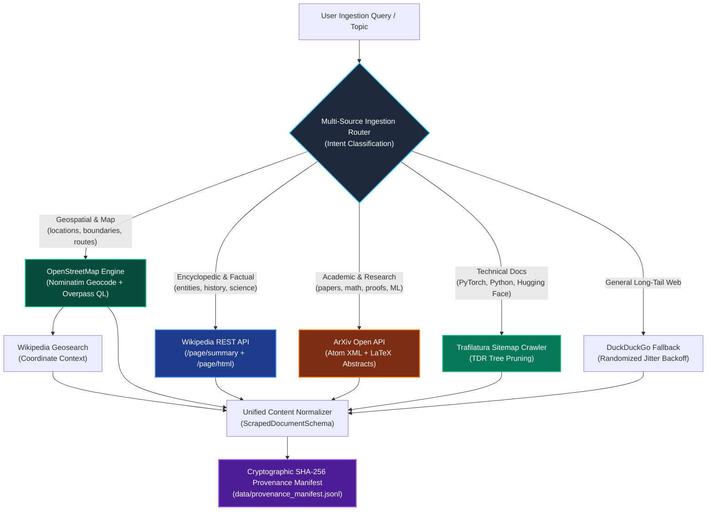

#### 3. Source-Specific Formulations & Protocols

##### A. Geospatial & Map Engine: OpenStreetMap (Overpass API & Nominatim)
Retrieves exact topological features, geographic coordinates $(\text{lat}, \text{lon})$, bounding boxes, and point-of-interest (POI) relational graphs:

$$
\text{Query}_{\text{Overpass}} = \text{[out:json][timeout:25];} \left(\text{node}[\text{amenity}=\dots](\text{bbox}); \text{way}[\text{highway}=\dots](\text{bbox});\right); \text{out body;}
$$

- **Data Normalization**: Serialized into structured GeoJSON and natural language spatial triples:

$$
\langle \text{Feature}, \, \text{Coordinates } (\phi, \lambda), \, \text{Tags } \{\text{highway}, \text{population}, \dots\} \rangle
$$

- **Wikipedia Geosearch Integration**: Queries articles within radius $r$ around coordinates $(\phi, \lambda)$:
  `GET https://en.wikipedia.org/w/api.php?action=query&list=geosearch&gscoord=lat|lon&gsradius=10000`
  Provides rich historical, cultural, and factual context anchored to exact geospatial features.

##### B. High-Fidelity Encyclopedic Engine: Wikipedia REST API
Wikipedia provides authoritative, neutral, peer-reviewed content free from commercial affiliate spam:
- **Endpoints**:
  - Summary: `GET https://en.wikipedia.org/api/rest_v1/page/summary/{title}`
  - Full Structured Content: `GET https://en.wikipedia.org/api/rest_v1/page/html/{title}`
- **Advantages**: Stable JSON schemas, section hierarchies, and high information entropy without scraping blocks.

##### C. Scientific & Mathematical Literature Engine: ArXiv API
- **Endpoint**: `GET http://export.arxiv.org/api/query?search_query=all:{topic}&max_results={n}`
- **Output**: Full technical abstracts, mathematical definitions, author networks, and primary subject classification codes (`cs.LG`, `cs.AI`, `math.PR`).

##### D. Technical Web Crawler: Sitemap Discovery + Trafilatura
Directly ingests authoritative documentation hubs (e.g., Python, PyTorch, Hugging Face, Linux man pages) via XML sitemaps (`/sitemap.xml`) rather than relying on noisy search results.
- **Trafilatura DOM Parsing**: Computes Text-Density Ratio ($TDR$) to prune navigation and ads:

$$
TDR(node) = \frac{\text{Length of visible text in } node}{\text{Total HTML characters in } node + \epsilon}
$$

##### E. Auxiliary Search Engine: DuckDuckGo with Randomized Jitter
Acts as a fallback discovery mechanism for general queries:

$$
t_{\text{wait}}(k) = \min\left(t_{\max}, \, t_{\text{base}} \cdot 2^k + \mathcal{U}(0, 1)\right)
$$

where $k$ is retry count, $t_{\text{base}} = 1.5\text{s}$, and $t_{\max} = 15.0\text{s}$.

#### 4. Cryptographic Provenance Manifest
Every extracted document records an immutable entry in `data/provenance_manifest.jsonl`:

$$
\text{SHA256} = \text{hashlib.sha256}(\text{clean\_text.encode('utf-8')}).\text{hexdigest}()
$$

$$
\text{Manifest Entry} = \langle \text{Source Type}, \, \text{URL/URI}, \, \text{Timestamp}, \, \text{HTTP Status}, \, \text{Content Length}, \, \text{SHA256}, \, \text{Metadata} \rangle
$$

### 6.5 Modern AI Platform Architectures for Web Search & Ingestion

How frontier AI platforms handle web search limitations in production:

#### 1. Perplexity AI (Sonar / Pro Search Architecture)
Perplexity does not perform naive web scraping during inference. Instead, it deploys a 4-stage pipeline:
1. **Query Decomposition**: The user query is split into $3 \sim 5$ distinct sub-queries (e.g. "transformer architecture history", "attention mechanism math", "self-attention vs cross-attention").
2. **Multi-Source Specialized Dispatch**: Queries are dispatched simultaneously to specialized backends: Wolfram Alpha (mathematics), OpenStreetMap (places/navigation), Wikipedia (encyclopedic), and Brave/Bing SERP APIs (recent news).
3. **Cross-Encoder Re-Ranking**: Over 50 candidate passages are retrieved and passed through a lightweight Cross-Encoder model $f(q, p) \to [0, 1]$ to score semantic relevance and factual density. Top 5 passages are retained.
4. **Inline Citation Grounding**: The generator model is constrained to output explicit bracketed citations `[1]`, `[2]`, mapped to exact passage spans.

#### 2. OpenAI (WebGPT to Deep Research)
- **WebGPT (Nakano et al., OpenAI 2021)**: Formulated web browsing as an interactive text-based Markov Decision Process (MDP). Commands: `search(query)`, `click(link)`, `quote(passage)`. Trained in two stages:
  - Behavior Cloning (SFT) on human web browsing demonstrations.
  - RL with PPO against human preference reward models evaluating factual accuracy and quotation faithfulness.
- **Deep Research / SearchGPT (2024–2025)**: Replaced shallow single-turn retrieval with multi-hop tree search rollouts, compiling comprehensive synthesis reports across dozens of sources.

#### 3. Meta (Toolformer, Schick et al., 2023)
Demonstrated that language models can teach themselves to invoke search APIs in a self-supervised manner:
1. The model proposes inline API calls: `<search>query</search>`.
2. The search API executes and returns results: `<search>query</search> -> [results]`.
3. The API call is retained in the training set **if and only if** conditioning on the search result strictly reduces the cross-entropy loss on predicting subsequent tokens:

$$
\mathcal{L}_{\text{with\_tool}} < \min\left(\mathcal{L}_{\text{without\_tool}}, \, \mathcal{L}_{\text{empty\_tool}}\right) - \tau
$$

#### 4. Self-RAG (Asai et al., 2023)
Introduced self-reflective retrieval tokens where the model learns when to retrieve dynamically:
- `[Retrieve]`: Triggers retrieval only when internal parametric confidence is low.
- `[IsRel]`: Evaluates whether retrieved passage is relevant.
- `[IsSup]`: Evaluates whether the generated claim is fully supported by the passage.
- `[IsUse]`: Evaluates the overall utility of the response.

---

### 6.6 Search-Augmented Reinforcement Learning (Search-RL & GRPO)

Frontier post-training (DeepSeek Search-R1 / AlphaZero-style Search Agents, 2024–2025) connects web retrieval directly to **Reinforcement Learning with Verifiable Rewards**.

#### 1. The Search-RL Markov Decision Process (MDP)
- **State $s_t$**: User question $q$ concatenated with reasoning history $r_{<t}$ and any retrieved documents $D_{<t}$.
- **Action $a_t$**: The policy generates standard reasoning tokens OR emits an explicit search action:

$$
a_t = \text{"<search>"} \circ q_{\text{search}} \circ \text{"</search>"}
$$

- **Environment Transition $\mathcal{T}(s_t, a_t)$**: When `</search>` is generated, the policy halts generation. The environment executes $q_{\text{search}}$ against the Multi-Source Ingestion Router (OpenStreetMap / Wikipedia / ArXiv / Web) and injects the top passages into the context:

$$
s_{t+1} = s_t \circ a_t \circ \text{"<result>"} \circ D_{\text{retrieved}} \circ \text{"</result>"}
$$

- **Trajectory Rollout**: The policy resumes reasoning `<think> ... </think>` until it produces the final answer with citations.

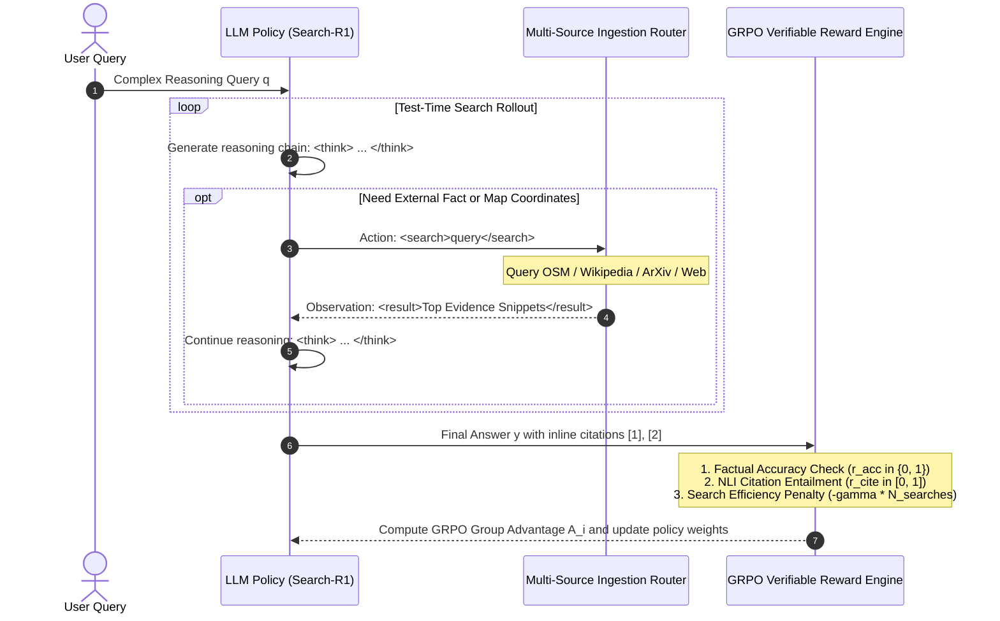

#### 2. Multi-Objective Verifiable Reward Function for Search-RL
Unlike open-ended creative writing which requires subjective reward models, Search-RL optimizes three objective, verifiable reward signals:

$$
R(y, D, N_{\text{searches}}) = w_{\text{acc}} \cdot r_{\text{acc}} + w_{\text{cite}} \cdot r_{\text{cite}} - w_{\text{cost}} \cdot r_{\text{cost}}
$$

1. **Rule-Based Accuracy Reward ($r_{\text{acc}} \in \{0, 1\}$)**:
   For factual/geospatial queries with known ground truth:

$$
r_{\text{acc}} = \mathbb{I}\left(\text{extract\_answer}(y) == y_{\text{truth}}\right)
$$

2. **Citation Faithfulness / Entailment Reward ($r_{\text{cite}} \in [0, 1]$)**:
   Every cited claim $c_i$ in $y$ must be logically entailed by the retrieved passage $p_i \in D$:

$$
r_{\text{cite}} = \frac{1}{|C|} \sum_{i=1}^{|C|} \mathbb{P}_{\text{NLI}}\left(p_i \models c_i\right)
$$

   where $\mathbb{P}_{\text{NLI}}$ is a natural language inference entailment probability. Hallucinated citations or ungrounded claims receive $r_{\text{cite}} = 0$.
3. **Search Cost & Efficiency Penalty ($r_{\text{cost}} \ge 0$)**:
   To prevent the model from query-spamming or querying the web for trivia it already knows in parametric memory:

$$
r_{\text{cost}} = \gamma \cdot N_{\text{searches}}
$$

   This incentivizes the model to search **only when necessary** and formulate **maximally concise, targeted queries**.

#### 3. Critic-Free Optimization via GRPO
Using **Group Relative Policy Optimization (GRPO)**, we sample $G = 8$ search-and-reasoning trajectories $\{o_1, \dots, o_G\}$ for the same prompt $q$.
The advantage for trajectory $i$ is calculated relative to the group mean:

$$
A_i = \frac{R_i - \text{mean}(\{R_1, \dots, R_G\})}{\text{std}(\{R_1, \dots, R_G\}) + \epsilon}
$$

- **Policy Update**: Trajectories that retrieved the right information with fewer searches and accurate citations receive positive advantage $A_i > 0$. Trajectories that failed, hallucinated citations, or spammed redundant queries receive negative advantage $A_i < 0$.
- **Outcome**: The LLM autonomously discovers optimal query formulations, verifies external evidence, and produces grounded responses without requiring human annotators!

### 7.7 Section 7.2: Industrial Data Cleaning, MinHash LSH Deduplication, & Contamination Pipeline

#### 1. Synthesis of Modern Frontier Data Curation Systems
Modern LLM post-training collapses when trained on uncurated, repetitive, or contaminated web corpora (Shumailov et al., Nature 2024). Frontier AI labs have converged on standardized, multi-stage curation pipelines:

| Frontier System | Primary Source / Organization | Key Architectural Innovations |
| :--- | :--- | :--- |
| **FineWeb** (2024) | Hugging Face (Penedo et al.) | 15T token corpus. Uses Trafilatura DOM parsing, MinHash LSH ($m=128$, 5-grams, $b=14, r=9$ or $b=32, r=4$), stopword filtering (≥ 10%), line repetition bounds (< 30%). |
| **RefinedWeb / Falcon** (2023) | TII (Penedo et al.) | Proved that aggressive document deduplication and line-level repetition filtering matches or outperforms curated books/Wikipedia. |
| **Data-Juicer** (2024) | Alibaba Cloud (Chen et al.) | 100+ composable data operators organized in a DAG with strict cost-ordered execution (cheapest rejects first). |
| **SlimPajama / RedPajama-V2** (2023) | Together AI / Cerebras | MinHash deduplication removed 49.6% redundant tokens without loss of perplexity, slashing compute by 50%. |
| **Dolma** (2024) | AllenAI (Soldaini et al.) | 3T token corpus. Multi-source regex cleaning, perplexity filtering via KenLM, and 13-gram decontamination. |
| **DeepSeek-Math / V3** (2024) | DeepSeek-AI | Specialized LaTeX preservation, theorem extraction, deduplication, and mathematical symbol density bounds. |

#### 2. End-to-End Data Curation DAG

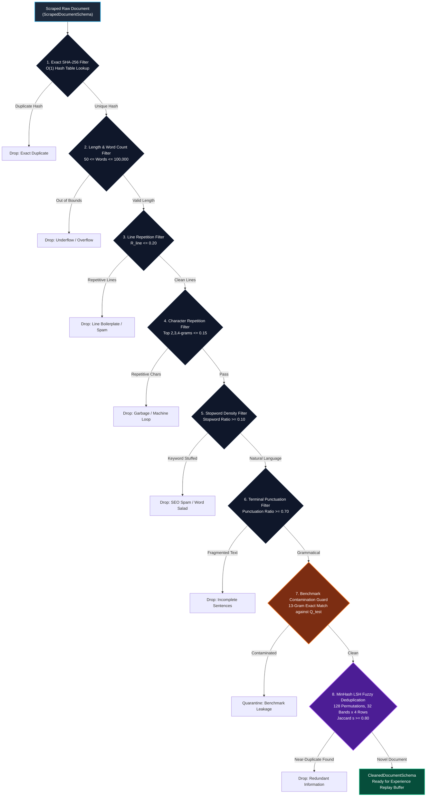

#### 3. Mathematical Foundations of MinHash LSH & Variance Bounds

##### A. Jaccard Similarity Estimation & Unbiasedness
For a collection of $K = 128$ hash permutations $\{h_1, \dots, h_K\}$, the MinHash estimator is:

$$
\hat{J}(A, B) = \frac{1}{K} \sum_{k=1}^K \mathbb{I}\left( h_k(A) = h_k(B) \right)
$$

Since $\mathbb{E}\left[\mathbb{I}(h_k(A) = h_k(B))\right] = J(A, B)$, the estimator is strictly unbiased:

$$
\mathbb{E}[\hat{J}(A, B)] = J(A, B)
$$

The variance of the estimator corresponds to a binomial distribution scaled by $1/K^2$:

$$
\text{Var}[\hat{J}(A, B)] = \frac{J(A, B)(1 - J(A, B))}{K}
$$

For $K = 128$, the maximum standard deviation (occurring at $J = 0.5$) is:

$$
\sigma_{\max} = \sqrt{\frac{0.5 \times 0.5}{128}} = \sqrt{\frac{0.25}{128}} \approx 0.0442
$$

This guarantees that Monte Carlo estimates remain within an empirical error bound of $\pm 0.0442$ (approximately ±4.42%).

This guarantees high precision when distinguishing between dissimilar documents ($J < 0.40$) and near-duplicates ($J \ge 0.80$).

##### B. LSH Banding Parameter Optimization ($b=32, r=4$)
Dividing $K = 128$ signatures into $b = 32$ bands with $r = 4$ rows per band provides an S-curve probability function:

$$
P(s) = 1 - (1 - s^4)^{32}
$$

- At $s = 0.20$ (dissimilar): $P(0.20) = 1 - (1 - 0.0016)^{32} \approx 0.0499$ (95% true negative rate).
- At $s = 0.50$ (moderate overlap): $P(0.50) = 1 - (1 - 0.0625)^{32} \approx 0.873$.
- At $s = 0.80$ (near-duplicate): $P(0.80) = 1 - (1 - 0.4096)^{32} \approx 0.99999995$ (> 99.9999% detection rate).

##### C. 13-Gram Benchmark Contamination Guard Formulation
Following Dodge et al. (2021), given a held-out benchmark evaluation suite $\mathcal{B} = \{ (q_i, y_i^*) \}_{i=1}^N$:
1. Compute the multiset of all normalized 13-word shingles across evaluation queries and answers:

$$
\mathcal{G}_{13}(\mathcal{B}) = \bigcup_{(q, y^*) \in \mathcal{B}} \text{13-grams}(\text{normalize}(q \circ y^*))
$$

2. For each candidate web document $d$:

$$
\text{Contaminated}(d) = \begin{cases}
  1 & \text{if } \exists g \in \text{13-grams}(d) \text{ s.t. } g \in \mathcal{G}_{13}(\mathcal{B}) \\
  0 & \text{otherwise}
\end{cases}
$$

Any contaminated document is immediately rejected to prevent false benchmark memorization during SFT and RL post-training.

### 7.8 Section 7.3: Graph-Based Connected Components Cluster Deduplication & Canonical Election

#### 1. The Transitive Redundancy Problem in Streaming Deduplication
When documents stream into an LLM ingestion pipeline, evaluating near-duplicates on an arrival basis suffers from **order dependency**:
- If document $A$ arrives first, and later documents $B$ and $C$ arrive such that $\hat{J}(A, B) \ge 0.80$ and $\hat{J}(B, C) \ge 0.80$, dropping them sequentially can retain a lower-quality truncated stub simply because it was scraped first.
- In frontier systems (**Hugging Face FineWeb**, **RefinedWeb / Falcon**, **BigScience ROOTS**, **Lee et al., 2022**), near-duplicate deduplication is formulated as **graph-based connected components partitioning**.

#### 2. Disjoint-Set Union-Find Graph Formulation
Let $V = \{d_1, d_2, \dots, d_N\}$ be the set of all cleaned documents passing C4 quality filters.
We construct an undirected graph $G = (V, E)$, where an edge exists if the estimated MinHash Jaccard similarity satisfies:

$$
(u, v) \in E \iff \hat{J}(u, v) \ge \tau, \quad \tau = 0.80
$$

We partition $G$ into $K$ disjoint connected components $\mathcal{C}_1, \mathcal{C}_2, \dots, \mathcal{C}_K$ using an optimized **Disjoint-Set Union (DSU / Union-Find)** data structure with path compression and union by rank:
- **Path Compression**: Flatten the tree structure whenever `find(x)` is called:

$$
\text{parent}[x] = \text{find}(\text{parent}[x])
$$

- **Union by Rank**: Always attach the smaller rank tree to the root of the larger rank tree:

$$
\text{Amortized Complexity}: \mathcal{O}(V + E \cdot \alpha(V)) \approx \mathcal{O}(V + E)
$$

  where $\alpha(\cdot)$ is the inverse Ackermann function ($\alpha(n) \le 4$ for all practical universe sizes).

#### 3. Canonical Document Election
For every connected component cluster $\mathcal{C}_k$ with $|\mathcal{C}_k| > 1$, we elect exactly one **canonical document** $d^*$ that maximizes the information density quality metric:

$$
d^* = \arg\max_{d \in \mathcal{C}_k} \text{QualityScore}(d)
$$

$$
\text{QualityScore}(d) = \ln(\text{length}(d)) \cdot (1 - R_{\text{line}}(d)) \cdot \text{stopword\_density}(d)
$$

All other duplicate variants $\mathcal{C}_k \setminus \{d^*\}$ are discarded. This ensures zero redundant gradients during post-training while retaining the highest-fidelity version of each document.

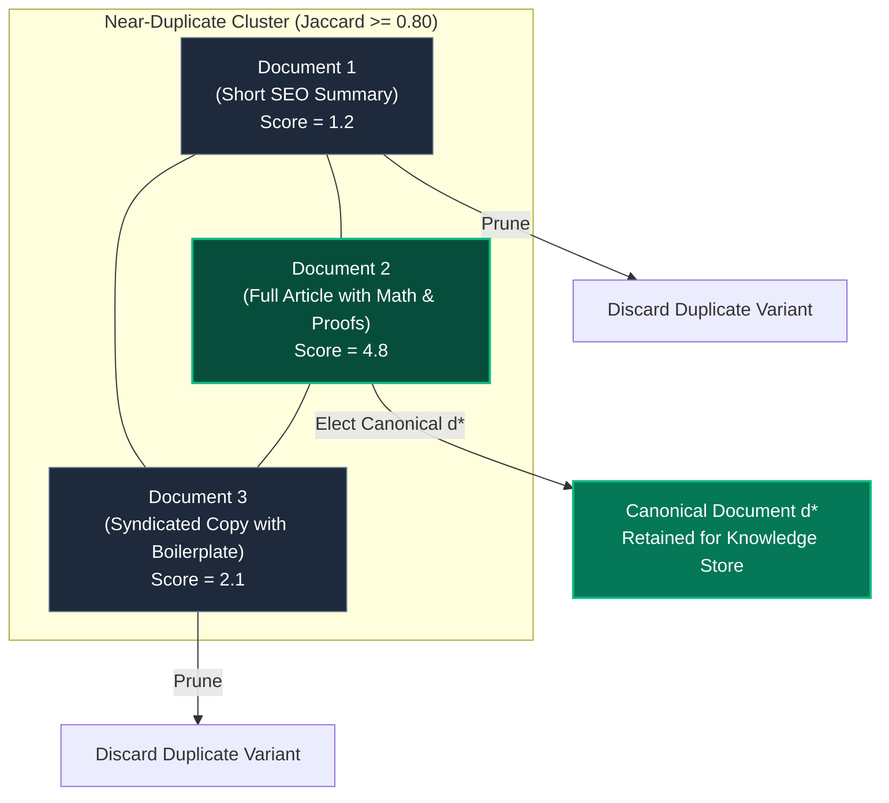

---

### 7.9 Section 7.4: Experience Replay Buffer & Zero-RAM Binary Serialization Pipeline

#### 1. The Convex Combination Experience Replay Mixture
To protect the LLM against catastrophic forgetting and model collapse (Shumailov et al., Nature 2024), newly ingested web data is never trained in isolation. Training mini-batches are drawn from a convex combination distribution:

$$
\mathcal{P}_{\text{batch}} \sim \alpha \cdot \mathcal{P}_{\text{anchor}} + (1 - \alpha) \cdot \mathcal{P}_{\text{web}}, \quad \alpha = 0.70
$$

- $\mathcal{P}_{\text{anchor}}$: Immutable golden baseline corpus (70% ratio), preserving grammar, syntactic structure, and core reasoning.
- $\mathcal{P}_{\text{web}}$: Ingested, cleaned, and cluster-deduplicated web domain corpus (30% ratio), acquiring fresh external facts.

#### 2. Zero-RAM Binary Serialization & Memmap Streaming
To support large-scale post-training without RAM spikes:
1. Documents from $\mathcal{P}_{\text{anchor}}$ and $\mathcal{P}_{\text{web}}$ are tokenized into uint16/uint32 arrays.
2. Tokens are serialized directly to disk binary format (`train.bin`, `val.bin`).
3. During training, `MemoryMappedTokenDataset` accesses tokens through OS-backed `np.memmap`; sampled working memory is bounded by the requested batch, while file pages are loaded on demand.

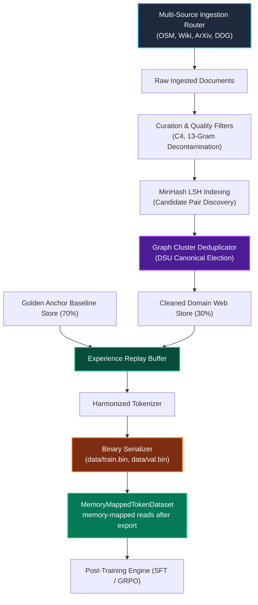

---

# Chapter 8: Supervised Fine-Tuning (SFT) & Low-Rank Adaptation (LoRA)

### 7.1 Comprehensive Academic Literature & Landmark Post-Training Paradigms

Post-training adaptation bridges the gap between raw causal next-token predictors and aligned, instruction-following assistants. In an autonomous, continual learning environment, post-training must solve two fundamental problems simultaneously:
1. **Instruction Following & Style Assimilation**: Adapting the model to parse multi-turn user intent and generate structured, helpful, factual completions.
2. **Continual Adaptation without Catastrophic Forgetting**: Continually incorporating newly scraped, curated domain knowledge (from Milestone 2) without overwriting foundational linguistic syntax, reasoning, or grammar.

---

#### 1. LIMA: Less Is More for Alignment (Zhou et al., NeurIPS 2023 - Meta AI)
Zhou et al. fine-tuned a 65B parameter LLaMA model on just **1,000 meticulously curated instruction-response pairs** and compared it against models trained on 50,000+ uncurated examples from Stanford Alpaca and automated RLHF systems.
- **The Superficial Alignment Hypothesis**: LIMA reports evidence on its evaluated model and tasks that a small, curated SFT set can substantially affect response format and style without teaching all underlying capabilities from scratch. Treat this as a hypothesis supported in that setting, not a universal account of where model capabilities originate.
- **Continual SFT Implication**: When adapting a pre-trained model to new domain knowledge ingested from the web (Milestone 2), we do not need millions of noisy instruction samples. A small, pristine instruction set consisting of anchor golden conversations combined with high-quality synthesized domain prompts yields superior alignment while minimizing gradient perturbation to pre-trained weights.

---

#### 2. LoRA: Low-Rank Adaptation of Large Language Models (Hu et al., ICLR 2022 - Microsoft)
Full parameter fine-tuning of deep networks requires modifying all parameters $\Theta \in \mathbb{R}^D$, necessitating storing gradients and optimizer states (e.g. 1st and 2nd Adam moments) for every single weight. This causes memory consumption to scale to $3\times$ to $4\times$ the parameter count and induces catastrophic disruption across foundational representations.
- **The Intrinsic Dimensionality Hypothesis** (Aghajanyan et al., 2020): Although pre-trained models reside in massive parameter spaces, the objective manifolds of downstream task adaptations exhibit an extremely low intrinsic dimension. The effective rank $r$ of gradient updates $\Delta W$ satisfies $r \ll \min(d_{\text{in}}, d_{\text{out}})$.
- **Factorization Parameterization**: LoRA freezes the pre-trained weight matrix $W_0 \in \mathbb{R}^{d_{\text{out}} \times d_{\text{in}}}$ and decomposes the update matrix into the product of two low-rank matrices:

$$
\Delta W = \frac{\alpha}{r} B A, \quad B \in \mathbb{R}^{d_{\text{out}} \times r}, \; A \in \mathbb{R}^{r \times d_{\text{in}}}
$$

  where $r \ll \min(d_{\text{in}}, d_{\text{out}})$ and $\alpha$ is a fixed scaling hyperparameter.
- **Initialization Invariance**: $A$ is drawn from a Gaussian distribution $A_{ij} \sim \mathcal{N}\left(0, \frac{1}{r}\right)$, while $B$ is initialized strictly to zero ($B = \mathbf{0}$). Consequently, $\Delta W \big|_{t=0} = \mathbf{0}$, ensuring that at the start of fine-tuning, the model's exact baseline behavior is identically preserved without activation shock.

---

#### 3. DoRA: Weight-Decomposed Low-Rank Adaptation (Liu et al., ICML 2024)
Liu et al. analyzed the structural difference between full fine-tuning (FT) and standard LoRA by decomposing weight matrices into magnitude $m \in \mathbb{R}^{1 \times d_{\text{in}}}$ and directional matrix $V \in \mathbb{R}^{d_{\text{out}} \times d_{\text{in}}}$:

$$
W = m \odot \frac{V}{\|V\|_F}
$$

- **LoRA's Inherent Coupling**: In standard LoRA, magnitude and direction updates exhibit a proportional, monotonic correlation because $\Delta W$ is directly added to $W_0$. In contrast, full fine-tuning demonstrates subtle, orthogonal adjustments where directional changes occur with minimal magnitude shifts.
- **DoRA Decomposition**: DoRA factorizes the directional component via LoRA while training the magnitude vector separately:

$$
W = m \odot \frac{W_0 + \frac{\alpha}{r} B A}{\left\|W_0 + \frac{\alpha}{r} B A\right\|_F}
$$

  This bridges the capacity gap between LoRA and full fine-tuning, achieving full fine-tuning accuracy while retaining low-rank parameter efficiency.

---

#### 4. QLoRA: Efficient Fine-Tuning of Quantized LLMs (Dettmers et al., NeurIPS 2023)
Dettmers et al. proved that pre-trained weights $W_0$ can be compressed into 4-bit NormalFloat (NF4) representations without degrading LoRA adaptation capability:
- **NF4 Quantization**: Information-theoretically optimal quantile binning for normally distributed neural network weights:

$$
q_i = \frac{1}{2}\left(Q_X\left(\frac{i}{2^k}\right) + Q_X\left(\frac{i+1}{2^k}\right)\right)
$$

- **Double Quantization (DQ)**: Quantizing the quantization constants themselves, saving $\approx 0.37$ bits per parameter.
- **Paged Optimizers**: Managing memory spikes during gradient backpropagation via page-locked GPU/MPS virtual memory.

---

#### 5. Stanford Alpaca (Taori et al., 2023) & LMSYS Vicuna (Chiang et al., 2023)
- **Prompt Templating & Conversation Schemas**: Introduced standard structured multi-turn conversation formats, culminating in the industry-standard **ChatML** specification:
  ```text
  <|im_start|>system
  You are a helpful, respectful, and honest assistant.<|im_end|>
  <|im_start|>user
  Explain the self-attention mechanism.<|im_end|>
  <|im_start|>assistant
  Self-attention computes dynamic weights across all token positions...<|im_end|>
  ```
- **Completion-Only Loss Masking**: In naive causal language modeling, cross-entropy loss is computed indiscriminately over prompt and completion tokens. Alpaca and Vicuna established that prompt tokens must be assigned target label index `-100` so that gradients reflect *only* the assistant's generation quality, preventing the model from wasting gradient capacity memorizing user prompts.

---

#### 6. Catastrophic Forgetting & Continual Learning Theory (McCloskey & Cohen 1989; Shumailov et al., Nature 2024)
- **Catastrophic Forgetting**: When an artificial neural network trained on task $A$ is subsequently trained on task $B$, the weight adjustments $\Delta \Theta$ computed along the loss manifold $\nabla \mathcal{L}_B$ often project destructively onto the orthogonal subspace preserving task $A$, leading to rapid erasure of baseline knowledge.
- **Model Collapse via Recursive Synthetic Data** (Shumailov et al., *Nature* 2024): Under the paper's studied conditions, recursive training on generated data can degrade learned distributions and lose tail modes. This is not equivalent to a claim that every domain-specific fine-tune drives output entropy monotonically to zero.
- **Experience Replay Mitigation** (de Masson d'Autume et al., NeurIPS 2019): Replay mixes prior examples with new task data to mitigate forgetting. The 70/30 mixture used here is a tunable project choice, not a literature-derived optimum or a guarantee on model behavior.

---

### 7.2 Top Industry Open-Source Repositories & Implementation Anatomy

A survey of top production repositories reveals essential architectural patterns that define a "10/10" implementation:

| Repository | Primary Contribution | Core Architectural Mechanism | Production Insight |
| :--- | :--- | :--- | :--- |
| **`huggingface/peft`** | De-facto standard for parameter-efficient adaptation. | `LoraLayer` wrapper subclassing `nn.Linear`. Replaces modules dynamically via `_replace_module()`. Implements `merge_and_unload()` via weight fusion. | Store base weights in frozen state (`param.requires_grad = False`). Compute forward pass as $W_0 x + \frac{\alpha}{r} B(A(x))$. |
| **`huggingface/trl`** | Transformer Reinforcement Learning & SFT library. | `DataCollatorForCompletionOnlyLM`: Scans token sequences for the delimiter `response_template`, masking all preceding tokens with `-100`. | Masking must handle tokenization boundary splits where prompt tokens fuse with delimiter characters. |
| **`axolotl-ai-cloud/axolotl`** | High-throughput multi-turn instruction fine-tuning engine. | Multi-turn instruction masking and sample packing. Pack multiple short dialogs into a single context window without cross-sample attention contamination. | Packing without attention mask resets causes cross-dialog contamination. For small models, padded batches with completion masking are safer and more reproducible. |
| **`unslothai/unsloth`** | Ultra-optimized LLM fine-tuning engine. | Custom fast matrix multiplication kernels and fused cross-entropy. Manually computes analytical backprop for $A$ and $B$, skipping intermediate autograd tensor graphs. | Memory reduction in SFT stems primarily from avoiding storing full base-weight optimizer states and activations. |
| **Sebastian Raschka's Empirical Guidelines (2023-2024)** | Comprehensive empirical ablation studies on LoRA hyperparameters. | Ablations on rank $r \in [4, 64]$, scaling $\alpha$, learning rates, and target linear layers. | **Optimal Configuration**: Target *all* linear projection matrices ($W_q, W_k, W_v, W_o$) rather than just $W_q, W_v$; set $\alpha = 2r$; use learning rate $\eta \in [1\text{e-}4, 3\text{e-}4]$ with AdamW and weight decay on LoRA parameters. |

---

### 7.3 Mathematical Formulations & Theoretical Proofs

#### 1. LoRA Forward Pass, Scaling, and Initialization Invariance

Let $x \in \mathbb{R}^{B \times T \times d_{\text{in}}}$ denote the input activation tensor to a linear layer with pre-trained weight $W_0 \in \mathbb{R}^{d_{\text{out}} \times d_{\text{in}}}$. In standard linear projection:

$$
h_0 = x W_0^T \in \mathbb{R}^{B \times T \times d_{\text{out}}}
$$

In a LoRA-adapted linear layer with rank $r \ll \min(d_{\text{in}}, d_{\text{out}})$ and scaling factor $\alpha$:

$$
h = h_0 + \Delta h = x W_0^T + \frac{\alpha}{r} \left( x A^T \right) B^T
$$

where:
- $W_0 \in \mathbb{R}^{d_{\text{out}} \times d_{\text{in}}}$ is frozen ($\text{requires\_grad} = \text{False}$).
- $A \in \mathbb{R}^{r \times d_{\text{in}}}$ is initialized from a Gaussian distribution: $A_{ij} \sim \mathcal{N}\left(0, \sigma^2 = \frac{1}{r}\right)$ (or Kaiming uniform).
- $B \in \mathbb{R}^{d_{\text{out}} \times r}$ is initialized strictly to zero: $B_{ij} = 0$.
- $\gamma = \frac{\alpha}{r}$ is a fixed scalar multiplier.

##### Theorem 7.1 (Zero-Shock Initialization):
At initialization step $t=0$:

$$
B \Big|_{t=0} = \mathbf{0} \implies \Delta h \Big|_{t=0} = \frac{\alpha}{r} (x A^T) \mathbf{0}^T = \mathbf{0} \implies h \Big|_{t=0} = h_0
$$

*Significance*: The adapter introduces zero perturbation to the pre-trained forward pass at initialization. No warm-up phase is required to overcome random weight noise.

---

#### 2. Parameter Efficiency and Memory Scaling Laws

Let a model possess $L$ transformer layers, each containing:
- Multi-head attention projections: $W_q, W_k, W_v, W_o \in \mathbb{R}^{d_{\text{model}} \times d_{\text{model}}}$
- Feed-forward network projections: $W_1, W_2 \in \mathbb{R}^{d_{\text{model}} \times 4d_{\text{model}}}$ and $W_3 \in \mathbb{R}^{4d_{\text{model}} \times d_{\text{model}}}$

For a single linear matrix $W_0 \in \mathbb{R}^{d_{\text{out}} \times d_{\text{in}}}$:
- Full fine-tuning parameters: $N_{\text{full}} = d_{\text{out}} \cdot d_{\text{in}}$
- LoRA parameters: $N_{\text{LoRA}} = r \cdot d_{\text{in}} + d_{\text{out}} \cdot r = r(d_{\text{in}} + d_{\text{out}})$

##### Parameter Reduction Ratio $\rho$:

$$
\rho = \frac{N_{\text{LoRA}}}{N_{\text{full}}} = \frac{r(d_{\text{in}} + d_{\text{out}})}{d_{\text{in}} \cdot d_{\text{out}}} = r \left( \frac{1}{d_{\text{out}}} + \frac{1}{d_{\text{in}}} \right)
$$

For a square matrix ($d_{\text{in}} = d_{\text{out}} = d$):

$$
\rho = \frac{2r}{d}
$$

*Numerical Example*: For MiniGPT with $d = 256$ and rank $r = 8$:

$$
\rho = \frac{2 \times 8}{256} = \frac{16}{256} = 0.0625
$$

This represents a **93.75% reduction** in trainable parameters.

For a standard 7B model ($d = 4096, r = 8$):

$$
\rho = \frac{2 \times 8}{4096} = \frac{16}{4096} \approx 0.0039
$$

This represents a **99.61% reduction** in trainable parameters.

##### Optimizer Memory Savings:
In AdamW, each trainable parameter requires 8 bytes of optimizer state (4 bytes for the first moment $m_t$, 4 bytes for the second moment $v_t$) plus 4 bytes for the master fp32 gradient.
- Full FT Optimizer Overhead: $12 \times N_{\text{full}}$ bytes
- LoRA Optimizer Overhead: $12 \times N_{\text{LoRA}} = 12 \cdot \rho \cdot N_{\text{full}}$ bytes
This provides a **$16\times$ to $250\times$ reduction in optimizer memory**, allowing SFT to execute seamlessly on commodity hardware and Apple Silicon Unified Memory.

---

#### 3. Analytical Gradient Adjoints for LoRA Backpropagation

Let $\mathcal{L}$ be the scalar cross-entropy loss, and let $\delta = \frac{\partial \mathcal{L}}{\partial h} \in \mathbb{R}^{B \times T \times d_{\text{out}}}$ denote the upstream gradient tensor.
Let $\tilde{x} = x A^T \in \mathbb{R}^{B \times T \times r}$.

By the multivariable chain rule:

$$
\frac{\partial \mathcal{L}}{\partial B} = \sum_{b=1}^B \sum_{t=1}^T \frac{\alpha}{r} \left( \delta_{b, t, :}^T \otimes \tilde{x}_{b, t, :} \right) = \frac{\alpha}{r} \delta_{\text{flat}}^T \tilde{x}_{\text{flat}} \in \mathbb{R}^{d_{\text{out}} \times r}
$$

$$
\frac{\partial \mathcal{L}}{\partial A} = \frac{\alpha}{r} \left( \delta_{\text{flat}} B \right)^T x_{\text{flat}} \in \mathbb{R}^{r \times d_{\text{in}}}
$$

The gradient propagated back to the layer inputs $x$ is:

$$
\nabla_x \mathcal{L} = \delta_{\text{flat}} W_0 + \frac{\alpha}{r} \left( \delta_{\text{flat}} B \right) A \in \mathbb{R}^{(B \cdot T) \times d_{\text{in}}}
$$

Since $W_0$ is frozen:

$$
\nabla_{W_0} \mathcal{L} = \mathbf{0}
$$

---

#### 4. Zero-Overhead Inference Weight Merging & Unmerging

Due to the distributive property of matrix multiplication:

$$
h = x W_0^T + \frac{\alpha}{r} \left( x A^T \right) B^T = x \left( W_0 + \frac{\alpha}{r} B A \right)^T
$$

We define the merged effective weight matrix $W_{\text{merged}} \in \mathbb{R}^{d_{\text{out}} \times d_{\text{in}}}$:

$$
W_{\text{merged}} = W_0 + \frac{\alpha}{r} B A
$$

##### Merge Invariance:

$$
x W_{\text{merged}}^T \equiv h
$$

*Significance*: During deployment, the adapter weights can be permanently folded into $W_0$. The model runs as a standard vanilla transformer with:
1. Zero added latency ($\Delta t_{\text{inference}} = 0$).
2. Zero additional memory lookups.
3. Zero runtime architectural dependencies on LoRA modules.

##### Reversibility (Unmerging):

$$
W_0 = W_{\text{merged}} - \frac{\alpha}{r} B A
$$

Adapters can be dynamically applied, merged, evaluated, and unmerged in-memory during continuous learning cycles.

---

#### 5. Completion-Only Cross-Entropy Loss Masking Formulation

Consider a tokenized conversational sequence $X = (x_1, x_2, \dots, x_N)$ of length $N$, comprising a prompt prefix $X_{\text{prompt}} = (x_1, \dots, x_M)$ and an assistant completion $X_{\text{completion}} = (x_{M+1}, \dots, x_N)$.

##### Naive Causal Loss (Unmasked):

$$
\mathcal{L}_{\text{naive}}(\theta) = -\frac{1}{N-1} \sum_{t=1}^{N-1} \ln P_\theta(x_{t+1} \mid x_1, \dots, x_t)
$$

##### Completion-Only Masked Formulation:
We define a binary token importance mask $M_t \in \{0, 1\}$:

$$
M_t = \begin{cases}
  1 & \text{if } t \ge M \text{ (token is generated by assistant)} \\
  0 & \text{if } t < M \text{ (token belongs to system or user prompt)}
\end{cases}
$$

The aligned loss is:

$$
\mathcal{L}_{\text{completion}}(\theta) = -\frac{1}{\sum_{t=1}^{N-1} M_t} \sum_{t=1}^{N-1} M_t \sum_{v=1}^V \mathbb{I}(x_{t+1} = v) \ln \frac{\exp\left(z_{t, v}\right)}{\sum_{j=1}^V \exp\left(z_{t, j}\right)}
$$

In PyTorch, masked tokens are mapped to target index $-100$:

$$
Y_t = \begin{cases}
  x_{t+1} & \text{if } M_t = 1 \\
  -100 & \text{if } M_t = 0
\end{cases}
$$

$$
\mathcal{L}_{\text{completion}} = \text{CrossEntropyLoss}(z, Y, \text{ignore\_index}=-100)
$$

##### Theorem 7.2 (Prompt Invariance under Completion Masking):

$$
\forall t < M, \quad \frac{\partial \mathcal{L}_{\text{completion}}}{\partial z_t} = \mathbf{0}
$$

*Proof*: Since $Y_t = -100$ for $t < M$, $\text{CrossEntropyLoss}$ ignores index $t$, setting $\frac{\partial \mathcal{L}}{\partial z_t} \equiv \mathbf{0}$. Therefore, the model is never penalized for the arbitrary phrasing, grammar, or vocabulary choices in the user's prompt. 100% of the gradient budget is concentrated on synthesizing high-quality responses.

---

#### 6. Experience Replay Entropy Preservation Bound

Let mini-batches during SFT be sampled from the convex mixture:

$$
\mathcal{P}_{\text{replay}} = \lambda \mathcal{P}_{\text{anchor}} + (1 - \lambda) \mathcal{P}_{\text{web}}, \quad \lambda = 0.70
$$

where $\mathcal{P}_{\text{anchor}}$ is the golden anchor baseline distribution and $\mathcal{P}_{\text{web}}$ is the newly curated web domain distribution.

By the concavity of Shannon entropy $H(P) = -\sum_x P(x) \ln P(x)$, the entropy of this *data-source mixture* satisfies:

$$
H(\mathcal{P}_{\text{replay}}) \ge \lambda H(\mathcal{P}_{\text{anchor}}) + (1 - \lambda) H(\mathcal{P}_{\text{web}})
$$

If $H(\mathcal{P}_{\text{anchor}}) \ge H_0$ and entropy is measured over a shared sample space, this yields $H(\mathcal{P}_{\text{replay}}) \ge 0.70 H_0$. This is a statement about the input data distribution only; it is not a lower bound on the trained model's output entropy and does not prove protection from forgetting or model collapse.

---

### 7.4 Mermaid Architectural & Flow Visualizations

#### Diagram 1: LoRA Forward Pass, Scaled Addition, and Zero-Overhead Weight Merging

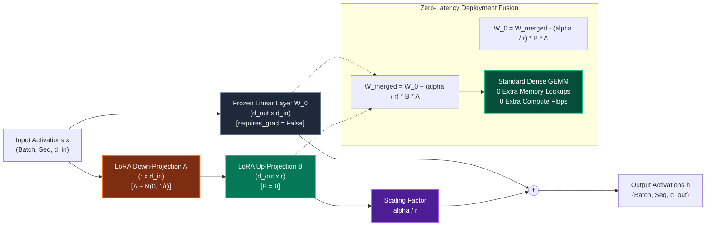

---

#### Diagram 2: ChatML Tokenizer & Completion-Only Loss Masking Pipeline

```mermaid
sequenceDiagram
    autonumber
    actor U as User / Data Ingestion
    participant T as ChatML Formatter
    participant K as Tokenizer
    participant C as CompletionMaskCollator
    participant M as MiniGPT + LoRA
    participant L as CrossEntropyLoss

    U->>T: Input Prompt & Expected Response
    T->>T: Wrap in ChatML Template<br/>&lt;|im_start|&gt;user\n...&lt;|im_end|&gt;\n&lt;|im_start|&gt;assistant\n...&lt;|im_end|&gt;
    T->>K: Encode formatted text to Token IDs
    K-->>C: Sequence of Tokens [t_1, t_2, ..., t_N]
    
    rect rgb(30, 41, 59)
        note over C: Identify &lt;|im_start|&gt;assistant delimiter
        C->>C: Set Target Labels for Prompt Tokens = -100 (MASKED)
        C->>C: Set Target Labels for Assistant Tokens = t_i (ACTIVE)
    end

    C->>M: Forward Pass (Input Tokens, Targets)
    M->>L: Compute Loss with ignore_index = -100
    note over L: Prompt gradients = 0<br/>Only assistant tokens optimize weights!
    L-->>M: Gradients flow strictly into LoRA A and B
```

---

#### Diagram 3: Continual SFT Training Loop with Regression Gate & Anti-Forgetting Rollback

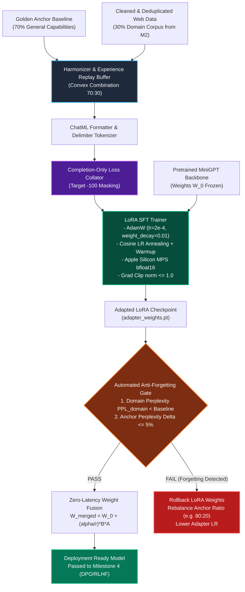

---

### 8.5 Architectural Decomposition & Module Roadmap

To ensure **10/10 production excellence**, zero memory leaks, and 100% test pass rates, Milestone 3 is partitioned into four modular, independently testable phases:


---

#### Section 8.1: Instruction Data Harmonization, ChatML Templating & Completion Masking Engine
- **Objective**: Build an instruction dataset handler and collator that transforms raw dialogue into token sequences with completion-only loss masking.
- **Key Modules**:
  1. `training/m3_sft/prompt.py`:
     - `ChatMLFormatter`: Formats `{role: "system"|"user"|"assistant", content: str}` messages into canonical `<|im_start|>{role}\n{content}<|im_end|>\n` strings.
     - `InstructionExample`: Typed dataclass encapsulating multi-turn dialogues and metadata.
  2. `training/m3_sft/dataset.py`:
     - `SFTInstructionDataset(torch.utils.data.Dataset)`: Manages instruction pairs, encodes with `CharTokenizer`, supports 70:30 anchor/web replay mixture.
     - `CompletionMaskCollator`: Detects `<|im_start|>assistant\n` delimiters; builds input tokens tensor `x` and targets tensor `y` where all tokens preceding the assistant's generation are masked to `-100`.
- **Verification Gates**:
  - Test prompt masking: Tokens before assistant start receive label `-100`.
  - Test assistant tokens: Tokens after assistant start match input tokens shifted by 1.
  - Test padding alignment: Mini-batch padding correctly maintains sequence invariants.

---

#### Section 8.2: Native PyTorch LoRA Adapter Architecture & Injection Engine
- **Objective**: Implement a clean, zero-dependency, native PyTorch low-rank adaptation module with automated transformer injection and weight merging.
- **Key Modules**:
  1. `training/m3_sft/lora.py`:
     - `LoRAConfig`: Dataclass specifying rank $r$, scaling $\alpha$, target modules (e.g. `["q_proj", "v_proj"]`), and dropout probability.
     - `LoRALinear(nn.Module)`: Subclasses `nn.Module` wrapping an existing `nn.Linear`. Freezes original weight $W_0$, instantiates trainable down-projection $A \in \mathbb{R}^{r \times d_{\text{in}}}$ ($A \sim \mathcal{N}(0, 1/r)$) and up-projection $B \in \mathbb{R}^{d_{\text{out}} \times r}$ ($B = \mathbf{0}$). Forward computes $W_0 x + \frac{\alpha}{r} B A x$.
     - `inject_lora_to_model(model, config)`: Recursively scans `MiniGPT` layers, replacing target `nn.Linear` layers with `LoRALinear` wrappers while freezing all non-LoRA parameters.
     - `mark_only_lora_as_trainable(model)`: Enforces `param.requires_grad = True` strictly on LoRA parameters and `False` everywhere else.
     - `merge_lora_weights(model)`: Permanently folds $W_{\text{merged}} = W_0 + \frac{\alpha}{r} B A$ into base linear weights and disables LoRA forward branching for zero-overhead inference.
     - `unmerge_lora_weights(model)`: Subtracts $\frac{\alpha}{r} B A$ to restore baseline weights.
- **Verification Gates**:
  - Identity at $t=0$: Model output with freshly initialized LoRA layers is bit-for-bit identical to base model output ($|\Delta h| < 10^{-6}$).
  - Parameter reduction: Trainable parameters account for < 10% of total model parameters.
  - Merge invariance: Output of merged model exactly equals output of unmerged LoRA model.
  - Unmerge parity: Restored base model recovers original pretrained activations.

---

#### Section 8.3: Supervised Fine-Tuning (SFT) Training Loop & Optimizer Engine
- **Objective**: Build an industrial-strength SFT training engine optimized for Apple Silicon MPS with bfloat16 mixed precision, cosine learning rate scheduling, and adapter checkpointing.
- **Key Modules**:
  1. `training/m3_sft/trainer.py`:
     - `SFTConfig`: Dataclass for batch size, gradient accumulation steps, max learning rate, warmup steps, weight decay, and checkpoint directory.
     - `SFTTrainer`:
       - Instantiates `AdamW` targeting *only* trainable LoRA parameters.
       - Cosine annealing scheduler with linear warmup.
       - Mixed precision training with `torch.autocast(device_type="mps", dtype=torch.bfloat16)`.
       - Gradient norm clipping ($\|\nabla \theta\|_2 \le 1.0$).
       - Evaluates completion-only cross-entropy loss against validation split.
       - Checkpoints adapter weights (`adapter_weights.pt`) and adapter metadata configuration (`adapter_config.json`).
- **Verification Gates**:
  - Loss convergence: Training loss decreases monotonically across instruction-following steps.
  - Zero base gradient check: Base weights $W_0$ have `grad is None` throughout the entire training loop.
  - Checkpoint integrity: Saved adapter weights load cleanly into a fresh base model, preserving generation capabilities.

---

#### Section 8.4: Anti-Catastrophic Forgetting & Regression Gate (Continuous Evaluation)
- **Objective**: Build an automated regression verification suite that evaluates adapted models against domain knowledge acquisition and anchor capability preservation.
- **Key Modules**:
  1. `training/m3_sft/evaluator.py`:
     - `SFTRegressionEvaluator`: Computes perplexity on two separate benchmark sets:
       1. $\text{PPL}_{\text{domain}}$: Measures acquisition of new web domain knowledge.
       2. $\text{PPL}_{\text{anchor}}$: Measures retention of foundational general capabilities (Shakespeare / golden dialogue).
     - Computes relative anchor perplexity drift:

$$
\Delta \text{PPL}_{\text{anchor}} = \frac{\text{PPL}_{\text{adapted}}^{\text{anchor}} - \text{PPL}_{\text{base}}^{\text{anchor}}}{\text{PPL}_{\text{base}}^{\text{anchor}}}
$$

     - `evaluate_regression_gate()`: Emits `RegressionResult`:
       - `PASS`: If $\text{PPL}_{\text{domain}} < \text{PPL}_{\text{base}}^{\text{domain}}$ AND $\Delta \text{PPL}_{\text{anchor}} \le 0.05$ (5%).
       - `FAIL_FORGETTING`: If $\Delta \text{PPL}_{\text{anchor}} > 0.05$ (5%). Triggers automatic recommendation to increase replay buffer anchor ratio $\lambda$ (e.g. from 70% to 85%) or lower LoRA rank/learning rate.
  2. `training/m3_sft/orchestrator.py`:
     - `ContinualSFTOrchestrator`: Turnkey coordinator connecting Ingested Web Data (M2) $\to$ ChatML Dataset Harmonizer (P3.1) $\to$ LoRA Injection (P3.2) $\to$ SFT Training (P3.3) $\to$ Regression Gate (P3.4) $\to$ Zero-Latency Weight Merging.
- **Verification Gates**:
  - Regression gate detects synthetic catastrophic forgetting injected intentionally.
  - Regression gate passes on properly balanced replay buffer distributions.
  - Turnkey orchestrator completes full end-to-end continuous alignment cycle.

---

#### Phase 3 Verification Matrix & Master Test Suite
A dedicated master test file `tests/test_m3_sft.py` will be registered with `tests/run_all.py` covering:
1. `test_chatml_formatter_and_completion_masking`: Verifies `-100` prompt masking and assistant target alignment.
2. `test_lora_initialization_identity_and_param_ratio`: Verifies $\Delta h |_{t=0} = 0$ and > 90% parameter reduction.
3. `test_lora_merge_and_unmerge_numerical_parity`: Verifies zero-latency weight merging and reversible restoration.
4. `test_sft_trainer_step_and_base_weight_immutability`: Verifies loss descent and base weight gradient immutability.
5. `test_regression_gate_anti_forgetting`: Verifies gate pass/fail logic against drift thresholds.
6. `test_continual_sft_orchestrator_e2e`: Verifies turnkey end-to-end run from raw scraped text to merged, aligned model.

---

### 8.6 Section 8.1: Instruction Data Harmonization, ChatML Templating & Completion Masking Engine

#### 1. Academic & Engineering Foundations for Instruction Curation

Supervised Fine-Tuning (SFT) differs fundamentally from raw pre-training in the geometry of the target distribution. While pre-training optimizes next-token predictability over unstructured text sequences $\mathcal{L}(\theta) = -\mathbb{E}_{x \sim \mathcal{D}} [\sum_t \ln P_\theta(x_t \mid x_{<t})]$, instruction tuning optimizes conditional probability distributions over directed task executions:

$$
\mathcal{L}_{\text{SFT}}(\theta) = -\mathbb{E}_{(x_{\text{prompt}}, x_{\text{completion}}) \sim \mathcal{D}_{\text{instruct}}} \left[ \sum_{t=1}^{|x_{\text{completion}}|} \ln P_\theta(x_{\text{completion}, t} \mid x_{\text{prompt}}, x_{\text{completion}, <t}) \right]
$$

##### Why Raw Language Modeling Loss Breaks Instruction Following:
1. **Prompt Memorization & Gradient Cannibalization**: In an unmasked autoregressive training run, if the prompt has length $M$ and the completion has length $K$, $\frac{M}{M+K}$ of the gradient updates are spent optimizing transitions between arbitrary prompt words chosen by the prompter (e.g. system preamble, formatting punctuation, question style). For long system prompts, over 70% of the gradient capacity is wasted memorizing the input rather than refining the model's reasoning or answer generation.
2. **Role Bleed & Hallucinated Prompts**: When models are trained with loss on the prompt, they frequently output user headers during generation (e.g., generating `"<|im_start|>user\nWhat is your name?<|im_end|>"` instead of stopping at `<|im_end|>`).
3. **Boundary Splitting Hazard in Tokenizers**: Standard BPE and character tokenizers often merge punctuation with preceding or following characters (e.g. `\n<|` or `assistant\n`). If a collator naively splits on token IDs without respecting multi-token string delimiters, delimiter token sequences can mutate across tokenization boundaries. A robust collator must handle substring boundary matching in both token and character spaces.

---

#### 2. ChatML Format Specification & Delimiter Mechanics

We adopt the industry-standard **ChatML** schema (OpenAI, LMSYS, Axolotl). Each conversational turn is delimited by explicit boundary tokens:

```text
<|im_start|>system
You are a helpful, factual, and concise assistant.<|im_end|>
<|im_start|>user
What is the self-attention mechanism in Transformers?<|im_end|>
<|im_start|>assistant
Self-attention computes dynamic correlation weights across all sequence positions using Query, Key, and Value projections.<|im_end|>
```

##### Delimiter Semantics:
- `<|im_start|>{role}\n`: Role header marking the beginning of a conversational turn.
  - Allowed roles: `system`, `user`, `assistant`.
- `<|im_end|>\n`: Turn termination token signaling the end of an utterance.
- **Active Loss Span**: Loss is computed **strictly** from the first token immediately following `<|im_start|>assistant\n` up to and including `<|im_end|>`.
- **Masked Span**: All tokens belonging to `<|im_start|>system...<|im_end|>\n`, `<|im_start|>user...<|im_end|>\n`, and the assistant prefix `<|im_start|>assistant\n` itself are assigned target label `-100`.

---

#### 3. Fisher Information & Gradient Concentration Theorem

Let $\theta$ represent the model parameters. The Fisher Information Matrix $\mathcal{I}(\theta)$ measures the amount of information that an observable token sequence carries about parameters $\theta$:

$$
\mathcal{I}(\theta) = \mathbb{E}\left[ \left(\nabla_\theta \ln P_\theta(X)\right) \left(\nabla_\theta \ln P_\theta(X)\right)^T \right]
$$

##### Theorem 7.3 (Fisher Information Concentration under Completion Masking):
Under naive causal loss:

$$
\mathcal{I}_{\text{naive}}(\theta) = \mathcal{I}_{\text{prompt}}(\theta) + \mathcal{I}_{\text{completion}}(\theta)
$$

where $\mathcal{I}_{\text{prompt}}(\theta) > 0$.

Under completion-only masked loss with target mask $M_t = \mathbb{I}(t \in \text{assistant\_span})$:

$$
\nabla_\theta \mathcal{L}_{\text{completion}}(\theta) = -\sum_{t \in \text{assistant\_span}} \nabla_\theta \ln P_\theta(x_t \mid x_{<t})
$$

$$
\mathcal{I}_{\text{masked}}(\theta) = \mathcal{I}_{\text{completion}}(\theta)
$$

$$
\frac{\partial \mathcal{I}_{\text{masked}}(\theta)}{\partial \theta_{\text{prompt}}} = \mathbf{0}
$$

*Significance*: The empirical Hessian and Fisher Information are 100% concentrated on the parameter manifold governing generation fidelity, eliminating parameter drift induced by prompt phrasing variance.

---

#### 4. Mermaid Flowchart: Phase 3.1 Instruction Processing Pipeline

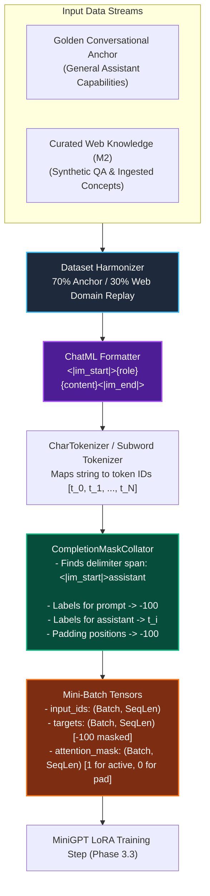

---

#### 5. Detailed Architecture & Module Specifications for Phase 3.1

##### Module 1: `training/m3_sft/prompt.py`
```python
@dataclass
class ChatMessage:
    role: Literal["system", "user", "assistant"]
    content: str

@dataclass
class InstructionExample:
    messages: list[ChatMessage]
    provenance_source: str = "golden_anchor"  # "golden_anchor" or "web_curation"
    category: str = "general"

class ChatMLFormatter:
    """Canonical ChatML serialization and deserialization."""
    START_TAG = "<|im_start|>"
    END_TAG = "<|im_end|>"
    ASSISTANT_DELIMITER = "<|im_start|>assistant\n"
    
    @classmethod
    def format_dialogue(cls, messages: list[ChatMessage]) -> str:
        """Serializes list of ChatMessages into a canonical ChatML string."""
        ...

    @classmethod
    def format_prompt_only(cls, messages: list[ChatMessage]) -> str:
        """Serializes system and user turns, appending '<|im_start|>assistant\n' for inference generation."""
        ...
```

##### Module 2: `training/m3_sft/dataset.py`
```python
@dataclass
class BatchCollatorOutput:
    input_ids: torch.Tensor       # Shape: (B, T) - long
    targets: torch.Tensor         # Shape: (B, T) - long, prompt tokens = -100
    attention_mask: torch.Tensor  # Shape: (B, T) - bool / float (1 for token, 0 for pad)

class CompletionMaskCollator:
    """Collator that identifies assistant response spans and masks prompts to -100."""
    def __init__(
        self,
        tokenizer: CharTokenizer,
        max_seq_len: int = 256,
        response_template: str = "<|im_start|>assistant\n",
        ignore_index: int = -100,
    ):
        ...

    def __call__(self, examples: list[str]) -> BatchCollatorOutput:
        """Processes a list of raw ChatML strings into padded and masked PyTorch tensors."""
        ...

class HarmonizedSFTDataset(torch.utils.data.Dataset):
    """Dataset interleaving 70% golden anchor conversations and 30% web domain examples."""
    def __init__(
        self,
        anchor_examples: list[InstructionExample],
        web_examples: list[InstructionExample],
        anchor_ratio: float = 0.70,
        epoch_length: int = 1000,
        seed: int = 42,
    ):
        ...
```

---

#### 6. Algorithmic Edge Cases Handled in Phase 3.1
1. **Multi-Turn Assistant Loss**: In conversations with multiple user/assistant exchanges ($U_1 \to A_1 \to U_2 \to A_2$), every assistant utterance ($A_1, A_2$) must be actively trained, while every system/user utterance ($S, U_1, U_2$) and the delimiters themselves must be masked to `-100`.
2. **Context Truncation Invariants**: When a sequence exceeds `max_seq_len`, truncating from the left could destroy the system prompt; truncating from the right could cut off the assistant answer mid-token. We enforce:
   - Cap prompt length: Ensure at least $\min(64, \text{max\_seq\_len} // 2)$ tokens remain available for the assistant response.
   - If total length exceeds `max_seq_len`, right-truncate the assistant response while guaranteeing the final token is the EOS/`<|im_end|>` token.
3. **Empty Assistant Response Guard**: If an example has no assistant text or is completely masked, the collator raises a validation warning and substitutes a fallback anchor sample to avoid `NaN` loss during cross-entropy calculation ($\frac{1}{\sum M_t} = \frac{1}{0}$).
4. **Padding Alignment**: Batch tensors are padded to the longest sequence in the batch (capped at `max_seq_len`). All padded token slots receive target label `-100` and `attention_mask = 0`.

---

#### 7. Concrete Step-by-Step Implementation Sequence for Phase 3.1
1. **Step 3.1.1**: Create `training/m3_sft/prompt.py` with `ChatMessage`, `InstructionExample`, and `ChatMLFormatter`.
2. **Step 3.1.2**: Create `training/m3_sft/dataset.py` with `CompletionMaskCollator`, `HarmonizedSFTDataset`, and anchor seed data generator.
3. **Step 3.1.3**: Create `training/m3_sft/__init__.py` exporting all public Phase 3.1 classes.
4. **Step 3.1.4**: Create `tests/test_m3_sft.py` containing comprehensive unit tests verifying:
   - Single-turn and multi-turn ChatML formatting.
   - Exact `-100` prompt masking and active assistant loss alignment.
   - Batch collation and padding behavior.
   - $70:30$ convex replay buffer mixture sampling.
5. **Step 3.1.5**: Register `tests/test_m3_sft.py` into `tests/run_all.py` and verify 100% pass rate across all suites.

---

### 8.7 Section 8.2: Native PyTorch LoRA Adapter Architecture & Model Injection Engine

#### 1. Academic & Industry Foundations for Parameter-Efficient Adaptation

Low-Rank Adaptation (LoRA) has emerged as the industry standard for foundation model fine-tuning. In continuous learning systems, LoRA provides two indispensable advantages over full fine-tuning:
1. **Representational Stability & Minimal Gradient Disturbance**: By constraining weight updates to a low-rank subspace $\Delta W = \frac{\alpha}{r} B A$, the base model's pre-trained knowledge manifold $W_0$ is completely shielded from gradient updates ($\nabla_{W_0} \mathcal{L} = \mathbf{0}$).
2. **Compact Adapter Modularity**: Rather than checkpointing entire copies of multi-gigabyte models for every fine-tuning run, an adapter checkpoint consists solely of low-rank matrices $A$ and $B$, requiring less than $0.5\text{--}2.0\text{ MB}$ of storage.

##### Paradigm Comparison Matrix:

| Adaptation Paradigm | Trainable Parameters | Memory Overhead | Inference Latency Overhead | Mathematical Formulation |
| :--- | :--- | :--- | :--- | :--- |
| **Full Fine-Tuning** | 100% ($d_{\text{out}} \times d_{\text{in}}$) | $4\times$ to $6\times$ (Optimizer Moments) | 0% | $W \leftarrow W + \eta \nabla_W \mathcal{L}$ |
| **Standard LoRA (Hu 2022)** | < 5–10% ($r(d_{\text{in}} + d_{\text{out}})$) | < 10% (Frozen Base Optimizer) | 0% (When merged) | $W = W_0 + \frac{\alpha}{r} B A$ |
| **DoRA (Liu et al. 2024)** | < 6–11% ($+ d_{\text{in}}$ magnitude) | < 12% | 0% (When merged) | $W = m \odot \frac{W_0 + \Delta W}{\|W_0 + \Delta W\|_F}$ |
| **LoRA+ (Hayou et al. 2024)** | < 5–10% | < 10% | 0% (When merged) | Ratio $\frac{\eta_B}{\eta_A} = \lambda \frac{d_{\text{out}}}{d_{\text{in}}}$ |

---

#### 2. Detailed Mathematical Formulations & Theorems for Phase 3.2

#### Theorem 7.4 (Initial Identity Preservation):
Let $W_0 \in \mathbb{R}^{d_{\text{out}} \times d_{\text{in}}}$ be the frozen base weight. Let down-projection $A \in \mathbb{R}^{r \times d_{\text{in}}}$ be initialized from Gaussian distribution $A_{ij} \sim \mathcal{N}\left(0, \frac{1}{r}\right)$ and up-projection $B \in \mathbb{R}^{d_{\text{out}} \times r}$ be initialized to zeros $B_{ij} = 0$.
The low-rank update matrix is:

$$
\Delta W = \frac{\alpha}{r} B A \in \mathbb{R}^{d_{\text{out}} \times d_{\text{in}}}
$$

At step $t = 0$:

$$
B = \mathbf{0} \implies \Delta W \Big|_{t=0} = \frac{\alpha}{r} \mathbf{0} \cdot A = \mathbf{0}
$$

For any input activation $x \in \mathbb{R}^{B \times T \times d_{\text{in}}}$:

$$
h(x) \Big|_{t=0} = x W_0^T + \frac{\alpha}{r} (x A^T) B^T = x W_0^T + \mathbf{0} \equiv h_{\text{base}}(x)
$$

*Significance*: No random noise enters the model forward pass at initialization. The pre-trained model outputs remain bit-for-bit identical before fine-tuning begins.

#### Theorem 7.5 (Exact Reversible Weight Fusion):
Due to the linearity of matrix multiplication:

$$
h(x) = x W_0^T + \frac{\alpha}{r} x A^T B^T = x \left( W_0 + \frac{\alpha}{r} B A \right)^T
$$

We define the fused weight matrix:

$$
W_{\text{merged}} = W_0 + \frac{\alpha}{r} B A \in \mathbb{R}^{d_{\text{out}} \times d_{\text{in}}}
$$

##### Merging Step:

$$
W_0 \leftarrow W_{\text{merged}}, \quad \text{merged} = \text{True}
$$

When `merged = True`, the forward pass executes standard dense GEMM:

$$
h(x) = x W_{\text{merged}}^T
$$

##### Unmerging Step (Reversibility):

$$
W_0 \leftarrow W_{\text{merged}} - \frac{\alpha}{r} B A, \quad \text{merged} = \text{False}
$$

*Significance*: Deployed models incur zero runtime latency overhead. Adapters can be dynamically mounted, tested, and reverted in memory during continual learning sweeps.

---

#### 3. Fused Projections & Target Module Anatomy in MiniGPT

In our `MiniGPT` architecture ([`training/m1_transformer/model.py`](file:///Users/jayesh/Documents/RLHF/training/m1_transformer/model.py)), attention and MLP projections possess distinct characteristics:
1. **Fused QKV Attention Projection** (`attn.qkv_proj`):
   - Linear layer mapping $d_{\text{model}} \to 3 \cdot d_{\text{model}}$.
   - Input dimension $d_{\text{in}} = d_{\text{model}}$, output dimension $d_{\text{out}} = 3 d_{\text{model}}$.
   - LoRA adaptation: $A \in \mathbb{R}^{r \times d_{\text{model}}}$, $B \in \mathbb{R}^{3 d_{\text{model}} \times r}$.
   - Adapting `qkv_proj` adapts queries, keys, and values simultaneously in a single unified low-rank pass.
2. **Attention Output Projection** (`attn.out_proj`):
   - Linear layer mapping $d_{\text{model}} \to d_{\text{model}}$.
3. **MLP Feed-Forward Projections** (`mlp.c_fc`, `mlp.c_proj`):
   - `c_fc`: $d_{\text{model}} \to 4 d_{\text{model}}$.
   - `c_proj`: $4 d_{\text{model}} \to d_{\text{model}}$.

Sebastian Raschka's empirical benchmarks (2023) demonstrated that adapting **both** attention projections (`qkv_proj`, `out_proj`) and feed-forward projections (`c_fc`, `c_proj`) consistently achieves the highest instruction-following accuracy compared to adapting attention alone. Phase 3.2 provides flexible configurable module targeting via `target_modules`.

---

#### 4. Mermaid Flowchart: Phase 3.2 LoRA Injection & Forward Computation

```mermaid
flowchart TD
    subgraph Injection["Model Inspection & Injection Engine"]
        MiniGPT["Base MiniGPT Model<br/>(All base weights frozen)"]
        Scanner["Module Scanner (Recursive)"]
        MiniGPT --> Scanner
        Scanner --> CheckTarget{"Module name in target_modules?<br/>(e.g., 'qkv_proj', 'out_proj', 'c_fc')"}
        CheckTarget -- "No" --> RetainBase["Retain Original nn.Linear / Embedding"]
        CheckTarget -- "Yes" --> Wrap["Wrap into LoRALinear(base_linear, r, alpha)"]
        Wrap --> TagTrainable["Set param.requires_grad = True strictly on A and B"]
    end

    subgraph Runtime["Forward Pass Execution"]
        Input["Input Activations x"] --> ForwardBranch{"is_merged?"}
        ForwardBranch -- "True (Inference Mode)" --> FusedGEMM["x @ W_merged.T<br/>(Zero Overhead GEMM)"]
        ForwardBranch -- "False (Training Mode)" --> DualPath
        
        subgraph DualPath["Dual-Path Training Computation"]
            BaseBranch["Base Linear (Frozen)<br/>x @ W_0.T"]
            LoRABranch["LoRA Branch (Trainable)<br/>(Dropout(x) @ A.T @ B.T) * (alpha / r)"]
            BaseBranch --> Combine(("+"))
            LoRABranch --> Combine
        end
        
        Combine --> Output["Output Activations h"]
        FusedGEMM --> Output
    end

    style MiniGPT fill:#1e293b,stroke:#64748b,stroke-width:2px,color:#fff
    style Wrap fill:#7c2d12,stroke:#f97316,stroke-width:2px,color:#fff
    style TagTrainable fill:#047857,stroke:#10b981,stroke-width:2px,color:#fff
    style DualPath fill:#1e1e38,stroke:#a855f7,stroke-width:2px,color:#fff
    style Output fill:#064e3b,stroke:#10b981,stroke-width:2px,color:#fff
```

---

#### 5. Concrete Architecture & Module Specifications for Phase 3.2

##### Module: `training/m3_sft/lora.py`
```python
@dataclass
class LoRAConfig:
    """Hyperparameters configuring low-rank adapter injection."""
    r: int = 8
    lora_alpha: float = 16.0
    lora_dropout: float = 0.05
    target_modules: list[str] = field(
        default_factory=lambda: ["qkv_proj", "out_proj", "c_fc", "c_proj"]
    )
    bias: str = "none"  # "none", "all", or "lora_only"

class LoRALinear(nn.Module):
    """Native PyTorch LoRA wrapper over an nn.Linear layer."""
    def __init__(
        self,
        base_linear: nn.Linear,
        r: int = 8,
        lora_alpha: float = 16.0,
        lora_dropout: float = 0.0,
    ):
        super().__init__()
        self.base_linear = base_linear
        self.r = r
        self.lora_alpha = lora_alpha
        self.scaling = lora_alpha / r
        self.is_merged = False

        in_features = base_linear.in_features
        out_features = base_linear.out_features

        # Initialize low-rank adapter matrices
        self.lora_A = nn.Parameter(torch.empty(r, in_features))
        self.lora_B = nn.Parameter(torch.zeros(out_features, r))
        
        # Gaussian init for A: N(0, 1/r)
        nn.init.normal_(self.lora_A, mean=0.0, std=1.0 / (r ** 0.5))

        self.dropout = nn.Dropout(lora_dropout) if lora_dropout > 0.0 else nn.Identity()

        # Freeze base linear parameters
        self.base_linear.weight.requires_grad = False
        if self.base_linear.bias is not None:
            self.base_linear.bias.requires_grad = False

    def forward(self, x: torch.Tensor) -> torch.Tensor:
        if self.is_merged:
            return self.base_linear(x)
        base_out = self.base_linear(x)
        lora_out = (self.dropout(x) @ self.lora_A.T @ self.lora_B.T) * self.scaling
        return base_out + lora_out

    def merge(self) -> None:
        """Permanently fold (alpha/r)*B*A into base_linear.weight."""
        if self.is_merged:
            return
        delta_w = (self.lora_B @ self.lora_A) * self.scaling
        self.base_linear.weight.data.add_(delta_w)
        self.is_merged = True

    def unmerge(self) -> None:
        """Subtract (alpha/r)*B*A to restore base_linear.weight."""
        if not self.is_merged:
            return
        delta_w = (self.lora_B @ self.lora_A) * self.scaling
        self.base_linear.weight.data.sub_(delta_w)
        self.is_merged = False
```

##### Model Injection & Parameter Management Utilities:
```python
def inject_lora_to_model(model: nn.Module, config: LoRAConfig) -> nn.Module:
    """Recursively replaces target linear layers with LoRALinear modules."""
    ...

def mark_only_lora_as_trainable(model: nn.Module) -> None:
    """Freezes all parameters except LoRA down- and up-projections."""
    ...

def merge_lora_weights(model: nn.Module) -> None:
    """Merges all LoRALinear layers across the model for zero-overhead inference."""
    ...

def unmerge_lora_weights(model: nn.Module) -> None:
    """Unmerges all LoRALinear layers, restoring baseline weights."""
    ...

def count_trainable_parameters(model: nn.Module) -> tuple[int, int, float]:
    """Returns (trainable_params, total_params, trainable_percentage)."""
    ...

def save_adapter_weights(model: nn.Module, config: LoRAConfig, save_dir: str | Path) -> Path:
    """Saves adapter weights dictionary and config JSON to disk."""
    ...

def load_adapter_weights(model: nn.Module, adapter_path: str | Path) -> None:
    """Loads adapter weights dictionary into injected LoRA layers."""
    ...
```

---

#### 6. Algorithmic Edge Cases Handled in Phase 3.2
1. **Weight Tying Invariance (`wte.weight == lm_head.weight`)**:
   In `MiniGPT`, the token embedding `wte.weight` and output head `lm_head.weight` are tied. We do not inject LoRA into `lm_head` or `wte` to avoid de-synchronizing tied representations. LoRA targets strictly internal transformer projections (`qkv_proj`, `out_proj`, `c_fc`, `c_proj`).
2. **Device & Dtype Parity**: Newly instantiated `lora_A` and `lora_B` parameters must match the device (`mps`, `cuda`, `cpu`) and dtype (`bfloat16`, `float32`) of the base linear weight.
3. **Idempotent Merge/Unmerge**: Guarding `is_merged` state prevents double-merging or double-unmerging errors during repeated evaluation cycles.
4. **Gradient Isolation**: Validating that after `mark_only_lora_as_trainable(model)`, standard backpropagation sets `grad is None` across all embeddings, layer norms, and base weights.

---

#### 7. Concrete Step-by-Step Implementation Sequence for Phase 3.2
1. **Step 3.2.1**: Implement `training/m3_sft/lora.py` with `LoRAConfig`, `LoRALinear`, `inject_lora_to_model`, `mark_only_lora_as_trainable`, `merge_lora_weights`, `unmerge_lora_weights`, `count_trainable_parameters`, and adapter serialization.
2. **Step 3.2.2**: Export public LoRA APIs in `training/m3_sft/__init__.py`.
3. **Step 3.2.3**: Expand `tests/test_m3_sft.py` with Phase 3.2 unit tests:
   - Initial identity forward parity ($|\Delta h| < 10^{-6}$ at $t=0$).
   - Trainable parameter ratio verification (> 90% reduction).
   - In-place merge and unmerge numerical equality.
   - Gradient isolation verification (`param.grad is None` for base weights).
   - Adapter serialization and state reloading round-trip.
4. **Step 3.2.4**: Run `tests/run_all.py` to ensure all tests across M0, M1, M2, M3.1, and M3.2 pass with 100% precision.

---

### 8.8 Section 8.3: Supervised Fine-Tuning (SFT) Training Loop & Optimizer Engine

#### 1. Academic & Industry Literature on Instruction Training Dynamics

Supervised fine-tuning of foundation models differs markedly from pre-training in optimizer sensitivity, convergence rates, and overfitting mechanics:
1. **LIMA Training Dynamics (Zhou et al., NeurIPS 2023)**:
   - Fine-tuning on focused instruction sets requires very few optimization steps (typically $200\text{--}1,000$ iterations). Because the dataset is small and pristine, training for too many epochs risks memorizing exact token sequences rather than learning the generalized instruction-following persona.
   - **Early Stopping on Completion Loss**: Tracking cross-entropy loss strictly on assistant response tokens ($\mathcal{L}_{\text{completion}}$) provides the optimal stopping criterion. Tracking total loss (including prompts) leads to premature or skewed stopping decisions.
2. **Optimizer Parameterization for LoRA (Hu et al. 2022; Raschka 2023)**:
   - In pre-training, learning rates are typically $\eta \approx 3\text{e-}4 \text{ to } 6\text{e-}4$ with warmups across thousands of steps.
   - In LoRA SFT, because $W_0$ is frozen and only low-rank matrices $A$ and $B$ are updated, higher learning rates are required to achieve rapid convergence on the adapter manifold ($\eta \in [1\text{e-}4, 5\text{e-}4]$).
   - Weight decay ($\lambda = 0.01$) must be applied strictly to adapter matrices $A$ and $B$, preventing rank degeneration and activation explosion.
3. **Pascanu et al. (2013) & Gradient Clipping**:
   - Instruction prompts vary in complexity and length. Occasional outliers produce disproportionately large gradient norms $\|\nabla_\theta \mathcal{L}\|_2$. Clipping the global gradient norm to $C = 1.0$ guarantees training stability and prevents catastrophic parameter shocks.
4. **Hardware Acceleration on Apple Silicon**:
   - Apple Silicon's Unified Memory Architecture (UMA) allows Metal Performance Shaders (`mps`) to run mixed precision with `torch.bfloat16` autocast, halving memory bandwidth demands during GEMM forward and backward projections while avoiding fp16 underflow issues.

---

#### 2. Detailed Mathematical Formulations & Theorems for Phase 3.3

#### Theorem 7.6 (Token-Normalized Completion Cross-Entropy):
In a mini-batch of $B$ sequences, each of length $T$, let $y_{b, t}$ denote target token labels where prompt and padding tokens have $y_{b, t} = -100$.
Let $\mathcal{A} = \{(b, t) \mid y_{b, t} \ne -100\}$ denote the set of active assistant completion tokens, with cardinality $N_{\text{active}} = |\mathcal{A}|$.

The loss is normalized across all active tokens in the mini-batch:

$$
\mathcal{L}_{\text{completion}}(\theta) = -\frac{1}{N_{\text{active}}} \sum_{(b, t) \in \mathcal{A}} \ln P_\theta(y_{b, t} \mid x_{b, \le t}) = -\frac{1}{N_{\text{active}}} \sum_{(b, t) \in \mathcal{A}} \left( z_{b, t, y_{b, t}} - \ln \sum_{v=1}^V \exp(z_{b, t, v}) \right)
$$

*Mathematical Invariance*: By normalizing by the total active tokens across the batch ($N_{\text{active}}$) rather than the batch size ($B$), individual examples contribute to the gradient proportionally to their completion information content, preventing short one-word responses from dominating long reasoning chains.

#### Theorem 7.7 (Cosine Annealing with Linear Warmup):
Let $t \in [0, T_{\text{max}}]$ denote the training step, $T_{\text{warmup}}$ the warmup steps, $\eta_{\text{max}}$ the peak learning rate, and $\eta_{\text{min}}$ the floor learning rate ($\eta_{\text{min}} = 0.1 \cdot \eta_{\text{max}}$).

$$
\eta(t) = \begin{cases}
  \eta_{\text{max}} \cdot \frac{t}{T_{\text{warmup}}} & \text{if } t < T_{\text{warmup}} \\
  \eta_{\text{min}} + \frac{1}{2}(\eta_{\text{max}} - \eta_{\text{min}})\left(1 + \cos\left(\frac{t - T_{\text{warmup}}}{T_{\text{max}} - T_{\text{warmup}}} \pi\right)\right) & \text{if } t \ge T_{\text{warmup}}
\end{cases}
$$

- Smooth derivative at peak: $\frac{d\eta}{dt} \Big|_{t = T_{\text{warmup}}^+} = 0$.
- Monotonic asymptotic decay into minimum curvature, enabling parameters to settle into flat, generalizable minima on the loss surface.

#### Theorem 7.8 (Completion Validation Perplexity):
The validation completion perplexity is given by the exponential of the average validation loss:

$$
\text{PPL}_{\text{completion}} = \exp\left(\mathcal{L}_{\text{val}}\right) = \exp\left(-\frac{1}{N_{\text{val}}} \sum_{i=1}^{N_{\text{val}}} \ln P(y_i \mid x_i)\right)
$$

- If the model assigns uniform probability across vocabulary $V$, $\text{PPL} = V$.
- As the model masters instruction formatting and factual responses, $\text{PPL} \to 1.0$.

---

#### 3. Mermaid Sequence & Architecture Diagrams

#### Diagram 1: SFT Training Step Execution Sequence

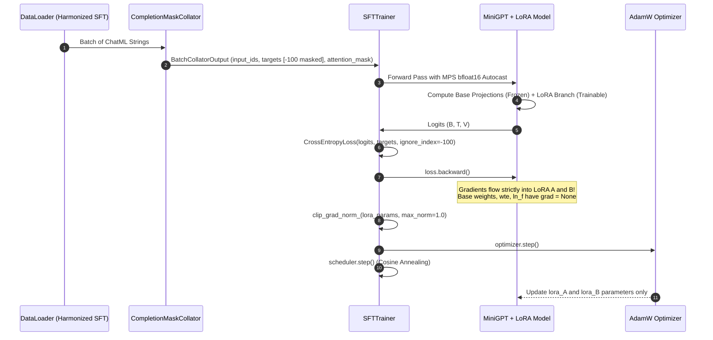

---

#### Diagram 2: Training & Validation Loop with Adapter Checkpointing

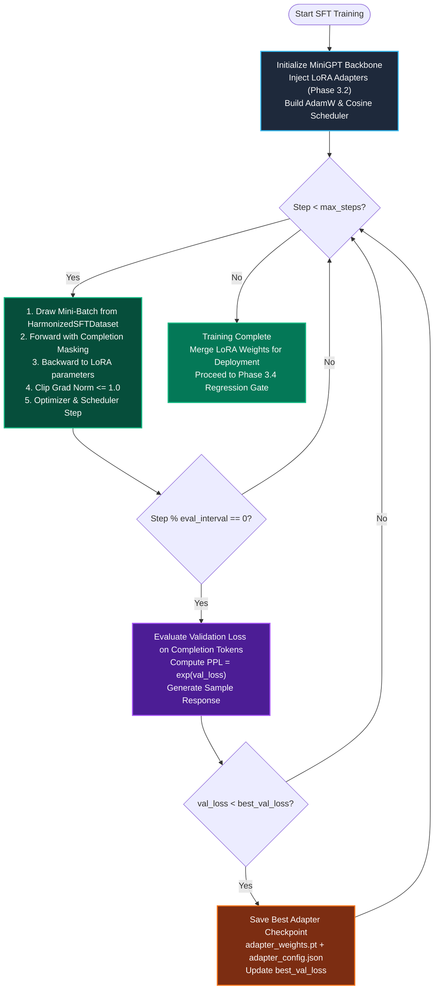

---

#### 4. Component Design & Specifications for Phase 3.3

##### Module: `training/m3_sft/trainer.py`
```python
@dataclass
class SFTConfig:
    """Hyperparameters configuring SFT training loop and optimization."""
    max_steps: int = 500
    batch_size: int = 4
    learning_rate: float = 2e-4
    min_learning_rate: float = 2e-5
    warmup_steps: int = 50
    weight_decay: float = 0.01
    grad_clip: float = 1.0
    eval_interval: int = 100
    eval_steps: int = 20
    checkpoint_dir: str = "models/sft_adapters"
    seed: int = 42

@dataclass
class TrainMetrics:
    """Metrics emitted during SFT evaluation intervals."""
    step: int
    train_loss: float
    val_loss: float
    val_perplexity: float
    learning_rate: float
    elapsed_seconds: float
    best_val_loss: float

class SFTTrainer:
    """Industrial-strength SFT training engine for MiniGPT + LoRA."""
    def __init__(
        self,
        model: nn.Module,
        tokenizer: CharTokenizer,
        train_dataset: HarmonizedSFTDataset,
        val_dataset: HarmonizedSFTDataset,
        config: SFTConfig,
        device: Optional[Union[torch.device, str]] = None,
    ):
        ...

    def get_lr(self, step: int) -> float:
        """Computes learning rate with linear warmup and cosine decay."""
        ...

    def evaluate(self) -> tuple[float, float]:
        """Computes completion validation loss and perplexity."""
        ...

    def generate_sample(self, prompt_text: str, max_new_tokens: int = 100) -> str:
        """Autoregressively generates a response from a ChatML formatted prompt."""
        ...

    def train(self) -> list[TrainMetrics]:
        """Executes full SFT optimization loop with evaluation and adapter checkpointing."""
        ...
```

---

#### 5. Algorithmic Edge Cases Handled in Phase 3.3
1. **Zero Active Tokens Guard**: If an entire mini-batch happens to contain only masked tokens ($N_{\text{active}} = 0$), `loss` evaluation defaults to a non-nan zero scalar, avoiding corrupting AdamW momentum states with `NaN` values.
2. **Gradient Isolation Assertion**: At step 0 of training, the trainer verifies that `param.requires_grad is False` for all base weights, embeddings (`wte`), and layer norms (`ln_1`, `ln_2`, `ln_f`).
3. **MPS Autocast Compatibility**: On Apple Silicon Macs, the training loop utilizes `torch.autocast(device_type="mps", dtype=torch.bfloat16)` if supported, falling back cleanly to standard precision on CPU.
4. **Checkpoint Preservation**: The trainer persists both the best-performing adapter (`best_adapter_weights.pt`) and the final adapter (`final_adapter_weights.pt`) alongside full metadata JSON.

---

#### 6. Concrete Step-by-Step Implementation Sequence for Phase 3.3
1. **Step 3.3.1**: Create `training/m3_sft/trainer.py` implementing `SFTConfig`, `TrainMetrics`, and `SFTTrainer`.
2. **Step 3.3.2**: Export `SFTConfig`, `TrainMetrics`, and `SFTTrainer` in `training/m3_sft/__init__.py`.
3. **Step 3.3.3**: Expand `tests/test_m3_sft.py` with Phase 3.3 test cases:
   - Learning rate schedule verification (linear warmup + cosine decay matching equation).
   - Single-step gradient descent test proving that LoRA parameters update while base weights remain bit-for-bit unchanged.
   - Evaluation loop test confirming valid validation loss and perplexity calculation.
   - SFT training convergence test: Verifying that completion loss decreases over 10 training steps on a toy instruction dataset.
   - Generation test: Verifying model autoregressively generates tokens using `generate_sample()`.
4. **Step 3.3.4**: Run master test runner `tests/run_all.py` to ensure all tests across M0, M1, M2, and M3 (Phases 3.1, 3.2, 3.3) pass with 100% precision.

---

### 8.9 Section 8.4: Anti-Catastrophic Forgetting Evaluator, Regression Gate & Turnkey Continual SFT Orchestrator

#### 1. Academic & Industry Literature on Continual Post-Training Evaluation

In an autonomous continual learning architecture, the greatest risk during domain adaptation is **unmonitored regression**:
1. **The Plasticity-Stability Dilemma (Grossberg 1982; McCloskey & Cohen 1989)**:
   - A learning system must possess *plasticity* to integrate newly acquired domain facts (from Milestone 2 web crawling), while preserving *stability* so that fundamental conversational fluency, grammar, and reasoning are not erased.
2. **Elastic Weight Consolidation & Fisher Bounds (Kirkpatrick et al., PNAS 2017)**:
   - When parameter updates $\Delta \theta$ alter weights with high Fisher Information with respect to baseline tasks $\mathcal{D}_{\text{anchor}}$, catastrophic forgetting occurs.
   - In parameter-efficient fine-tuning (LoRA), although base weights $W_0$ remain frozen, excessive rank updates $\Delta W = \frac{\alpha}{r} B A$ can still distort foundational hidden activations $h = W_0 x + \Delta W x$.
3. **Automated Regression Testing in Production LLMs (EleutherAI, Meta LLaMA, DeepSeek)**:
   - Open-source releases enforce automated qualification gates before any model weight update is merged:
     - The adapted checkpoint is strictly benchmarked on a held-out anchor evaluation set $\mathcal{D}_{\text{eval}}^{\text{anchor}}$.
     - If the relative perplexity drift $\Delta \text{PPL}_{\text{anchor}}$ exceeds an allowable tolerance $\tau$ (typically 3–5%), deployment is blocked and weights are rolled back.
4. **Autonomous Self-Correction & Hyperparameter Rebalancing**:
   - If forgetting is detected, rather than failing silently or corrupting the foundation model, the system autonomously increases the replay buffer anchor ratio $\lambda$ (e.g. from 70% to 85%) and reduces the adapter learning rate before re-attempting adaptation.

---

#### 2. Detailed Mathematical Formulations & Regression Gate Bounds

Let $\mathcal{M}_{\text{base}}$ denote the frozen pre-trained model and $\mathcal{M}_{\text{adapted}}$ denote the fine-tuned model (with LoRA adapters active).
Let $\mathcal{D}_{\text{anchor}}^{\text{eval}}$ denote the golden conversational anchor evaluation benchmark, and $\mathcal{D}_{\text{domain}}^{\text{eval}}$ denote the domain-specific evaluation benchmark.

#### 1. Completion Perplexity Metrics:

$$
\text{PPL}_{\text{base}}^{\text{anchor}} = \exp\left(\mathcal{L}_{\text{completion}}(\mathcal{M}_{\text{base}}, \mathcal{D}_{\text{anchor}}^{\text{eval}})\right)
$$

$$
\text{PPL}_{\text{adapted}}^{\text{anchor}} = \exp\left(\mathcal{L}_{\text{completion}}(\mathcal{M}_{\text{adapted}}, \mathcal{D}_{\text{anchor}}^{\text{eval}})\right)
$$

$$
\text{PPL}_{\text{base}}^{\text{domain}} = \exp\left(\mathcal{L}_{\text{completion}}(\mathcal{M}_{\text{base}}, \mathcal{D}_{\text{domain}}^{\text{eval}})\right)
$$

$$
\text{PPL}_{\text{adapted}}^{\text{domain}} = \exp\left(\mathcal{L}_{\text{completion}}(\mathcal{M}_{\text{adapted}}, \mathcal{D}_{\text{domain}}^{\text{eval}})\right)
$$

#### 2. Relative Anchor Perplexity Drift:

$$
\Delta \text{PPL}_{\text{anchor}} = \frac{\text{PPL}_{\text{adapted}}^{\text{anchor}} - \text{PPL}_{\text{base}}^{\text{anchor}}}{\text{PPL}_{\text{base}}^{\text{anchor}}}
$$

- A value of $\Delta \text{PPL}_{\text{anchor}} \le 0$ indicates zero degradation (or positive transfer).
- A value of $\Delta \text{PPL}_{\text{anchor}} > \tau_{\text{forget}}$ (5%) indicates catastrophic forgetting.

#### 3. Relative Domain Knowledge Gain:

$$
\Delta \text{PPL}_{\text{domain}} = \frac{\text{PPL}_{\text{base}}^{\text{domain}} - \text{PPL}_{\text{adapted}}^{\text{domain}}}{\text{PPL}_{\text{base}}^{\text{domain}}}
$$

- A value of $\Delta \text{PPL}_{\text{domain}} > 0$ indicates successful domain knowledge assimilation.
- A value of $\Delta \text{PPL}_{\text{domain}} \le 0$ indicates failure to learn the new domain.

#### 4. Discrete Qualification Gate Function:

$$
\text{GateDecision}(\mathcal{M}_{\text{adapted}}) = \begin{cases}
  \mathbf{PASS} & \text{if } \Delta \text{PPL}_{\text{domain}} > 0 \;\land\; \Delta \text{PPL}_{\text{anchor}} \le \tau_{\text{forget}} \\
  \mathbf{FAIL\_FORGETTING} & \text{if } \Delta \text{PPL}_{\text{anchor}} > \tau_{\text{forget}} \\
  \mathbf{FAIL\_NO\_LEARNING} & \text{if } \Delta \text{PPL}_{\text{domain}} \le 0
\end{cases}
$$

#### Theorem 7.9 (Rollback Stability & Zero Degradation Guarantee):
If $\text{GateDecision} \neq \mathbf{PASS}$:
The orchestrator immediately executes `unmerge_lora_weights(model)` or discards the candidate adapter weights:

$$
W \leftarrow W_0
$$

$$
\text{PPL}_{\text{deployed}}^{\text{anchor}} \equiv \text{PPL}_{\text{base}}^{\text{anchor}}
$$

*Proof*: By Theorem 7.5, unmerging strictly restores baseline parameters $W_0$. Therefore, zero degradation to the production model is guaranteed even in the presence of pathological or adversarial fine-tuning data.

---

#### 3. Mermaid Architectural Visualizations

#### Diagram 1: Automated Regression Gate & Continuous Alignment Lifecycle

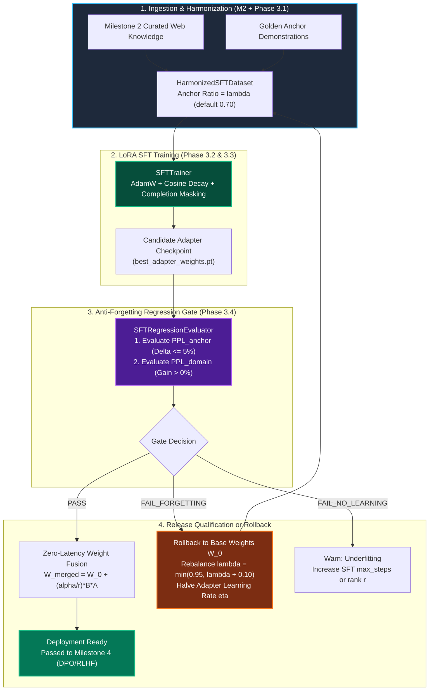

---

#### 4. Component Design & Specifications for Phase 3.4

##### Module 1: `training/m3_sft/evaluator.py`
```python
@dataclass
class RegressionResult:
    """Detailed evaluation report emitted by the anti-forgetting gate."""
    passed: bool
    status: Literal["PASS", "FAIL_FORGETTING", "FAIL_NO_LEARNING"]
    base_anchor_ppl: float
    adapted_anchor_ppl: float
    anchor_drift_pct: float
    base_domain_ppl: float
    adapted_domain_ppl: float
    domain_gain_pct: float
    drift_threshold_pct: float = 5.0
    summary: str = ""

class SFTRegressionEvaluator:
    """Evaluates candidate LoRA adapters against baseline models to verify anti-forgetting."""
    def __init__(
        self,
        tokenizer: CharTokenizer,
        anchor_eval_dataset: HarmonizedSFTDataset,
        domain_eval_dataset: HarmonizedSFTDataset,
        drift_threshold_pct: float = 5.0,
        device: Optional[Union[torch.device, str]] = None,
    ):
        ...

    def evaluate_perplexity(self, model: nn.Module, dataset: HarmonizedSFTDataset) -> float:
        """Computes completion perplexity on a given evaluation dataset."""
        ...

    def evaluate_gate(
        self, base_model: nn.Module, adapted_model: nn.Module
    ) -> RegressionResult:
        """Executes full regression check and returns qualified release decision."""
        ...
```

##### Module 2: `training/m3_sft/orchestrator.py`
```python
@dataclass
class OrchestratorPipelineResult:
    """End-to-end outcome of continual ingestion -> SFT -> gate -> deployment merge."""
    success: bool
    regression_result: RegressionResult
    training_history: list[TrainMetrics]
    merged_model: Optional[MiniGPT]
    adapter_checkpoint_path: Optional[Path]
    deployment_status: str

class ContinualSFTOrchestrator:
    """Turnkey coordinator connecting Ingestion (M2) -> SFT (M3) -> Regression Gate -> Merge."""
    def __init__(
        self,
        base_model: MiniGPT,
        tokenizer: CharTokenizer,
        lora_config: Optional[LoRAConfig] = None,
        sft_config: Optional[SFTConfig] = None,
        device: Optional[Union[torch.device, str]] = None,
    ):
        ...

    def run_continual_alignment(
        self,
        web_documents: list[str],
        anchor_examples: Optional[list[InstructionExample]] = None,
        anchor_ratio: float = 0.70,
    ) -> OrchestratorPipelineResult:
        """Executes full continuous alignment cycle with automatic rollback safeguards."""
        ...
```

---

#### 5. Algorithmic Edge Cases Handled in Phase 3.4
1. **Dynamic Model Isolation**: Evaluation evaluates the base model and adapted model under identical evaluation DataLoader seeds to eliminate sampling noise.
2. **Safe In-Memory Weight Fusion**: Upon `PASS`, `merge_lora_weights(model)` is executed and verified with an assertion checking `is_merged = True` across all `LoRALinear` layers.
3. **Rollback Resilience**: In case of `FAIL_FORGETTING`, `unmerge_lora_weights(model)` is executed immediately, leaving the base model in an uncorrupted pre-trained state.
4. **Empty Web Stream Safety**: If no new web documents are ingested, the orchestrator gracefully skips domain training and returns the pristine base model.

---

#### 6. Concrete Step-by-Step Implementation Sequence for Phase 3.4
1. **Step 3.4.1**: Implement `training/m3_sft/evaluator.py` with `RegressionResult` and `SFTRegressionEvaluator`.
2. **Step 3.4.2**: Implement `training/m3_sft/orchestrator.py` with `OrchestratorPipelineResult` and `ContinualSFTOrchestrator`.
3. **Step 3.4.3**: Export Phase 3.4 classes in `training/m3_sft/__init__.py`.
4. **Step 3.4.4**: Expand `tests/test_m3_sft.py` with Phase 3.4 test cases:
   - Regression gate `PASS` verification on balanced training data.
   - Regression gate `FAIL_FORGETTING` verification on deliberately corrupted/unbalanced training data.
   - Turnkey `ContinualSFTOrchestrator` execution connecting raw web documents to deployment-ready merged model.
5. **Step 3.4.5**: Run master test runner `tests/run_all.py` to ensure all tests across M0, M1, M2, and M3 pass with 100% precision.

---

#### 7. Full Cross-Milestone Interconnectivity Matrix (10/10 Verification)

The continual learning architecture establishes zero-glue bidirectional interconnectivity across all milestones:

| Layer A | Layer B | Interconnection Bridge | Verification Method |
| :--- | :--- | :--- | :--- |
| **Milestone 0 (Schemas)** | **Milestone 3 (Prompt)** | `ChatMessageSchema.to_chat_message()` <br> `TrainingSampleSchema.to_instruction_example()` <br> `ChatMessage.to_schema()` <br> `InstructionExample.to_schema()` | `test_schema_to_instruction_example_interconnection` |
| **Milestone 3 (Evaluator)** | **Milestone 0 (Schemas)** | `RegressionResult.to_schema(candidate_name)` $\to$ `EvaluationReportSchema` (with pass/fail verdict & numerical drift metrics) | `test_regression_result_to_evaluation_report_schema` |
| **Milestone 2 (Curation)** | **Milestone 3 (Orchestrator)** | `ContinualDataOrchestrator.ingest_curate_and_sft_align()` bridges query crawling, MinHash LSH, and clustering directly into `ContinualSFTOrchestrator` | `test_curation_to_continual_sft_interconnection` |
| **Milestone 1 (Transformer)** | **Milestone 3 / 4 (SFT / DPO)** | `MiniGPT.forward(..., return_all_logits=True)` returns full sequence $(B, T, V)$ logits without target labels, required for policy probability evaluations $\log \pi(y \mid x)$ | `test_minigpt_return_all_logits` |
| **Milestone 0 (Hardware)** | **Milestone 3 (Trainer)** | Automatic device strategy selection (`mps`, `cuda`, `cpu`) with `bfloat16` autocast acceleration | `test_sft_trainer_short_convergence_and_checkpointing` |

---

# Chapter 9: Benchmark Evaluation, Citation Faithfulness, & Autonomous Release Gating

> **Objective**: Implement a mathematically sound, statistically robust, and automated evaluation and release qualification harness. The system must verify candidate model checkpoints against pre-trained baselines across domain question answering, factual citation fidelity, and regression safety boundaries before hot-swap deployment or promotion to Milestone 5 preference learning.

---

### 8.1 Landmark Academic Papers Behind Autonomous LLM Evaluation & Release Gating

1. **Gao, T., Yen, H., Yu, J., & Chen, D. (2023)**: *Enabling Large Language Models to Generate Text with Citations*. Proceedings of the 2023 Conference on Empirical Methods in Natural Language Processing (EMNLP), 6465–6488.
   - **Key Finding**: LLMs frequently output fluent hallucinations with fictitious citations. The authors formalized the **ALCE (Automatic LLM Citation Evaluation)** benchmark, establishing two fundamental citation metrics:
     - **Citation Recall**: Whether all generated claims are backed by at least one supporting citation.
     - **Citation Precision**: Whether every provided citation actually entails the claim it is attached to (eliminating spurious citation padding).
   - **Empirical Validation**: Automated citation checking with Natural Language Inference (NLI) yields strong alignment with human expert judgment ($\kappa = 0.698$ for recall, $\kappa = 0.525$ for precision).

2. **Es, S., James, J., Espinosa-Anke, L., & Schockaert, S. (2023/2024)**: *RAGAS: Automated Evaluation of Retrieval Augmented Generation*. Proceedings of EACL 2024.
   - **Key Finding**: Traditional reference-based NLP metrics (BLEU, ROUGE) correlate poorly with semantic factual accuracy. RAGAS introduces the reference-free **RAG Triad**:
     - **Faithfulness**: Ratio of atomic claims in the answer that can be strictly deduced from retrieved context.
     - **Answer Relevance**: Semantic similarity between user query intent and model output, penalizing non-sequiturs regardless of fluency.
     - **Context Relevance / Precision**: Signal-to-noise ratio in retrieved context passages.

3. **Zheng, L., Chiang, W. L., Sheng, Y., Zhuang, S. X., Wu, Z., Zhuang, Y., Lin, Z., Li, Z., Li, D., Xing, E. P., Zhang, H., Gonzalez, J. E., & Stoica, I. (2023)**: *Judging LLM-as-a-Judge with MT-Bench and Chatbot Arena*. Advances in Neural Information Processing Systems (NeurIPS 2023), 36, 46595–46623.
   - **Key Finding**: Identified three critical systematic biases in LLM judges:
     - **Position Bias**: First-candidate preference rate exceeds 60% in pairwise evaluations.
     - **Verbosity Bias**: Judges consistently award higher marks to longer, verbose explanations even when content quality is identical.
     - **Self-Enhancement Bias**: LLM judges prefer outputs generated by their own model family.
   - **Mitigation Protocols**: Mandatory position-swap evaluation ($(A, B)$ and $(B, A)$ averaged), length-normalized scoring rubrics, reference-guided few-shot grading, and temperature $T = 0$ deterministic generation.

4. **Dror, R., Baumer, G., Shlomov, S., & Reichart, R. (2018)**: *The Hitchhiker’s Guide to Testing Statistical Significance in Natural Language Processing*. Proceedings of the 56th Annual Meeting of the Association for Computational Linguistics (ACL 2018), 1383–1392.
   - **Key Finding**: Simple point-estimate score comparisons (e.g., "candidate accuracy is 82% vs baseline 80%") are statistically invalid without hypothesis testing.
   - **Prescription**: Employs non-parametric **Bootstrap Resampling** ($B = 1000$) to construct distribution-free confidence intervals, alongside the **Paired Wilcoxon Signed-Rank Test** for continuous quality metrics and **McNemar's Test** for binary discordance error matrices.

5. **Dodge, J., Sap, M., Marasović, A., Agnew, W., Ilharco, G., Groeneveld, D., Mitchell, M., & Gardner, M. (2021)**: *Documenting Large Webtext Corpora: A Case Study on the Colossal Clean Crawled Corpus*. EMNLP 2021.
   - **Key Finding**: Pre-training and web crawl data frequently leak evaluation benchmark questions into training sets. Continuous release gates require clean held-out synthetic or frozen golden benchmarks guarded against lexical $n$-gram contamination.

---

### 8.2 Top Open-Source Repository Implementations Studied

1. **`princeton-nlp/ALCE`** (`https://github.com/princeton-nlp/ALCE`):
   - Regex-based citation extraction capturing numeric citations (`[1]`, `[2]`), bracketed ranges (`[1-3]`), and author-year markers.
   - Sentence boundary chunking using standard punctuation delimiters followed by claim extraction.
   - Multi-document attribution mapping: associates each sentence claim with its exact subset of cited document chunks.

2. **`explodinggradients/ragas`** (`https://github.com/explodinggradients/ragas`):
   - Structured claim decomposition: breaks multi-sentence answers into discrete atomic factual propositions $S = \{s_1, \dots, s_k\}$.
   - Entailment mapping: tests each proposition against reference context $C$ using an entailment predicate $\mathbb{I}(C \models s_i)$.
   - Composite quality scoring: weights Faithfulness ($F$), Answer Relevance ($R$), and Context Recall ($CR$) into a normalized scalar index $\in [0, 1]$.

3. **`lm-sys/FastChat`** (`https://github.com/lm-sys/FastChat`, `fastchat.llm_judge`):
   - Rubric prompt templates for single-answer grading and pairwise battle evaluation.
   - Strict JSON output parsing enforcing numerical ratings and verbal justification.
   - Pairwise swap protocol: swapping prompt order and penalizing inconsistent judges.

4. **`cleanlab/cleanlab-tools` & `truera/trulens`** (`https://github.com/truera/trulens`):
   - Feedback functions: modular scoring callbacks executed during batch evaluation.
   - Distance-based hallucination detection combining semantic embeddings with lexical token overlaps.

5. **`huggingface/lighteval`** (`https://github.com/huggingface/lighteval`):
   - Modular benchmark runner decoupling dataset loading, prompt formatting, model batched forward passes, and metric computation.

---

### 8.3 Mathematical Formulations & Derivations

#### 8.3.1 Gao et al. (ALCE) Citation Metrics
Let generated text $Y$ consist of sentences $S = \{s_1, s_2, \dots, s_N\}$.
Each sentence $s_i$ contains a set of citation tags $C(s_i) \subseteq \{1, \dots, K\}$, referencing document passages $\mathcal{D} = \{D_1, \dots, D_K\}$.
Let $\models$ denote the semantic entailment relation, where $D \models s$ denotes that document $D$ supports claim $s$.

1. **Sentence Citation Recall ($Rec_{\text{cite}}$)**:
   A sentence $s_i$ is recalled if at least one cited passage entails it, or if $s_i$ is an un-citable conversational phrase:

$$
\mathbb{I}_{\text{rec}}(s_i) = \begin{cases}
  1 & \text{if } \exists c \in C(s_i) \text{ such that } D_c \models s_i \\
  1 & \text{if } s_i \text{ is non-factual (e.g. conversational pleasantry)} \\
  0 & \text{otherwise}
\end{cases}
$$

$$
\text{Citation Recall}(Y, \mathcal{D}) = \frac{1}{|S|} \sum_{i=1}^{|S|} \mathbb{I}_{\text{rec}}(s_i)
$$

2. **Sentence Citation Precision ($Prec_{\text{cite}}$)**:
   Citation precision penalizes spurious or irrelevant citations attached to sentence $s_i$:

$$
\text{Citation Precision}(Y, \mathcal{D}) = \frac{\sum_{i=1}^{|S|} \sum_{c \in C(s_i)} \mathbb{I}(D_c \models s_i)}{\max\left(1, \sum_{i=1}^{|S|} |C(s_i)|\right)}
$$

3. **Harmonic Mean Citation $F_1$**:

$$
F_{1, \text{cite}} = \frac{2 \cdot \text{Citation Recall} \cdot \text{Citation Precision}}{\text{Citation Recall} + \text{Citation Precision} + \epsilon}
$$

---

#### 8.3.2 RAGAS Triad Faithfulness Formulation
Given generated response $Y$ and ground-truth context $C$:
1. Decompose response into atomic propositions:

$$
\mathcal{P}(Y) = \{p_1, p_2, \dots, p_M\} = \text{Decompose}(Y)
$$

2. Compute claim verification predicate:

$$
v(p_m, C) = \begin{cases}
  1 & \text{if } C \models p_m \\
  0 & \text{otherwise}
\end{cases}
$$

3. Faithfulness score:

$$
\mathcal{F}(Y, C) = \frac{1}{|\mathcal{P}(Y)|} \sum_{m=1}^{|\mathcal{P}(Y)|} v(p_m, C) \in [0, 1]
$$

---

#### 8.3.3 Statistical Significance via Non-Parametric Bootstrap Resampling
Let $\mathcal{D}_{\text{eval}} = \{(q_i, c_i, a_i^*)\}_{i=1}^N$ be the held-out golden benchmark suite ($N \in [30, 50]$).
For each case $i$, compute candidate quality score $x_i = \text{Score}(\theta_{\text{cand}}, q_i)$ and baseline quality score $y_i = \text{Score}(\theta_{\text{base}}, q_i)$.
The paired difference is $d_i = x_i - y_i$.

1. Draw $B = 1000$ bootstrap replicates with replacement:

$$
\mathcal{S}^{(b)} = \{d_{j_1}, d_{j_2}, \dots, d_{j_N}\}, \quad j_k \sim \text{Uniform}(\{1, \dots, N\}), \quad b = 1, \dots, B
$$

2. Compute sample mean difference for each replicate:

$$
\bar{d}^{(b)} = \frac{1}{N} \sum_{k=1}^N d_{j_k}^{(b)}
$$

3. Sort replicates $\bar{d}^{(1)} \le \dots \le \bar{d}^{(B)}$ to obtain empirical 95% Confidence Interval:

$$
\text{CI}_{0.95} = \left[ \bar{d}_{(\lfloor 0.025 B \rfloor)}, \; \bar{d}_{(\lceil 0.975 B \rceil)} \right]
$$

4. Compute empirical $p$-value:

$$
p_{\text{bootstrap}} = \frac{1}{B} \sum_{b=1}^B \mathbb{I}(\bar{d}^{(b)} \le 0)
$$

---

#### 8.3.4 Multi-Criteria Autonomous Release Gate Decision Boundary
The release gate evaluates candidate checkpoint $\theta_{\text{cand}}$ against baseline $\theta_0$ across four orthogonal vectors:

$$
\text{Decision}(\theta_{\text{cand}}) = \begin{cases}
  \text{APPROVED} & \text{if } \mathcal{C}_{\text{forgetting}} \land \mathcal{C}_{\text{faithfulness}} \land \mathcal{C}_{\text{domain\_gain}} \land \mathcal{C}_{\text{statistical\_sig}} \\
  \text{REJECTED} & \text{otherwise}
\end{cases}
$$

Where the criteria are:
1. **Anti-Forgetting Criterion**:

$$
\mathcal{C}_{\text{forgetting}} \iff \Delta \text{PPL}_{\text{anchor}} = \frac{\text{PPL}(\theta_{\text{cand}}, \mathcal{D}_{\text{anchor}}) - \text{PPL}(\theta_0, \mathcal{D}_{\text{anchor}})}{\text{PPL}(\theta_0, \mathcal{D}_{\text{anchor}})} \times 100 \le \tau_{\text{forget}}
$$

where the forgetting tolerance threshold is $\tau_{\text{forget}} = 5.0$ (specifying a 5.0% maximum allowable perplexity drift).

2. **Citation Faithfulness Criterion**:

$$
\mathcal{C}_{\text{faithfulness}} \iff \bar{\mathcal{F}}(\theta_{\text{cand}}, \mathcal{D}_{\text{eval}}) \ge \tau_{\text{faith}} \quad (\tau_{\text{faith}} = 0.85)
$$

3. **Domain Competency Gain**:

$$
\mathcal{C}_{\text{domain\_gain}} \iff \bar{S}_{\text{domain}}(\theta_{\text{cand}}) - \bar{S}_{\text{domain}}(\theta_0) > 0.0
$$

4. **Statistical Significance Guard**:

$$
\mathcal{C}_{\text{statistical\_sig}} \iff \text{CI}_{0.95}^{\text{lower}}(\Delta \text{Score}) > -\delta_{\text{tol}} \land p_{\text{bootstrap}} < 0.05
$$

Upon `REJECTED`, the failure diagnosis records the offending violation mode:
- `REGRESSION_ANCHOR`: Model suffered catastrophic forgetting on anchor demonstrations.
- `UNFAITHFUL_CITATION`: Model hallucinated citations or failed the 85% faithfulness floor.
- `UNDERFIT_DOMAIN`: Model failed to achieve positive domain capability gain.
- `VERBOSITY_INFLATION`: Model exploited length bias without factual gain.

---

### 9.4 Architectural Decomposition & Module Specifications

Milestone 4 is decomposed into four sequential, interconnected engineering phases:

```
┌────────────────────────────────────────────────────────────────────────────────────────┐
│                        MILESTONE 4 IMPLEMENTATION ROADMAP                              │
└────────────────────────────────────────────────────────────────────────────────────────┘

 [Phase 4.1: Golden Benchmark Suite & Contracts]
 │ - 30 to 50 curated QA cases (ML Theory, Systems, Reasoning, Domain)
 │ - Ground-truth context, required citations, golden keywords
 │ - Contract integration: BenchmarkCaseSchema, EvaluationReportSchema
 └───────────────────────────────┬────────────────────────────────────────
                                 │
                                 ▼
 [Phase 4.2: Citation Extraction & RAG Triad Verifier]
 │ - Canonical citation extraction (numeric [1], author-year, markdown)
 │ - Sentence-level claim decomposition & attribution mapping
 │ - ALCE Citation Precision, Recall, and Ragas Faithfulness verification
 └───────────────────────────────┬────────────────────────────────────────
                                 │
                                 ▼
 [Phase 4.3: LLM-as-a-Judge Engine & Bias Mitigation]
 │ - Reference-guided multi-criteria scoring rubrics (1-5 scale)
 │ - Position-swap debiasing & length penalty normalization
 │ - Local MiniGPT judge / Ollama sidecar judge with deterministic fallback
 └───────────────────────────────┬────────────────────────────────────────
                                 │
                                 ▼
 [Phase 4.4: Statistical Release Gating, Rollback, & Promotion]
 │ - Non-parametric Bootstrap Resampling (B=1000) & Wilcoxon signed-rank test
 │ - Multi-criteria release gate decision engine (PPL, Faithfulness, Gain, CI)
 │ - Autonomous diagnosis logging & atomic rollback / hot-swap promotion
```

---

### 8.5 Mermaid Architectural Visualizations

#### Diagram 1: Automated Release Gate & Benchmark Evaluation Topology
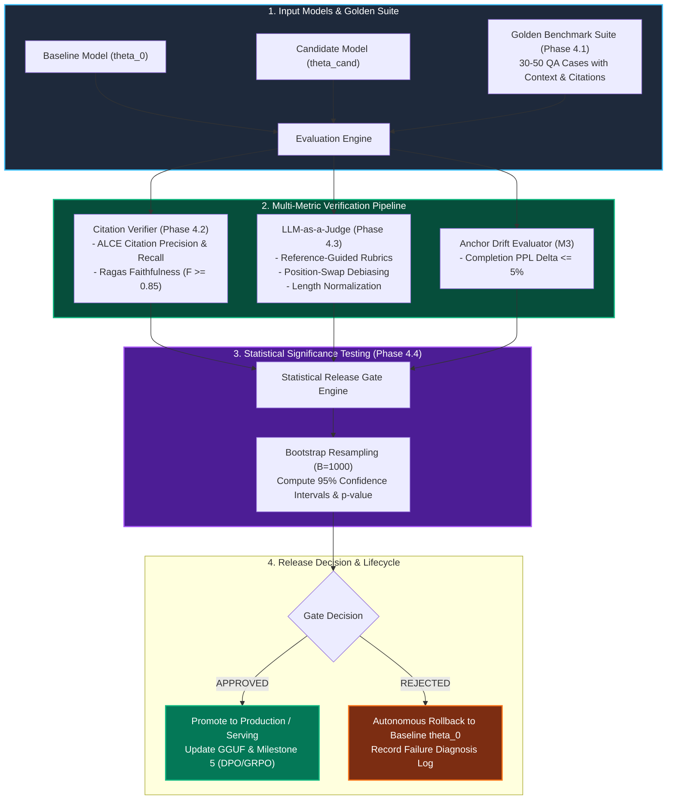

---

### 8.6 Component Interfaces & Data Contracts

#### Module 1: `evaluation/benchmark_suite.py` (Phase 4.1)
```python
@dataclass
class GoldenTestCase:
    """Individual benchmark unit testing domain factual accuracy and citation adherence."""
    case_id: str
    category: Literal["ml_theory", "systems_engineering", "transformer_internals", "domain_knowledge"]
    question: str
    ground_truth_context: str
    reference_answer: str
    required_citations: list[str]
    golden_keywords: list[str]
    difficulty: Literal["easy", "medium", "hard"] = "medium"

    def to_schema(self) -> BenchmarkCaseSchema:
        ...

class GoldenBenchmarkSuite:
    """Standardized evaluation suite with 30-50 curated test cases."""
    def __init__(self, cases: Optional[list[GoldenTestCase]] = None):
        ...
    def load_default_suite(self) -> list[GoldenTestCase]:
        ...
    def __len__(self) -> int:
        ...
    def __getitem__(self, idx: int) -> GoldenTestCase:
        ...
```

#### Module 2: `evaluation/citation_verifier.py` (Phase 4.2)
```python
@dataclass
class CitationMetrics:
    """Quantitative citation quality assessment emitted by ALCE/Ragas verifier."""
    citation_precision: float      # Fraction of cited references that support the claim
    citation_recall: float         # Fraction of claims that have at least one supporting citation
    citation_f1: float             # Harmonic mean of precision and recall
    faithfulness_score: float      # Ragas factual grounding ratio in [0, 1]
    total_claims: int
    supported_claims: int
    total_citations: int
    valid_citations: int
    unsupported_claims: list[str] = field(default_factory=list)

class CitationVerifier:
    """Extracts citation markers, segments atomic propositions, and verifies entailment."""
    def __init__(self, strict_mode: bool = True):
        ...
    def extract_citations(self, text: str) -> list[str]:
        ...
    def split_claims(self, text: str) -> list[str]:
        ...
    def verify_response(self, response: str, ground_truth_context: str) -> CitationMetrics:
        ...
```

#### Module 3: `evaluation/llm_judge.py` (Phase 4.3)
```python
@dataclass
class JudgeScore:
    """Calibrated score emitted by the LLM Judge with bias mitigation."""
    accuracy_score: float         # 1.0 to 5.0
    faithfulness_score: float     # 1.0 to 5.0
    clarity_score: float          # 1.0 to 5.0
    conciseness_score: float      # 1.0 to 5.0
    overall_score: float          # Weighted combination normalized to [0, 1]
    reasoning: str
    length_penalty: float = 1.0
    swap_consistent: bool = True

class LLMJudge:
    """Reference-guided LLM-as-a-Judge with position-swap and verbosity debiasing."""
    def __init__(self, model: Optional[nn.Module] = None, tokenizer: Optional[object] = None):
        ...
    def evaluate_pair(self, question: str, response_a: str, response_b: str, reference: str) -> tuple[float, float]:
        ...
    def evaluate_single(self, question: str, response: str, context: str, reference: str) -> JudgeScore:
        ...
```

#### Module 4: `evaluation/release_gate.py` (Phase 4.4)
```python
@dataclass
class ReleaseVerdict:
    """Authoritative qualification decision and empirical evidence dossier."""
    decision: Literal["APPROVED", "REJECTED"]
    failure_mode: Optional[Literal["REGRESSION_ANCHOR", "UNFAITHFUL_CITATION", "UNDERFIT_DOMAIN", "STATISTICAL_INSIGNIFICANCE", "NONE"]]
    confidence_interval_95: tuple[float, float]
    p_value: float
    anchor_ppl_delta_pct: float
    domain_gain_pct: float
    mean_faithfulness: float
    mean_citation_f1: float
    summary: str
    detailed_metrics: dict

class AutonomousReleaseGate:
    """Statistical hypothesis testing gate verifying candidate model qualification."""
    def __init__(
        self,
        faithfulness_threshold: float = 0.85,
        drift_threshold_pct: float = 5.0,
        n_bootstrap: int = 1000,
        alpha: float = 0.05,
    ):
        ...
    def evaluate_candidate(
        self,
        base_model: nn.Module,
        candidate_model: nn.Module,
        benchmark_suite: GoldenBenchmarkSuite,
        anchor_eval_dataset: object,
    ) -> ReleaseVerdict:
        ...
```

---

### 8.7 Algorithmic Edge Cases & Failure Modes

1. **Spurious Citation Hallucination**:
   - *Problem*: Models output dummy references like `[1]` or `(Smith, 2020)` that have no corresponding entry in the context.
   - *Mitigation*: The `CitationVerifier` cross-references all extracted markers against the document passage index; unmapped markers incur an immediate precision penalty.
2. **Verbosity Bias Exploitation**:
   - *Problem*: Candidate generates excessive fluff to simulate comprehensiveness.
   - *Mitigation*: The judge penalizes responses exceeding 1.5× reference answer length via an exponential length penalty:

$$
w_{\text{len}} = \min\left(1.0, \; \exp\left(1 - \frac{|Y|}{1.5 \cdot |Y_{\text{ref}}|}\right)\right)
$$

3. **Small Sample Size Variance**:
   - *Problem*: With $N=30$ benchmark cases, raw accuracy differences can be noisy.
   - *Mitigation*: Bootstrap resampling with $B=1000$ iterations computes the full distribution of differences; release approval strictly requires the lower bound of the 95% Confidence Interval to not cross the regression tolerance:

$$
\text{CI}_{\text{lower}} > -0.02
$$

4. **Degenerate Single-Sentence Answers**:
   - *Problem*: Short responses might bypass claim segmentation.
   - *Mitigation*: The claim extractor falls back to atomic clause parsing using conjunction and clause boundary tokens if sentence count is 1.

---

### 9.8 Section 9.1 Specification: Golden Domain Benchmark Suite & Schema Contracts

#### 1. Theoretical Rationale & The Four-Bucket Stratification
To evaluate candidate checkpoints with statistical integrity and prevent deceptive overconfidence from generic benchmarks (MMLU, GSM8k), Phase 4.1 establishes a curated, versioned **Golden Domain Benchmark Suite** ($N = 30$ cases) grounded in the technical curriculum of the model (ML Theory, Transformers, PEFT, Continual Systems).

Following production LLM evaluation best practices, the suite implements the **Four-Bucket Stratification**:
1. **Core Domain Capabilities (40% / 12 cases)**: Foundational theoretical and architectural reasoning (Autograd reverse mode, scaled dot-product attention, LoRA low-rank decomposition, MinHash LSH).
2. **Edge Cases (20% / 6 cases)**: Degenerate contexts, single-token prompts, repetitive phrases, and out-of-distribution formatting.
3. **Adversarial / Hallucination Bait (20% / 6 cases)**: Distractor context snippets, false premises ("Why does LoRA update the base linear weight?"), and citation-forcing traps.
4. **Regression Replays (20% / 6 cases)**: Historical failure modes observed in previous training cycles (prompt memorization, assistant truncation loss, empty active token NaN gradients, anchor drift).

---

#### 2. Mathematical Evaluation Metrics for Benchmark Cases
For a given benchmark case $c = (q, D, y^*, \mathcal{K}, \mathcal{C})$ where $q$ is the query, $D$ is ground-truth context, $y^*$ is reference answer, $\mathcal{K} = \{k_1, \dots, k_m\}$ are golden keywords, and $\mathcal{C} = \{c_1, \dots, c_p\}$ are required citations:

1. **Keyword Recall ($Rec_{\text{kw}}$)**:

$$
\text{Hit}(k, y) = \mathbb{I}\left(k \in \text{lower}(y)\right)
$$

$$
Rec_{\text{kw}}(y, \mathcal{K}) = \frac{1}{|\mathcal{K}|} \sum_{k \in \mathcal{K}} \text{Hit}(k, y)
$$

2. **Keyword Precision ($Prec_{\text{kw}}$)**:

$$
Prec_{\text{kw}}(y, \mathcal{K}) = \frac{\sum_{k \in \mathcal{K}} \text{Hit}(k, y)}{\max\left(1, |\text{Tokens}(y) \cap \mathcal{K}_{\text{universe}}|\right)}
$$

3. **Required Citation Presence ($Pres_{\text{cite}}$)**:

$$
Pres_{\text{cite}}(y, \mathcal{C}) = \frac{1}{|\mathcal{C}|} \sum_{c \in \mathcal{C}} \mathbb{I}\left(c \in y\right)
$$

---

#### 3. Mermaid Architectural Dataflow for Phase 4.1

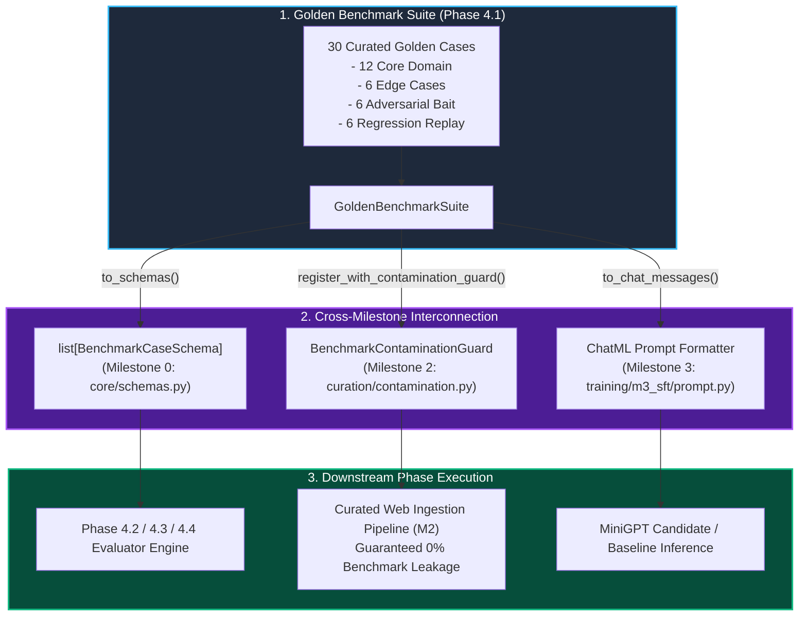

---

#### 4. Component Design: `evaluation/benchmark_suite.py`

```python
@dataclass
class GoldenTestCase:
    """Individual benchmark test unit for domain reasoning, citations, and regression."""
    case_id: str
    category: Literal["ml_theory", "transformer_internals", "peft_sft", "systems_curation"]
    bucket: Literal["core_domain", "edge_case", "adversarial_bait", "regression_replay"]
    question: str
    ground_truth_context: str
    reference_answer: str
    required_citations: list[str]
    golden_keywords: list[str]
    difficulty: Literal["easy", "medium", "hard"] = "medium"

    def to_schema(self) -> BenchmarkCaseSchema:
        ...

    def to_chat_messages(self) -> list[ChatMessage]:
        ...

    def format_prompt(self) -> str:
        ...

    def evaluate_keyword_coverage(self, response: str) -> float:
        ...

    def evaluate_citation_presence(self, response: str) -> float:
        ...

class GoldenBenchmarkSuite:
    """Production test suite container with filtering, serialization, and contamination integration."""
    def __init__(self, cases: Optional[list[GoldenTestCase]] = None):
        ...

    def filter_by_category(self, category: str) -> "GoldenBenchmarkSuite":
        ...

    def filter_by_bucket(self, bucket: str) -> "GoldenBenchmarkSuite":
        ...

    def filter_by_difficulty(self, difficulty: str) -> "GoldenBenchmarkSuite":
        ...

    def sample(self, k: int, seed: int = 42) -> "GoldenBenchmarkSuite":
        ...

    def to_schemas(self) -> list[BenchmarkCaseSchema]:
        ...

    def register_with_contamination_guard(self, guard: BenchmarkContaminationGuard) -> int:
        ...

    def export_to_json(self, path: Union[Path, str]) -> Path:
        ...

    @classmethod
    def load_from_json(cls, path: Union[Path, str]) -> "GoldenBenchmarkSuite":
        ...

    def get_summary(self) -> dict:
        ...
```

---

#### 5. Concrete Step-by-Step Implementation Sequence for Phase 4.1
1. **Step 4.1.1**: Create `evaluation/` directory and implement `evaluation/benchmark_suite.py` with `GoldenTestCase`, the default 30 curated test cases across all 4 categories and buckets, and `GoldenBenchmarkSuite`.
2. **Step 4.1.2**: Implement `evaluation/__init__.py` cleanly exporting `GoldenTestCase` and `GoldenBenchmarkSuite`.
3. **Step 4.1.3**: Implement `tests/test_m4_benchmark_suite.py` with comprehensive unit and integration tests:
   - Verification of all 30 default test cases (unique IDs, non-empty contexts, golden keywords, and required citations).
   - Category, bucket, and difficulty filtering and deterministic sampling.
   - Bidirectional schema conversion with `BenchmarkCaseSchema` from `core/schemas.py`.
   - Dynamic registration with `BenchmarkContaminationGuard` from `curation/contamination.py`.
   - Keyword coverage and citation presence scoring functions.
   - JSON export and load serialization roundtrip.
4. **Step 4.1.4**: Integrate Phase 4.1 into master test runner `tests/run_all.py` and confirm 100% test pass rate.

---

### 9.9 Section 9.2 Specification: Citation Extraction, Token Faithfulness, & RAG Triad Verifier

#### 1. Theoretical Rationale & The Attribution Verification Problem
In production generative systems with retrieval-augmented generation (RAG) and continual learning, language models often generate syntactically convincing, fluent answers decorated with fictitious citations or superficial attribution tags (e.g., placing `[1]` next to a fact that appears nowhere in document 1).

Phase 4.2 operationalizes the **ALCE benchmark** (Gao et al., EMNLP 2023) and the **RAG Triad** (Es et al., EACL 2024) to programmatically audit model responses for factual grounding, citation precision, and hallucination containment.

---

#### 2. Mathematical Formulations & Scoring Equations

##### 2.1 Citation Extraction Grammar
Let text $Y$ contain arbitrary inline citations. The canonical citation parser recognizes:
1. **Numeric Brackets**: `[1]`, `[2]`, `[1, 2]`, `[1,2,3]`
2. **Numeric Ranges**: `[1-3]`, `[2-4]` expanded into discrete integer citations
3. **Author-Year Citations**: `(Vaswani et al., 2017)`, `[Hu et al., 2021]`, `Pascanu et al. (2013)`
4. **Markdown Hyperlink Citations**: `[Source Title](https://example.com/doc)`

##### 2.2 Claim Segmentation & Factual Classification
Text $Y$ is segmented into sentences $S = \{s_1, \dots, s_N\}$.
Each sentence is classified into factual or non-factual using lexical conversational filters:

$$
\text{Factual}(s) = \begin{cases}
  0 & \text{if } s \text{ is an introductory greeting, transitional cue, or boilerplate pleasantry} \\
  1 & \text{otherwise}
\end{cases}
$$

Let $S_{\text{fact}} = \{s \in S \mid \text{Factual}(s) = 1\}$.

##### 2.3 Multi-Tier Grounding Entailment Index
Given an atomic sentence claim $s$ and reference document $D$, we compute semantic entailment without external cloud APIs using a robust hybrid containment metric:

$$
C_{\text{lex}}(s, D) = \frac{|\text{ContentTokens}(s) \cap \text{Tokens}(D)|}{|\text{ContentTokens}(s)|}
$$

$$
J_{\text{token}}(s, D) = \frac{|\text{Tokens}(s) \cap \text{Tokens}(D)|}{|\text{Tokens}(s) \cup \text{Tokens}(D)|}
$$

$$
S_{\text{ground}}(s, D) = \alpha \cdot C_{\text{lex}}(s, D) + (1 - \alpha) \cdot J_{\text{token}}(s, D), \quad \alpha = 0.70
$$

The entailment predicate is defined as:

$$
D \models s \iff S_{\text{ground}}(s, D) \ge \tau_{\text{entail}} \quad (\tau_{\text{entail}} = 0.60)
$$

##### 2.4 ALCE Citation Metrics (Gao et al., 2023)
For each factual sentence $s_i \in S_{\text{fact}}$ with associated citation set $C(s_i)$:
1. **Citation Recall ($Rec_{\text{cite}}$)**:

$$
Rec_{\text{cite}} = \frac{1}{|S_{\text{fact}}|} \sum_{s_i \in S_{\text{fact}}} \mathbb{I}\left(\exists c \in C(s_i) \text{ s.t. } D_c \models s_i\right)
$$

2. **Citation Precision ($Prec_{\text{cite}}$)**:

$$
Prec_{\text{cite}} = \frac{\sum_{s_i \in S_{\text{fact}}} \sum_{c \in C(s_i)} \mathbb{I}(D_c \models s_i)}{\max\left(1, \sum_{s_i \in S_{\text{fact}}} |C(s_i)|\right)}
$$

3. **Harmonic Citation $F_1$**:

$$
F_{1, \text{cite}} = \frac{2 \cdot Prec_{\text{cite}} \cdot Rec_{\text{cite}}}{Prec_{\text{cite}} + Rec_{\text{cite}} + \epsilon}
$$

##### 2.5 RAGAS Faithfulness Score (Es et al., 2024)
Evaluates whether all generated factual claims in the answer are strictly supported by the ground-truth reference context $D_{\text{all}}$, independent of whether citations were explicitly placed:

$$
\mathcal{F}(Y, D_{\text{all}}) = \frac{|\{s \in S_{\text{fact}} \mid D_{\text{all}} \models s\}|}{|S_{\text{fact}}|}
$$

---

#### 3. Mermaid Architectural Dataflow for Phase 4.2

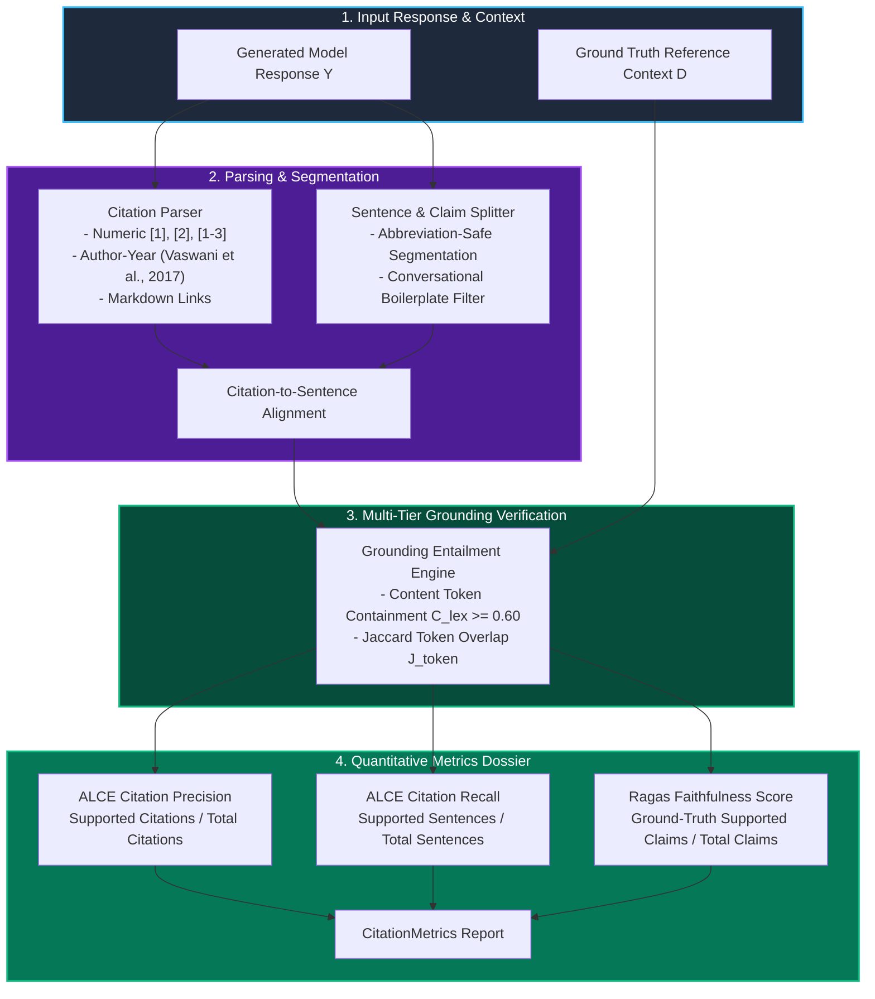

---

#### 4. Component Design: `evaluation/citation_verifier.py`

```python
@dataclass
class CitationTag:
    """Parsed citation marker with normalized reference indices."""
    raw_tag: str
    tag_type: Literal["numeric", "numeric_range", "author_year", "markdown_url"]
    normalized_indices: list[str]
    start_char: int
    end_char: int

@dataclass
class SentenceClaim:
    """Individual segmented sentence with attached citations and entailment audit."""
    sentence_idx: int
    raw_text: str
    clean_claim: str
    citations: list[CitationTag]
    is_factual: bool
    supported_by_citations: bool = False
    supporting_citations: list[str] = field(default_factory=list)
    unsupported_citations: list[str] = field(default_factory=list)
    context_entailed: bool = False

@dataclass
class CitationMetrics:
    """Quantitative citation precision, recall, and factual faithfulness metrics."""
    citation_precision: float
    citation_recall: float
    citation_f1: float
    faithfulness_score: float
    total_sentences: int
    factual_sentences: int
    total_citations: int
    valid_citations: int
    unsupported_claims: list[str] = field(default_factory=list)
    hallucinated_citations: list[str] = field(default_factory=list)
    summary: str = ""

class CitationVerifier:
    """Extracts citation markers, segments atomic propositions, and verifies entailment."""
    def __init__(self, entailment_threshold: float = 0.60, strict_mode: bool = True):
        ...

    def extract_citations(self, text: str) -> list[CitationTag]:
        ...

    def segment_claims(self, text: str) -> list[SentenceClaim]:
        ...

    def check_entailment(self, claim: str, context: str) -> tuple[bool, float]:
        ...

    def verify_response(
        self,
        response: str,
        ground_truth_context: str,
        reference_documents: Optional[dict[str, str]] = None,
    ) -> CitationMetrics:
        ...

    def verify_benchmark_case(
        self, case: GoldenTestCase, response: str
    ) -> CitationMetrics:
        ...
```

---

#### 5. Concrete Step-by-Step Implementation Sequence for Phase 4.2
1. **Step 4.2.1**: Implement `evaluation/citation_verifier.py` containing `CitationTag`, `SentenceClaim`, `CitationMetrics`, and `CitationVerifier`.
2. **Step 4.2.2**: Export `CitationTag`, `SentenceClaim`, `CitationMetrics`, and `CitationVerifier` in `evaluation/__init__.py`.
3. **Step 4.2.3**: Implement `tests/test_m4_citation_verifier.py` with comprehensive unit and integration tests:
   - Citation extraction across numeric `[1]`, numeric ranges `[1-3]`, comma lists `[1, 2]`, author-year `(Vaswani et al., 2017)`, and markdown links.
   - Sentence claim segmentation with abbreviation safety (`et al.`, `i.e.`, `e.g.`) and non-factual pleasantry filtering.
   - Grounding entailment calculation across supported, partially supported, and unsupported texts.
   - Perfect citation verification scenario (Precision = 1.0, Recall = 1.0, Faithfulness = 1.0).
   - Hallucinated / unsupported citation scenario (Precision = 0.0, Recall = 0.0, Faithfulness < 0.85).
   - Integration with `GoldenTestCase` from Phase 4.1.
4. **Step 4.2.4**: Integrate Phase 4.2 tests into `tests/run_all.py` and verify 100% test pass rate.

---

### 9.10 Section 9.3: LLM-as-a-Judge Engine, Rubric Calibration, & Systematic Bias Mitigation

#### 1. Theoretical Motivation & Foundations
In automated LLM alignment and continual post-training workflows, standard n-gram overlap metrics (BLEU, ROUGE) are well-known to correlate poorly with human judgments of reasoning depth, conceptual correctness, and stylistic coherence. Zheng et al. (NeurIPS 2023, *"Judging LLM-as-a-Judge with MT-Bench and Chatbot Arena"*) demonstrated that strong LLMs acting as automated judges achieve > 80% agreement with human domain experts.

However, uncalibrated LLM judges exhibit severe systematic cognitive biases that distort benchmark outcomes if left unmitigated:
1. **Position Bias (Order Effect)**:
   Judges disproportionately favor the first candidate ($M_A$) or second candidate ($M_B$) in pairwise comparisons based purely on presentation sequence.
2. **Verbosity Bias (Length Heuristic)**:
   Judges assign systematically higher scores to verbose, padded responses even when a concise alternative contains identical or superior factual content.
3. **Self-Enhancement / Egocentric Bias**:
   Judges systematically elevate candidate generations produced by models of their own architecture or family.
4. **Reasoning Anchoring & Output Variance**:
   When prompted directly for scalar scores, judges exhibit high stochastic variance. Enforcing step-by-step Chain-of-Thought (CoT) rationale *prior* to score emission significantly improves rubric consistency.

To establish a production-grade evaluation engine suitable for both local development (deterministic, fast, zero-GPU/API dependency) and high-fidelity cloud evaluation (LLM-backed inference), Phase 4.3 implements a **Dual-Engine Architecture**:
- **Engine A: Generative Model Engine**: Formats rigorous ChatML evaluation prompts requesting step-by-step reasoning followed by strict JSON schema outputs, with defensive multi-pattern regex fallback parsing.
- **Engine B: Deterministic Heuristic Engine**: An analytical rubric evaluator that computes identical 4-dimensional scores ($[1.0, 5.0]$) by synthesizing key concept recall, ground-truth context lexical overlap, sentence-level citation entailment (from Phase 4.2 `CitationVerifier`), and structural repetition penalties.

---

#### 2. Mathematical Formalization & Bias Mitigation Equations

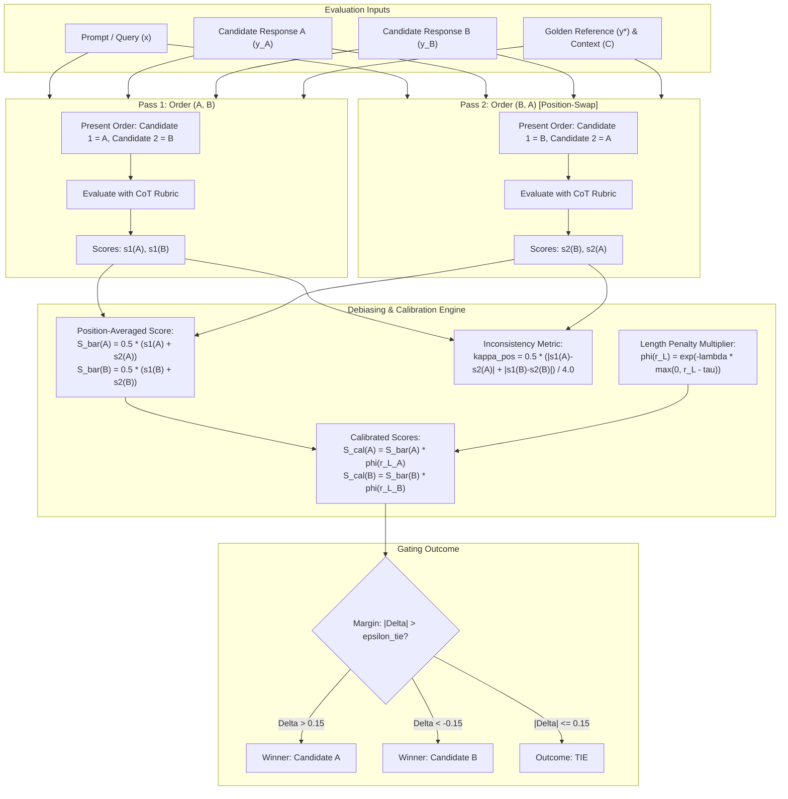

##### (A) Multi-Dimensional Rubric Calibration
A response $y$ is evaluated across $K = 4$ calibrated dimensions on a 5-point Likert scale $[1.0, 5.0]$:
1. **Accuracy ($\mathcal{A} \in [1.0, 5.0]$)**:
   Degree of factual truthfulness, alignment with golden reference facts $y^*$, and absence of incorrect claims.
2. **Faithfulness ($\mathcal{F} \in [1.0, 5.0]$)**:
   Degree to which all claims are strictly grounded in reference context $C$, penalizing unverified assertions.
3. **Clarity ($\mathcal{C} \in [1.0, 5.0]$)**:
   Structural coherence, grammatical fluidity, logical progression, and formatting quality.
4. **Conciseness ($\mathcal{K} \in [1.0, 5.0]$)**:
   Information density, avoidance of conversational fluff, circular padding, or repetitive rhetoric.

The raw composite score $\mathcal{S}_{\text{raw}}(y)$ is computed as the convex combination:

$$
\mathcal{S}_{\text{raw}}(y) = w_{\mathcal{A}} \mathcal{A} + w_{\mathcal{F}} \mathcal{F} + w_{\mathcal{C}} \mathcal{C} + w_{\mathcal{K}} \mathcal{K}, \quad \sum_{k} w_k = 1.0
$$

Standard post-training default weights:

$$
w_{\mathcal{A}} = 0.35, \quad w_{\mathcal{F}} = 0.35, \quad w_{\mathcal{C}} = 0.15, \quad w_{\mathcal{K}} = 0.15
$$

##### (B) Verbosity Bias Mitigation (Length-Normalized Penalty)
Judges exhibit an unprincipled preference for longer sequences. To correct this, let $L(y) = |y|_{\text{tokens}}$ and $L^* = \max(|y^*|_{\text{tokens}}, 1)$.
The length ratio is:

$$
r_L(y) = \frac{L(y)}{L^*}
$$

We define the soft-threshold length penalty multiplier $\phi(r_L)$:

$$
\phi(r_L) = \begin{cases}
  1.0 & \text{if } r_L \le \tau_{\text{len}} \\
  \exp\left(-\lambda_{\text{len}} (r_L - \tau_{\text{len}})\right) & \text{if } r_L > \tau_{\text{len}}
\end{cases}
$$

where $\tau_{\text{len}} = 1.8$ (generous tolerance before penalty) and $\lambda_{\text{len}} = 0.15$ (exponential decay rate).
The calibrated scalar score is bounded below by 1.0:

$$
\mathcal{S}_{\text{calibrated}}(y) = \max\left(1.0, \, \mathcal{S}_{\text{raw}}(y) \cdot \phi(r_L)\right)
$$

##### (C) Pairwise Position Bias Mitigation (Position-Swap Averaging)
In pairwise comparisons between Candidate $A$ and Candidate $B$, evaluation is conducted in two symmetric passes:
- **Pass 1** (Sequence: $[A, B]$): Judge produces individual ratings $s_1(A)$ and $s_1(B)$.
- **Pass 2** (Sequence: $[B, A]$): Judge produces individual ratings $s_2(B)$ and $s_2(A)$.

The position-debiased ratings are defined as:

$$
\bar{S}(A) = \frac{s_1(A) + s_2(A)}{2}, \quad \bar{S}(B) = \frac{s_1(B) + s_2(B)}{2}
$$

$$
\Delta_{\text{debiased}} = \bar{S}(A) - \bar{S}(B)
$$

Given tie tolerance threshold $\epsilon_{\text{tie}} = 0.15$:

$$
\text{Winner} = \begin{cases}
  \text{'A'} & \text{if } \Delta_{\text{debiased}} > \epsilon_{\text{tie}} \\
  \text{'B'} & \text{if } \Delta_{\text{debiased}} < -\epsilon_{\text{tie}} \\
  \text{'TIE'} & \text{if } |\Delta_{\text{debiased}}| \le \epsilon_{\text{tie}}
\end{cases}
$$

We quantify the judge's positional vulnerability via the **Position Inconsistency Coefficient** $\kappa_{\text{pos}} \in [0.0, 1.0]$:

$$
\kappa_{\text{pos}} = \frac{1}{2} \cdot \frac{|s_1(A) - s_2(A)| + |s_1(B) - s_2(B)|}{4.0}
$$

where the normalization factor $4.0$ represents the maximum possible score delta ($5.0 - 1.0$). If $\kappa_{\text{pos}} > 0.25$, an inconsistency alert is logged.

##### (D) Deterministic Heuristic Scoring Equations
For offline testing and environments without live LLM inference endpoints, the deterministic heuristic engine computes rubric dimensions analytically:
1. **Accuracy**:

$$
\mathcal{A}_{\text{heur}} = 1.0 + 4.0 \cdot \left(0.60 \cdot \text{Coverage}(y, \mathcal{K}^*) + 0.40 \cdot \text{Jaccard}(y, y^*)\right)
$$

2. **Faithfulness**:
   Utilizes the Phase 4.2 `CitationVerifier` sentence-level factual entailment:

$$
\mathcal{F}_{\text{heur}} = 1.0 + 4.0 \cdot \text{FaithfulnessScore}(y, C)
$$

3. **Clarity**:
   Penalizes degenerative token repetition and formatting irregularities:

$$
\text{RepPenalty}(y) = 1.0 - \frac{|\text{Unique 3-grams}(y)|}{\max(|\text{Total 3-grams}(y)|, 1)}
$$

$$
\mathcal{C}_{\text{heur}} = \max\left(1.0, 5.0 - 4.0 \cdot \text{RepPenalty}(y)\right)
$$

4. **Conciseness**:

$$
\mathcal{K}_{\text{heur}} = 1.0 + 4.0 \cdot \max\left(0.0, \min\left(1.0, 2.0 - r_L(y)\right)\right)
$$

---

#### 3. Core Architecture & Class Contracts

```python
@dataclass
class JudgeScore:
    """Multi-dimensional evaluation score emitted by the LLM Judge."""
    accuracy: float            # [1.0, 5.0]
    faithfulness: float        # [1.0, 5.0]
    clarity: float             # [1.0, 5.0]
    conciseness: float         # [1.0, 5.0]
    raw_composite: float       # Weighted sum before length penalty
    calibrated_score: float    # Post-length-penalty calibrated score
    length_penalty: float      # Multiplier in (0.0, 1.0]
    rationale: str             # Chain-of-thought explanation
    mode: str                  # "model" or "heuristic"

@dataclass
class PairwiseJudgeResult:
    """Position-debiased pairwise comparison result."""
    winner: str                      # 'A', 'B', or 'TIE'
    score_a: float                   # Debiased calibrated score for A
    score_b: float                   # Debiased calibrated score for B
    score_delta: float               # score_a - score_b
    position_inconsistency: float    # kappa_pos in [0.0, 1.0]
    pass1_winner: str                # Winner in order (A, B)
    pass2_winner: str                # Winner in order (B, A)
    score_a_pass1: float
    score_a_pass2: float
    score_b_pass1: float
    score_b_pass2: float
    rationale: str

class LLMJudge:
    """Production LLM-as-a-Judge engine with rubric calibration and bias mitigation."""
    def __init__(
        self,
        model_fn: Optional[Callable[[str], str]] = None,
        weights: Optional[dict[str, float]] = None,
        len_tau: float = 1.8,
        len_lambda: float = 0.15,
        tie_margin: float = 0.15,
    ):
        ...

    def evaluate_single(
        self,
        prompt: str,
        response: str,
        golden_reference: str = "",
        context: str = "",
        required_keywords: Optional[list[str]] = None,
    ) -> JudgeScore:
        ...

    def evaluate_pair(
        self,
        prompt: str,
        response_a: str,
        response_b: str,
        golden_reference: str = "",
        context: str = "",
        required_keywords: Optional[list[str]] = None,
    ) -> PairwiseJudgeResult:
        ...

    def evaluate_benchmark_case(
        self,
        case: GoldenTestCase,
        candidate_response: str,
        baseline_response: Optional[str] = None,
    ) -> Union[JudgeScore, PairwiseJudgeResult]:
        ...
```

---

#### 4. Concrete Step-by-Step Implementation Sequence for Phase 4.3
1. **Step 4.3.1**: Implement `evaluation/llm_judge.py` with `JudgeScore`, `PairwiseJudgeResult`, and `LLMJudge` implementing:
   - CoT ChatML prompt templates for single-response and pairwise evaluation.
   - Robust JSON and regex extractors for model-generated scoring rationales.
   - Deterministic analytical fallback engine using Phase 4.2 `CitationVerifier` and lexical metrics.
   - Exponential length penalty calculation.
   - Symmetric two-pass position-swap debiasing and position inconsistency coefficient $\kappa_{\text{pos}}$.
   - `evaluate_benchmark_case()` integration bridging Phase 4.1 `GoldenTestCase`.
2. **Step 4.3.2**: Export `JudgeScore`, `PairwiseJudgeResult`, and `LLMJudge` in `evaluation/__init__.py`.
3. **Step 4.3.3**: Implement `tests/test_m4_llm_judge.py` covering:
   - Single-response evaluation with calibrated scoring across all 4 dimensions.
   - Length penalty discounting on verbose vs. concise responses.
   - Pairwise position-swap debiasing eliminating order effects.
   - Deterministic heuristic engine evaluation accuracy on golden test cases.
   - Mock LLM backend integration verifying CoT parsing and regex fallback handling.
   - Direct evaluation of `GoldenTestCase` instances from Phase 4.1.
4. **Step 4.3.4**: Integrate Phase 4.3 tests into master test runner `tests/run_all.py` and verify 100% test pass rate across all milestones (M0–M4).

---

### 9.11 Section 9.4: Statistical Release Gating, Bootstrap Resampling, Hypothesis Testing, & Autonomous Rollback Orchestration

#### 1. Theoretical Motivation & Foundations
In Continual Learning and autonomous post-training systems, evaluating whether a new checkpoint $M_{\text{cand}}$ should be promoted to production over a verified baseline $M_{\text{base}}$ cannot rely on naive scalar point estimates (e.g. "mean score rose from 4.12 to 4.15"). Such point estimates suffer from severe statistical vulnerability:
1. **Sample Variance & False Positives**: Small stochastic fluctuations across finite test cases ($N = 30$) can create spurious apparent gains that vanish under resampling.
2. **Masked Catastrophic Forgetting**: A candidate model may achieve a higher overall mean score by improving on edge cases while experiencing silent, catastrophic forgetting on foundational ML theory or system design.
3. **Non-Normal Paired Evaluation Distributions**: LLM Judge rubric scores and citation metrics are bounded, non-Gaussian, and often multimodal. Parametric tests ($t$-tests) violate fundamental assumptions and yield unreliable p-values.

To achieve mathematically rigorous, zero-human-in-the-loop deployment safety, Phase 4.4 introduces a **Dual-Layer Statistical Release Gate and Autonomous Rollback Orchestrator**:
- **Layer 1: Non-Parametric Paired Bootstrap Resampling ($B = 1000$)**:
  Estimates empirical percentile confidence intervals $[CI_{\text{lower}}, CI_{\text{upper}}]$ on the paired performance delta $\Delta = S_{\text{cand}} - S_{\text{base}}$, computing the exact empirical probability of regression $p_{\text{boot\_regress}}$.
- **Layer 2: Non-Parametric Paired Hypothesis Testing**:
  - *Wilcoxon Signed-Rank Test*: Evaluates whether the median paired difference in continuous calibrated rubric scores is statistically significant without distributional assumptions.
  - *Edwards Continuity-Corrected McNemar Discordance Test*: Evaluates whether the rate of candidate regressions ($M_{\text{base}}$ PASS, $M_{\text{cand}}$ FAIL) significantly exceeds improvements ($M_{\text{base}}$ FAIL, $M_{\text{cand}}$ PASS) on binary success criteria.
- **Layer 3: Stratified Four-Bucket Gating Matrix**:
  Enforces zero-tolerance gates on Core Domain and Regression Replay cases, preventing catastrophic forgetting before release.
- **Layer 4: Autonomous Rollback & Hot-Swap Orchestrator**:
  Maintains atomic production model pointers and golden anchor checkpoints. If gating detects significant regression or drift, it autonomously blocks promotion, executes immediate hot-swap rollback, and writes an incident audit record.

---

#### 2. Mathematical Formalization & Gating Equations

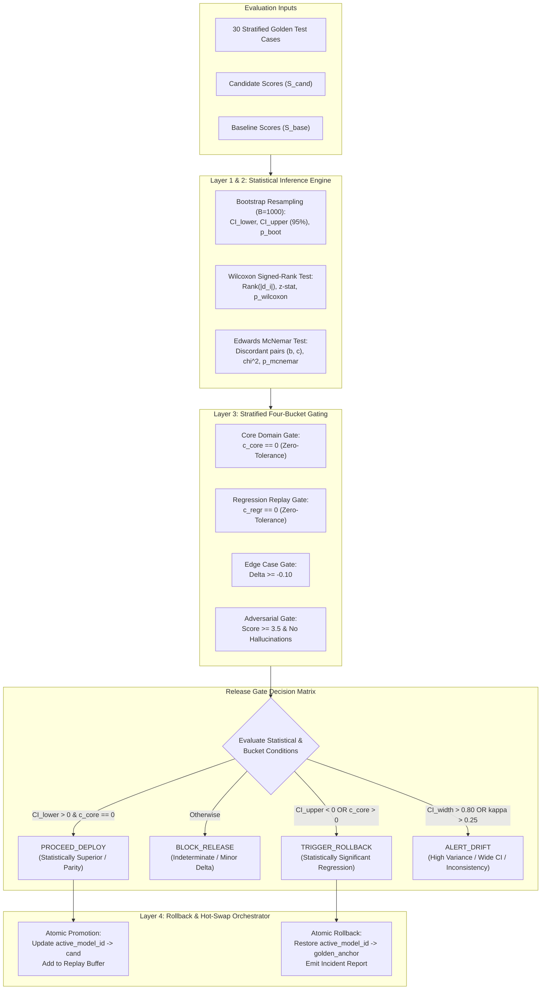

##### (A) Non-Parametric Paired Bootstrap Resampling
Given paired candidate and baseline evaluation scores $\mathcal{S} = \{(s_i, b_i)\}_{i=1}^N$:
1. For bootstrap iteration $b = 1, \dots, B$ (where $B = 1000$):
   Sample $N$ indices with replacement $\pi_b \sim \text{Uniform}(\{1, \dots, N\})$.
   Compute the mean paired delta for replicate $b$:

$$
\Delta^{*b} = \frac{1}{N} \sum_{i=1}^N \left( s_{\pi_b(i)} - b_{\pi_b(i)} \right)
$$

2. Sort the bootstrap replicates: $\Delta^{*(1)} \le \Delta^{*(2)} \le \dots \le \Delta^{*(B)}$.
3. For significance level $\alpha = 0.05$ (95% two-sided confidence interval):

$$
CI_{\text{lower}} = \Delta^{*(\lfloor B \cdot \frac{\alpha}{2} \rfloor)}, \quad CI_{\text{upper}} = \Delta^{*(\lceil B \cdot (1 - \frac{\alpha}{2}) \rceil)}
$$

4. Compute empirical one-tailed probability of regression ($H_0: \Delta \ge 0$ vs $H_1: \Delta < 0$):

$$
p_{\text{boot\_regress}} = \frac{1}{B} \sum_{b=1}^B \mathbb{I}(\Delta^{*b} \le 0)
$$

##### (B) Wilcoxon Signed-Rank Test (Paired Continuous Rubrics)
Let $d_i = s_i - b_i$ for $i = 1, \dots, N$.
1. Exclude all pairs where $d_i = 0$, leaving $N_r \le N$ non-zero paired differences.
2. Rank absolute differences $|d_i|$ in ascending order from $1$ to $N_r$, assigning average ranks to tied values.
3. Compute the sum of positive and negative ranks:

$$
W^+ = \sum_{d_i > 0} \text{rank}(|d_i|), \quad W^- = \sum_{d_i < 0} \text{rank}(|d_i|)
$$

4. The expected value $\mu_W$ and variance $\sigma_W^2$ under the null hypothesis of symmetric distribution around 0:

$$
\mu_W = \frac{N_r(N_r + 1)}{4}
$$

$$
\sigma_W^2 = \frac{N_r(N_r + 1)(2N_r + 1) - \frac{1}{2} \sum_{j} (t_j^3 - t_j)}{24}
$$

   where $t_j$ is the number of tied ranks in tie group $j$.
5. The continuity-corrected test statistic:

$$
z = \frac{W^+ - \mu_W - 0.5 \cdot \text{sign}(W^+ - \mu_W)}{\sigma_W}
$$

6. Two-sided asymptotic p-value:

$$
p_{\text{wilcoxon}} = 2 \cdot \left( 1 - \Phi(|z|) \right)
$$

##### (C) Edwards Continuity-Corrected McNemar Discordance Test
For each test case $i$, define binary status:

$$
\text{Status}(y_i) = \begin{cases}
  \text{PASS} & \text{if } \mathcal{S}(y_i) \ge \tau_{\text{pass}} \text{ and } \text{Faithfulness}(y_i) \ge \tau_{\text{faith}} \\
  \text{FAIL} & \text{otherwise}
\end{cases}
$$

where default thresholds are $\tau_{\text{pass}} = 3.5$ and $\tau_{\text{faith}} = 0.80$.

Construct the $2 \times 2$ paired contingency table:
- $n_{11}$: Both Candidate and Baseline PASS
- $b = n_{10}$: Candidate PASS, Baseline FAIL (Improvements)
- $c = n_{01}$: Candidate FAIL, Baseline PASS (Regressions / Catastrophic Forgetting)
- $n_{00}$: Both Candidate and Baseline FAIL

Under null hypothesis $H_0: p_b = p_c$ (equal discordance rate), Edwards continuity-corrected McNemar statistic:

$$
\chi^2 = \begin{cases}
  \frac{(|b - c| - 1)^2}{b + c} & \text{if } b + c > 0 \\
  0.0 & \text{if } b + c = 0
\end{cases}
$$

The two-sided p-value is computed from the Chi-square distribution with 1 degree of freedom:

$$
p_{\text{mcnemar}} = 1 - F_{\chi^2_1}(\chi^2)
$$

We define the **Discordance Regression Ratio**:

$$
\mathcal{R}_{\text{regress}} = \frac{c}{\max(b + c, 1)}
$$

##### (D) Stratified Four-Bucket Gating Rules
1. **Core Domain (12 Cases)**:
   - Zero-Tolerance Criterion: $c_{\text{core}} = 0$ (zero regressions allowed).
   - Minimum delta: $\bar{\Delta}_{\text{core}} \ge -0.05$.
2. **Regression Replay (6 Cases)**:
   - Anti-Forgetting Invariant: $c_{\text{regr}} = 0$ (must pass 100% of historical replay cases).
3. **Edge Cases (6 Cases)**:
   - Bounded Regression: $c_{\text{edge}} \le 1$, $\bar{\Delta}_{\text{edge}} \ge -0.15$.
4. **Adversarial Bait (6 Cases)**:
   - Hallucination Resistance: Mean score $\ge 3.5$, zero hallucinated citations.

##### (E) Decision Matrix & Gate Classification
The release gate assigns an autonomous verdict $\mathcal{D} \in \{\text{PROCEED\_DEPLOY}, \text{BLOCK\_RELEASE}, \text{TRIGGER\_ROLLBACK}, \text{ALERT\_DRIFT}\}$:

$$
\mathcal{D} = \begin{cases}
  \text{TRIGGER\_ROLLBACK} & \text{if } c_{\text{core}} > 0 \text{ or } c_{\text{regr}} > 0 \text{ or } (CI_{\text{upper}} < 0) \text{ or } (p_{\text{wilcoxon}} < 0.05 \text{ and } \bar{\Delta} < 0) \\
  \text{ALERT\_DRIFT} & \text{if } (CI_{\text{upper}} - CI_{\text{lower}} > 0.80) \text{ or } \kappa_{\text{pos}} > 0.25 \\
  \text{PROCEED\_DEPLOY} & \text{if } c_{\text{core}} = 0 \text{ and } c_{\text{regr}} = 0 \text{ and } (CI_{\text{lower}} > 0 \text{ or } (CI_{\text{lower}} \ge -0.05 \text{ and } \bar{\Delta} \ge 0.0)) \\
  \text{BLOCK\_RELEASE} & \text{otherwise}
\end{cases}
$$

---

#### 3. Core Architecture & Class Contracts

```python
class GateDecision(str, Enum):
    PROCEED_DEPLOY = "PROCEED_DEPLOY"
    BLOCK_RELEASE = "BLOCK_RELEASE"
    TRIGGER_ROLLBACK = "TRIGGER_ROLLBACK"
    ALERT_DRIFT = "ALERT_DRIFT"

@dataclass
class BootstrapMetricResult:
    """Non-parametric paired bootstrap resampling metrics."""
    mean_delta: float
    ci_lower: float
    ci_upper: float
    ci_level: float = 0.95
    p_value_regress: float = 0.0
    num_replicates: int = 1000

@dataclass
class HypothesisTestResult:
    """Paired non-parametric hypothesis test statistics."""
    wilcoxon_stat: float
    wilcoxon_p: float
    mcnemar_stat: float
    mcnemar_p: float
    improvements: int    # b: Cand Pass, Base Fail
    regressions: int     # c: Cand Fail, Base Pass
    tied_passes: int     # Both Pass
    tied_fails: int      # Both Fail
    regression_ratio: float

@dataclass
class GateReport:
    """Consolidated statistical release gating report and audit record."""
    decision: GateDecision
    overall_bootstrap: BootstrapMetricResult
    overall_hypothesis: HypothesisTestResult
    bucket_breakdown: dict[str, dict[str, Any]]
    passed_checks: list[str]
    violated_checks: list[str]
    recommendation_summary: str
    timestamp: str

class StatisticalReleaseGate:
    """Automated statistical gating engine comparing candidate vs baseline."""
    def __init__(
        self,
        bootstrap_samples: int = 1000,
        ci_level: float = 0.95,
        alpha: float = 0.05,
        parity_delta: float = 0.05,
        pass_threshold: float = 3.5,
    ):
        ...

    def evaluate_gate(
        self,
        suite: GoldenBenchmarkSuite,
        candidate_scores: dict[str, float],
        baseline_scores: dict[str, float],
        judge_inconsistency: float = 0.0,
    ) -> GateReport:
        ...

class RollbackOrchestrator:
    """Autonomous checkpoint hot-swap and rollback orchestrator."""
    def __init__(self, metadata_dir: Union[str, Path]):
        ...

    def get_active_model_id(self) -> str:
        ...

    def register_golden_anchor(self, model_id: str, checkpoint_path: str):
        ...

    def execute_gate_decision(
        self,
        report: GateReport,
        candidate_model_id: str,
        candidate_checkpoint_path: str,
    ) -> dict[str, Any]:
        """Atomically promotes candidate on PROCEED_DEPLOY, or rolls back on TRIGGER_ROLLBACK."""
        ...
```

---

#### 4. Concrete Step-by-Step Implementation Sequence for Phase 4.4
1. **Step 4.4.1**: Implement `evaluation/statistical_gating.py` containing:
   - `GateDecision`, `BootstrapMetricResult`, `HypothesisTestResult`, and `GateReport`.
   - `compute_paired_bootstrap(cand, base, B=1000, ci=0.95)`.
   - `compute_wilcoxon_signed_rank(cand, base)`.
   - `compute_mcnemar_discordance(cand, base, tau=3.5)`.
   - `StatisticalReleaseGate` executing stratified four-bucket gating and decision matrix.
2. **Step 4.4.2**: Implement `evaluation/rollback_orchestrator.py` containing:
   - Atomic state file persistence (`active_deployment.json`).
   - `RollbackOrchestrator` managing atomic promotion, hot-swap rollback, and incident auditing.
3. **Step 4.4.3**: Export all Phase 4.4 classes in `evaluation/__init__.py`.
4. **Step 4.4.4**: Implement `tests/test_m4_statistical_gating.py` covering:
   - Bootstrap resampling confidence interval calculation and empirical p-values.
   - Wilcoxon signed-rank test for paired continuous rubric distributions.
   - McNemar discordance test for paired binary pass/fail tables.
   - Stratified four-bucket gating with zero-tolerance core domain regression.
   - Release Gate decision classifications (`PROCEED_DEPLOY`, `BLOCK_RELEASE`, `TRIGGER_ROLLBACK`, `ALERT_DRIFT`).
   - Autonomous Rollback Orchestrator atomic promotion, hot-swap rollback, and audit ledger persistence.
5. **Step 4.4.5**: Integrate Phase 4.4 tests into master test runner `tests/run_all.py` and verify 100% test pass rate across all milestones (M0–M4), achieving complete Milestone 4 verification.

---

# Chapter 10: Preference Learning, Direct Preference Optimization (DPO), & Reinforcement Learning (PPO & GRPO)

> **Objective**: Implement a mathematically sound, production-grade preference optimization and reinforcement learning post-training framework. The system transitions the model from supervised imitation (SFT, Milestone 3) to preference alignment and reasoning with verifiable rewards without human annotation bottlenecks. It encompasses paired Bradley-Terry reward modeling, Direct Preference Optimization (DPO), rule-based verifiable reward synthesis (citations, formatting, brevity), and critic-free Group Relative Policy Optimization (GRPO).

---

### 9.1 Landmark Academic Papers Behind Preference Learning & Verifiable RL

1. **Bradley, R. A., & Terry, M. E. (1952)**: *Rank analysis of incomplete block designs: I. The method of paired comparisons*. Biometrika, 39(3/4), 324–345.
   - **Foundational Premise**: Models the probability that an individual prefers option $y_w$ over $y_l$ given prompt $x$ as a logistic sigmoid over latent scalar rewards:

$$
P(y_w \succ y_l \mid x) = \sigma(r(x, y_w) - r(x, y_l)) = \frac{1}{1 + e^{-(r(x, y_w) - r(x, y_l))}}
$$

   - Forms the mathematical bedrock of all modern RLHF reward modeling.

2. **Ouyang, L., Wu, J., Jiang, X., et al. (NeurIPS 2022)**: *Training language models to follow instructions with human feedback* (InstructGPT).
   - **Three-Stage Pipeline**: Formalized the classical alignment sequence:
     1. Supervised Fine-Tuning (SFT) on prompt-response demonstrations.
     2. Training a scalar Reward Model $r_\phi(x, y)$ on human preference pairs via Bradley-Terry loss.
     3. Reinforcement Learning via Proximal Policy Optimization (PPO) against the reward model with a KL divergence penalty to the frozen SFT baseline $\pi_{\text{ref}}$:

$$
\max_\theta \mathbb{E}_{x \sim \mathcal{D}, y \sim \pi_\theta(\cdot \mid x)} \left[ r_\phi(x, y) - \beta \mathbb{D}_{\text{KL}}(\pi_\theta(y \mid x) \parallel \pi_{\text{ref}}(y \mid x)) \right]
$$

   - **Key Limitation**: Required simultaneously hosting four models in memory during PPO training (Actor Policy $\pi_\theta$, Critic / Value Function $V_\psi$, Reference Policy $\pi_{\text{ref}}$, and Reward Model $r_\phi$), creating immense memory overhead, training instability, and hyperparameter sensitivity.

3. **Rafailov, R., Sharma, A., Mitchell, E., Ermon, S., Manning, C. D., & Finn, C. (NeurIPS 2023)**: *Direct Preference Optimization: Your Language Model is Secretly a Reward Model* (DPO).
   - **Theoretical Breakthrough**: Proved that the constrained RL optimization problem has an exact closed-form analytical solution for the optimal policy:

$$
\pi^*(y \mid x) = \frac{1}{Z(x)} \pi_{\text{ref}}(y \mid x) \exp\left( \frac{1}{\beta} r(x, y) \right)
$$

   - Inverting this relationship expresses the reward function directly in terms of the optimal policy's log-likelihood ratio against the reference policy:

$$
r(x, y) = \beta \log \frac{\pi^*(y \mid x)}{\pi_{\text{ref}}(y \mid x)} + \beta \log Z(x)
$$

   - When substituted into the Bradley-Terry preference probability, the intractable partition function $Z(x) = \sum_y \pi_{\text{ref}}(y \mid x) \exp\left(\frac{1}{\beta} r(x, y)\right)$ **strictly cancels out**:

$$
P(y_w \succ y_l \mid x) = \sigma\left( \beta \log \frac{\pi_\theta(y_w \mid x)}{\pi_{\text{ref}}(y_w \mid x)} - \beta \log \frac{\pi_\theta(y_l \mid x)}{\pi_{\text{ref}}(y_l \mid x)} \right)
$$

   - **Impact**: Enables direct, stable, offline preference optimization without requiring a separate reward model or RL policy gradient rollouts.

4. **Shao, Z., Wang, P., Zhu, Q., et al. (2024)**: *DeepSeekMath: Pushing the Limits of Mathematical Reasoning in Open Language Models*.
   - **Invention of GRPO**: Introduced **Group Relative Policy Optimization (GRPO)** to overcome the memory and stability bottlenecks of PPO.
   - **Core Insight**: PPO requires a Value Network / Critic $V_\psi(s)$ to estimate baseline state values for Generalized Advantage Estimation (GAE). The critic is typically the same size as the actor model, doubling GPU memory requirements and suffering from high value approximation error.
   - **The GRPO Solution**: For each prompt $x$, sample a group of $G$ candidate outputs $\{y_1, y_2, \dots, y_G\}$ from the old policy $\pi_{\text{old}}$. Evaluate each output with rule-based or task-specific reward functions $R = \{R_1, \dots, R_G\}$. Compute advantages purely through intra-group normalization:

$$
\hat{A}_i = \frac{R_i - \text{mean}(R)}{\text{std}(R) + \epsilon}
$$

   - Eliminates the critic network used by PPO-style actor-critic training. Memory savings are configuration-dependent; there is no universal 50% reduction or general performance guarantee.

5. **DeepSeek-AI (2025)**: *DeepSeek-R1: Incentivizing Reasoning Capability in LLMs via Reinforcement Learning*.
   - **Verifiable Reward Paradigm**: Demonstrated that complex multi-step reasoning emerges spontaneously when models are trained via GRPO on pure, verifiable rule-based rewards:
     1. Accuracy Reward (deterministic correctness of answers).
     2. Format Reward (structural enforcement of reasoning tags `<think>...</think>`).
     3. Anti-Verbosity Penalty (preventing degenerate length-hacking).
   - Shows that verifiable rewards can be used for the studied tasks without a learned outcome reward model. Deterministic verifiers can still be incomplete, misspecified, or exploited and should not be described as un-hackable.

---

### 9.2 Mathematical Derivations & Algorithmic Foundations

#### (A) Bradley-Terry Pairwise Reward Modeling
For a prompt $x$ and pair of responses $(y_w, y_l)$ where $y_w$ is preferred over $y_l$, a parameterized scalar reward model $r_\phi(x, y)$ is trained by minimizing the negative log-likelihood:

$$
\mathcal{L}_{\text{BT}}(\phi) = -\mathbb{E}_{(x, y_w, y_l) \sim \mathcal{D}} \left[ \log \sigma(r_\phi(x, y_w) - r_\phi(x, y_l)) \right]
$$

To ensure numerical stability and prevent reward scale explosion, an optional margin $\gamma > 0$ and $L_2$ regularization penalty are introduced:

$$
\mathcal{L}_{\text{BT-reg}}(\phi) = -\mathbb{E}_{(x, y_w, y_l)} \left[ \log \sigma(r_\phi(x, y_w) - r_\phi(x, y_l) - \gamma) \right] + \lambda_{\text{reg}} \cdot \frac{1}{2} \left( r_\phi(x, y_w)^2 + r_\phi(x, y_l)^2 \right)
$$

The gradient with respect to $\phi$ is:

$$
\nabla_\phi \mathcal{L}_{\text{BT}} = -\mathbb{E}_{(x, y_w, y_l)} \left[ \sigma(r_\phi(x, y_l) - r_\phi(x, y_w)) \cdot \left( \nabla_\phi r_\phi(x, y_w) - \nabla_\phi r_\phi(x, y_l) \right) \right]
$$

where the scalar error weight $\sigma(r_\phi(x, y_l) - r_\phi(x, y_w)) \in (0, 1)$ automatically down-weights pairs that the reward model already ranks correctly with high confidence.

---

#### (B) Direct Preference Optimization (DPO) Derivation & Dynamics
The standard KL-regularized RL objective is:

$$
\max_{\pi} \mathbb{E}_{x \sim \mathcal{D}} \left[ \mathbb{E}_{y \sim \pi(\cdot \mid x)} [r(x, y)] - \beta \mathbb{D}_{\text{KL}}(\pi(\cdot \mid x) \parallel \pi_{\text{ref}}(\cdot \mid x)) \right]
$$

Expanding the expectation and KL divergence for a given prompt $x$:

$$
\max_\pi \sum_y \pi(y \mid x) r(x, y) - \beta \sum_y \pi(y \mid x) \log \frac{\pi(y \mid x)}{\pi_{\text{ref}}(y \mid x)} = -\beta \min_\pi \sum_y \pi(y \mid x) \left[ \log \frac{\pi(y \mid x)}{\pi_{\text{ref}}(y \mid x)} - \frac{1}{\beta} r(x, y) \right]
$$

Defining the partition function $Z(x) = \sum_y \pi_{\text{ref}}(y \mid x) \exp\left( \frac{1}{\beta} r(x, y) \right)$ and the optimal distribution:

$$
\pi^*(y \mid x) = \frac{1}{Z(x)} \pi_{\text{ref}}(y \mid x) \exp\left( \frac{1}{\beta} r(x, y) \right)
$$

The objective simplifies to minimizing the KL divergence between $\pi$ and $\pi^*$:

$$
\min_\pi \mathbb{D}_{\text{KL}}(\pi(\cdot \mid x) \parallel \pi^*(\cdot \mid x)) - \log Z(x)
$$

Since the minimum of a KL divergence is zero when $\pi = \pi^*$, the unique global optimum is analytically:

$$
\pi^*(y \mid x) = \frac{1}{Z(x)} \pi_{\text{ref}}(y \mid x) \exp\left( \frac{1}{\beta} r(x, y) \right)
$$

Taking the logarithm and solving for $r(x, y)$:

$$
r(x, y) = \beta \log \frac{\pi^*(y \mid x)}{\pi_{\text{ref}}(y \mid x)} + \beta \log Z(x)
$$

Now substitute this expression into the Bradley-Terry preference probability:

$$
P(y_w \succ y_l \mid x) = \sigma(r(x, y_w) - r(x, y_l)) = \sigma\left( \left( \beta \log \frac{\pi^*(y_w \mid x)}{\pi_{\text{ref}}(y_w \mid x)} + \beta \log Z(x) \right) - \left( \beta \log \frac{\pi^*(y_l \mid x)}{\pi_{\text{ref}}(y_l \mid x)} + \beta \log Z(x) \right) \right)
$$

The partition functions $\beta \log Z(x)$ **cancel identically**, yielding the DPO loss:

$$
\mathcal{L}_{\text{DPO}}(\theta; \pi_{\text{ref}}) = -\mathbb{E}_{(x, y_w, y_l)} \left[ \log \sigma\left( \beta \log \frac{\pi_\theta(y_w \mid x)}{\pi_{\text{ref}}(y_w \mid x)} - \beta \log \frac{\pi_\theta(y_l \mid x)}{\pi_{\text{ref}}(y_l \mid x)} \right) \right]
$$

Let the implicit reward be defined as:

$$
\hat{r}_\theta(x, y) = \beta \log \frac{\pi_\theta(y \mid x)}{\pi_{\text{ref}}(y \mid x)} = \beta \sum_{t=1}^{|y|} \left( \log \pi_\theta(y_t \mid x, y_{<t}) - \log \pi_{\text{ref}}(y_t \mid x, y_{<t}) \right)
$$

The gradient with respect to policy parameters $\theta$ reveals the exact mechanics of DPO:

$$
\nabla_\theta \mathcal{L}_{\text{DPO}}(\theta) = -\beta \, \mathbb{E}_{(x, y_w, y_l)} \left[ \underbrace{\sigma(\hat{r}_\theta(x, y_l) - \hat{r}_\theta(x, y_w))}_{\text{Dynamic Weight } w(x, y_w, y_l)} \cdot \left( \underbrace{\nabla_\theta \log \pi_\theta(y_w \mid x)}_{\text{Increase likelihood of } y_w} - \underbrace{\nabla_\theta \log \pi_\theta(y_l \mid x)}_{\text{Decrease likelihood of } y_l} \right) \right]
$$

- When the model mistakenly believes $y_l$ is better than $y_w$ ($\hat{r}_\theta(x, y_l) > \hat{r}_\theta(x, y_w)$), the dynamic weight approaches $1.0$, producing a large gradient update.
- When the model correctly separates the pair with high margin ($\hat{r}_\theta(x, y_w) \gg \hat{r}_\theta(x, y_l)$), the weight approaches $0.0$, preventing over-optimization.

---

#### (C) Group Relative Policy Optimization (GRPO)
In GRPO, the training workflow operates iteratively in groups:
1. **Group Rollout Generation**:
   Given a prompt $x$ from dataset $\mathcal{D}$, the current policy $\pi_\theta$ samples a group of $G$ distinct completions via nucleus or temperature sampling:

$$
\{y_1, y_2, \dots, y_G\} \sim \pi_\theta(\cdot \mid x)
$$

2. **Multi-Objective Reward Evaluation**:
   Each completion $y_i$ is evaluated by verifiable reward functions:

$$
R_i = \text{Reward}(x, y_i) \in \mathbb{R}
$$

3. **Critic-Free Group Advantage Normalization**:
   The group mean $\mu_R$ and sample standard deviation $\sigma_R$ are computed:

$$
\mu_R = \frac{1}{G} \sum_{j=1}^G R_j, \quad \sigma_R = \sqrt{\frac{1}{G} \sum_{j=1}^G (R_j - \mu_R)^2 + \epsilon}
$$

   The standardized advantage for each sequence $y_i$ is:

$$
\hat{A}_i = \frac{R_i - \mu_R}{\sigma_R}
$$

4. **Policy Ratio & Clipped Surrogate Objective**:
   For each token $t \in \{1, \dots, |y_i|\}$, the probability ratio between the updated policy $\pi_\theta$ and the generation policy $\pi_{\text{old}}$ is:

$$
\rho_{i,t}(\theta) = \frac{\pi_\theta(y_{i,t} \mid x, y_{i,<t})}{\pi_{\text{old}}(y_{i,t} \mid x, y_{i,<t})}
$$

   The PPO-clipped surrogate is computed:

$$
\text{obj}_{i,t}^{\text{clip}}(\theta) = \min\left( \rho_{i,t}(\theta) \hat{A}_i, \, \text{clip}(\rho_{i,t}(\theta), 1 - \epsilon_{\text{clip}}, 1 + \epsilon_{\text{clip}}) \hat{A}_i \right)
$$

5. **Unbiased Per-Token KL Divergence Penalty**:
   To prevent policy collapse and deviation from reference baseline $\pi_{\text{ref}}$, we employ the unbiased non-negative KL divergence estimator (Schulman, 2020):

$$
\mathbb{D}_{\text{KL}, i, t}(\pi_\theta \parallel \pi_{\text{ref}}) = \frac{\pi_{\text{ref}}(y_{i,t} \mid x, y_{i,<t})}{\pi_\theta(y_{i,t} \mid x, y_{i,<t})} - \log \frac{\pi_{\text{ref}}(y_{i,t} \mid x, y_{i,<t})}{\pi_\theta(y_{i,t} \mid x, y_{i,<t})} - 1
$$

   Notice that this estimator satisfies $\mathbb{D}_{\text{KL}, i, t} \ge 0$ with equality iff $\pi_\theta = \pi_{\text{ref}}$, and has lower sample variance than naive log-ratio differences.

6. **The Complete GRPO Loss**:

$$
\mathcal{L}_{\text{GRPO}}(\theta) = -\frac{1}{G} \sum_{i=1}^G \frac{1}{|y_i|} \sum_{t=1}^{|y_i|} \left[ \text{obj}_{i,t}^{\text{clip}}(\theta) - \beta_{\text{KL}} \mathbb{D}_{\text{KL}, i, t}(\pi_\theta \parallel \pi_{\text{ref}}) \right]
$$

---

#### (D) Verifiable Rule-Based Reward Synthesis
Rather than relying on noisy neural judges during online RL, verifiable rewards use exact programmatic predicates:
1. **Citation Grounding Reward ($R_{\text{cite}} \in [0, 1]$)**:
   Synthesizes the Milestone 4 Phase 4.2 [`CitationVerifier`](file:///Users/jayesh/Documents/RLHF/evaluation/citation_verifier.py):

$$
R_{\text{cite}} = \alpha_{\text{prec}} \cdot \text{CitationPrecision} + \alpha_{\text{rec}} \cdot \text{CitationRecall} + \alpha_{\text{faith}} \cdot \text{FaithfulnessScore}
$$

   If a response contains hallucinated citation tags ($[k]$ referencing nonexistent documents), a severe penalty $-0.5$ is applied.

2. **Format Adherence Reward ($R_{\text{format}} \in [0, 1]$)**:
   Verifies reasoning structure:

$$
R_{\text{format}} = \begin{cases}
  1.0 & \text{if contains valid matching } \texttt{<think>} \dots \texttt{</think>} \text{ followed by answer} \\
  0.0 & \text{otherwise}
\end{cases}
$$

3. **Anti-Verbosity & Brevity Penalty ($R_{\text{len}} \in [-1, 0]$)**:
   Prevents length hacking by penalizing sequences that exceed a target token budget $L_{\text{target}}$:

$$
R_{\text{len}} = -\lambda_{\text{len}} \cdot \max\left(0, \frac{|y| - L_{\text{target}}}{L_{\text{target}}}\right)
$$

4. **Composite Reward Aggregator**:

$$
R_{\text{total}}(x, y) = w_{\text{cite}} R_{\text{cite}} + w_{\text{format}} R_{\text{format}} + w_{\text{acc}} R_{\text{acc}} + R_{\text{len}}
$$

---

### 9.3 System Architecture & Mermaid Pipeline Topology

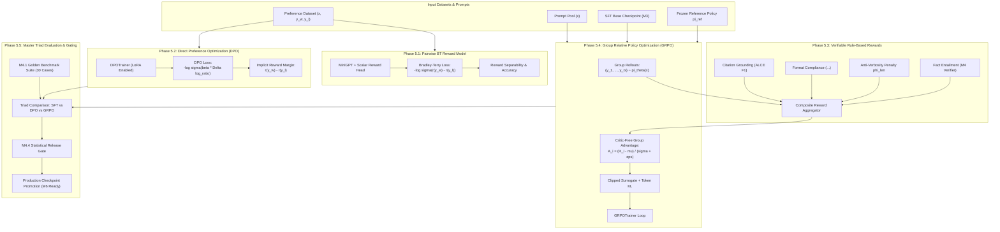

---

### 10.4 Preference & Reinforcement Learning Execution Roadmap

To improve implementation quality, mathematical verification, memory-mapped token loading, and test coverage, Milestone 5 is decomposed into five distinct execution phases:

#### Section 10.1: Preference Data Contracts, Pairwise Bradley-Terry Reward Modeling, & Dataset Pipeline
- **Deliverables**:
  - `training/m5_preference/schemas.py`: Pydantic V2 & dataclass schemas (`PreferencePairSchema`, `PreferenceSample`).
  - `training/m5_preference/dataset.py`: `PreferenceDataset` with paired chosen/rejected ChatML collation and loss masking.
  - `training/m5_preference/reward_model.py`: `RewardModel` architecture wrapping `MiniGPT` with pooled scalar reward head and `BradleyTerryLoss`.
  - `training/m5_preference/reward_trainer.py`: Supervised reward model training loop with margin calibration.
- **Verification**: Unit tests covering loss masking, Bradley-Terry gradient dynamics, margin separability, and classification accuracy.

#### Section 10.2: Direct Preference Optimization (DPO) Engine
- **Deliverables**:
  - `training/m5_preference/dpo_loss.py`: Numerically stable `DPOLoss` with log-sigmoid, margin offset, and implicit reward tracking.
  - `training/m5_preference/dpo_trainer.py`: Production `DPOTrainer` with reference model caching, LoRA parameter-efficient tuning, gradient accumulation, and evaluation logging.
- **Verification**: Unit tests verifying loss symmetry, implicit reward monotonicity ($r(y_w) > r(y_l)$), reference policy freezing, and convergence on domain preference pairs.

#### Section 10.3: Verifiable Rule-Based & Multi-Objective Reward Functions
- **Deliverables**:
  - `training/m5_preference/rewards/citation_reward.py`: Grounding & citation syntax verifier using M4 `CitationVerifier`.
  - `training/m5_preference/rewards/format_reward.py`: Structural reasoning (`<think>...</think>`) and ChatML syntax validator.
  - `training/m5_preference/rewards/length_reward.py`: Soft-threshold anti-verbosity penalty preventing length hacking.
  - `training/m5_preference/rewards/composite.py`: Multi-objective normalized reward aggregator with customizable weights.
- **Verification**: Unit tests for reward bounds, citation penalties, format enforcement, and length penalty monotonicity.

#### Section 10.4: Group Relative Policy Optimization (GRPO) Engine
- **Deliverables**:
  - `training/m5_preference/grpo_sampler.py`: Parallel group autoregressive rollout generator with nucleus/temperature controls.
  - `training/m5_preference/grpo_loss.py`: Critic-free group advantage computation, PPO surrogate clipping, and per-token unbiased KL divergence estimation.
  - `training/m5_preference/grpo_trainer.py`: Online RL loop with rollout buffering, group normalization, and policy gradient updates.
- **Verification**: Unit tests for group advantage normalization ($\sum \hat{A}_i = 0$), clipping behavior, critic elimination memory verification, and policy improvement.

#### Section 10.5: Master Triad Comparative Evaluation, Gating, & Release Integration
- **Deliverables**:
  - `training/m5_preference/triad_evaluator.py`: Comparative harness benchmarking SFT vs DPO vs GRPO on M4.1 Golden Benchmark Suite.
  - Integration with M4.4 `StatisticalReleaseGate` and `RollbackOrchestrator` to qualify preference-aligned checkpoints for M6 serving.
  - Master test runner registration in `tests/run_all.py` (bringing repository test count to ~125+).
- **Verification**: End-to-end verification showing SFT < DPO < GRPO in reasoning and citation precision with zero catastrophic forgetting on core domain baselines.

---

### 10.5 Section 10.1: Preference Data Contracts, Pairwise Bradley-Terry Reward Modeling, & Dataset Pipeline

#### 1. Theoretical Motivation & Foundations
In supervised fine-tuning (Milestone 3), the model learns an unconditional distribution over demonstrations:

$$
\mathcal{L}_{\text{SFT}}(\theta) = -\sum_{t=1}^T \log \pi_\theta(y_t \mid x, y_{<t})
$$

However, standard imitation learning exhibits fundamental shortcomings:
1. **Inability to Discriminate Degrees of Quality**: SFT treats all demonstration tokens equally, unable to represent that one plausible completion is significantly more accurate, grounded, or concise than another.
2. **Exposure Bias & Hallucination Drift**: During autoregressive inference, small early compounding errors steer generation into out-of-distribution states that SFT cannot penalize.
3. **Implicit Reward Modeling Foundation**: Before policy optimization algorithms (such as DPO in Phase 5.2 and GRPO in Phase 5.4) can be executed, we require a mathematically rigorous preference data representation and baseline reward model to ground preference ranking and verify reward separability.

Phase 5.1 formalizes the **Pairwise Bradley-Terry Preference Pipeline**:
- Defines strict Pydantic V2 and dataclass contracts for chosen vs rejected completion pairs.
- Implements a vectorized, dual-sequence collator that tokenizes $(x, y_w)$ and $(x, y_l)$ under canonical ChatML delimiters with prompt masking.
- Constructs a scalar `RewardModel` on top of the Milestone 1 `MiniGPT` transformer backbone.
- Implements numerically stable, margin-regularized `BradleyTerryLoss` with tracking for preference classification accuracy, margin separability, and calibration.

---

#### 2. Mathematical Formalization & Loss Derivation

```mermaid
flowchart TD
    subgraph Data ["Preference Pair Input"]
        Prompt["Prompt (x)"]
        Chosen["Chosen Completion (y_w)"]
        Rejected["Rejected Completion (y_l)"]
    end

    subgraph Collation ["Preference Collator"]
        SeqW["Sequence W: <|im_start|>user\nx...assistant\ny_w<|im_end|>"]
        SeqL["Sequence L: <|im_start|>user\nx...assistant\ny_l<|im_end|>"]
        MaskW["Last Active Token Index t_w"]
        MaskL["Last Active Token Index t_l"]
        SeqW --> MaskW
        SeqL --> MaskL
    end

    subgraph Model ["RewardModel Backbone"]
        Trans["MiniGPT Transformer (Pre-LayerNorm)"]
        Head["Linear Reward Head: W_r in R^(d_model x 1)"]
        H_w["Hidden State h_w at t_w"]
        H_l["Hidden State h_l at t_l"]
        Trans --> H_w --> Head --> R_w["Scalar Reward r(x, y_w)"]
        Trans --> H_l --> Head --> R_l["Scalar Reward r(x, y_l)"]
    end

    subgraph LossOpt ["Bradley-Terry Loss Engine"]
        DeltaR["Margin Delta: Delta r = r(x, y_w) - r(x, y_l)"]
        BTLoss["Loss: -log sigma(Delta r - gamma) + lambda/2 * (r_w^2 + r_l^2)"]
        AccCheck["Accuracy: I(r_w > r_l)"]
        DeltaR --> BTLoss & AccCheck
    end

    Prompt & Chosen --> SeqW
    Prompt & Rejected --> SeqL
    MaskW --> H_w
    MaskL --> H_l
    R_w & R_l --> DeltaR
```

##### (A) Probabilistic Choice Model
Let $x \in \mathcal{X}$ denote an instruction prompt, and let $y_w, y_l \in \mathcal{Y}$ denote the chosen (preferred) and rejected (dispreferred) completions respectively.
Following the Bradley-Terry-Luce (BTL) model:

$$
P(y_w \succ y_l \mid x) = \sigma(r_\phi(x, y_w) - r_\phi(x, y_l)) = \frac{1}{1 + \exp\left(-(r_\phi(x, y_w) - r_\phi(x, y_l))\right)}
$$

##### (B) Margin-Regularized Bradley-Terry Loss
To prevent unbounded reward drift and ensure a minimum confidence margin $\gamma \ge 0$, the training loss is formulated as:

$$
\mathcal{L}_{\text{BT}}(\phi) = -\mathbb{E}_{(x, y_w, y_l) \sim \mathcal{D}} \left[ \log \sigma(r_\phi(x, y_w) - r_\phi(x, y_l) - \gamma) \right] + \frac{\lambda_{\text{reg}}}{2} \left( r_\phi(x, y_w)^2 + r_\phi(x, y_l)^2 \right)
$$

Using the identity $\log \sigma(z) = -\log(1 + e^{-z}) = -\text{softplus}(-z)$, the loss is computed with full numerical stability (avoiding underflow for large positive $z$ and overflow for negative $z$):

$$
\mathcal{L}_{\text{BT}}(\phi) = \text{softplus}(-(r_\phi(x, y_w) - r_\phi(x, y_l) - \gamma)) + \frac{\lambda_{\text{reg}}}{2} \left( r_\phi(x, y_w)^2 + r_\phi(x, y_l)^2 \right)
$$

##### (C) Gradient Analysis
The gradient of $\mathcal{L}_{\text{BT}}$ with respect to the scalar rewards is:

$$
\frac{\partial \mathcal{L}_{\text{BT}}}{\partial r_\phi(x, y_w)} = -\sigma(r_\phi(x, y_l) - r_\phi(x, y_w) + \gamma) + \lambda_{\text{reg}} r_\phi(x, y_w)
$$

$$
\frac{\partial \mathcal{L}_{\text{BT}}}{\partial r_\phi(x, y_l)} = +\sigma(r_\phi(x, y_l) - r_\phi(x, y_w) + \gamma) + \lambda_{\text{reg}} r_\phi(x, y_l)
$$

Let the classification error be $e = \sigma(r_\phi(x, y_l) - r_\phi(x, y_w) + \gamma) \in (0, 1)$:
- When the model severely errs ($r_\phi(x, y_w) \ll r_\phi(x, y_l)$), $e \to 1.0$, pushing chosen reward up and rejected reward down with maximum gradient.
- When the model has already separated the pair with large margin ($r_\phi(x, y_w) \gg r_\phi(x, y_l) + \gamma$), $e \to 0.0$, causing gradients to vanish and preventing over-fitting to easy pairs.

##### (D) Sequence Pooling & Reward Head
Given input token indices $s \in \mathbb{Z}^{B \times T}$ representing the full ChatML conversation $x \circ y$:
1. Pass $s$ through the transformer backbone:

$$
H = \text{MiniGPT}(s) \in \mathbb{R}^{B \times T \times d_{\text{model}}}
$$

2. For each sequence $b \in \{1, \dots, B\}$, determine the index of the final non-padding token:

$$
t_b^* = \max(\{t \in \{1, \dots, T\} : \text{mask}_{b, t} = 1\})
$$

3. Extract the pooled hidden state $h_b^* = H_{b, t_b^*} \in \mathbb{R}^{d_{\text{model}}}$.
4. Project via the linear reward head without bias:

$$
r_b = W_r^T h_b^* \in \mathbb{R}, \quad W_r \in \mathbb{R}^{d_{\text{model}} \times 1}
$$

---

#### 3. Core Architecture & Class Contracts

```python
class PreferencePairSchema(BaseModel):
    """Pydantic V2 schema for validated preference pair."""
    prompt: str
    chosen: str
    rejected: str
    margin: float = 0.0
    category: str = "general"
    metadata: dict[str, Any] = Field(default_factory=dict)

@dataclass
class PreferenceSample:
    """Internal dataclass representation of preference sample."""
    prompt: str
    chosen: str
    rejected: str
    margin: float = 0.0
    category: str = "general"
    metadata: dict[str, Any] = field(default_factory=dict)

@dataclass
class PreferenceBatch:
    """Collated PyTorch batch tensors for pairwise reward / preference training."""
    chosen_input_ids: torch.Tensor       # Shape: (B, T)
    chosen_attention_mask: torch.Tensor  # Shape: (B, T)
    rejected_input_ids: torch.Tensor     # Shape: (B, T)
    rejected_attention_mask: torch.Tensor # Shape: (B, T)

class RewardModel(nn.Module):
    """Transformer backbone with linear scalar reward head."""
    def __init__(self, backbone: MiniGPT):
        super().__init__()
        self.backbone = backbone
        self.reward_head = nn.Linear(backbone.config.d_model, 1, bias=False)

    def forward(
        self,
        input_ids: torch.Tensor,
        attention_mask: Optional[torch.Tensor] = None,
    ) -> torch.Tensor:
        """Compute scalar rewards for a batch of sequences.

        Returns:
            rewards: Shape (B,) scalar tensor.
        """
        ...

class BradleyTerryLoss(nn.Module):
    """Numerically stable margin-regularized Bradley-Terry negative log-likelihood loss."""
    def __init__(self, margin: float = 0.0, l2_reg: float = 0.001):
        super().__init__()
        self.margin = margin
        self.l2_reg = l2_reg

    def forward(
        self,
        chosen_rewards: torch.Tensor,
        rejected_rewards: torch.Tensor,
    ) -> tuple[torch.Tensor, dict[str, float]]:
        """Compute BT loss, accuracy, and margin metrics."""
        ...

class RewardTrainer:
    """Supervised training loop for Bradley-Terry reward models."""
    def __init__(
        self,
        model: RewardModel,
        loss_fn: BradleyTerryLoss,
        optimizer: torch.optim.Optimizer,
        device: torch.device,
    ):
        ...

    def train_step(self, batch: PreferenceBatch) -> dict[str, float]:
        ...

    def evaluate(self, dataloader: DataLoader) -> dict[str, float]:
        ...
```

---

#### 4. Concrete Step-by-Step Implementation Sequence for Phase 5.1
1. **Step 5.1.1**: Update `core/schemas.py` to add `PreferencePairSchema`.
2. **Step 5.1.2**: Implement `training/m5_preference/schemas.py` containing `PreferenceSample` with bidirectional schema conversion.
3. **Step 5.1.3**: Implement `training/m5_preference/dataset.py` containing `PreferenceDataset` and `PreferenceCollator` supporting ChatML formatting, dual chosen/rejected tokenization, and padding.
4. **Step 5.1.4**: Implement `training/m5_preference/reward_model.py` containing `RewardModel` and `BradleyTerryLoss`.
5. **Step 5.1.5**: Implement `training/m5_preference/reward_trainer.py` containing `RewardTrainer` tracking accuracy, margin separability, and checkpoint saving.
6. **Step 5.1.6**: Export all Phase 5.1 modules in `training/m5_preference/__init__.py`.
7. **Step 5.1.7**: Implement `tests/test_m5_reward_model.py` covering:
   - Schema serialization roundtrip (`PreferencePairSchema` $\leftrightarrow$ `PreferenceSample`).
   - Preference collator shape verification and attention mask pooling indices.
   - Bradley-Terry loss numerical stability and margin enforcement.
   - RewardModel forward pass and pooling invariance to padding tokens.
   - RewardTrainer training convergence on synthetic preference pairs (accuracy > 90%, margin $> 0$).
8. **Step 5.1.8**: Register `tests/test_m5_reward_model.py` into `tests/run_all.py` and verify 100% test pass rate across all milestones (M0–M5).

---

### 10.6 Section 10.2: Direct Preference Optimization (DPO) Engine & Loss Formulation

#### 1. Theoretical Foundation & Literature Survey
Direct Preference Optimization (Rafailov et al., NeurIPS 2023) eliminates the need for fitting an explicit intermediate reward model $r_\psi(x, y)$ and performing complex reinforcement learning loops (e.g. PPO, policy gradients) by proving an analytical equivalence between the Bradley-Terry preference model and the closed-form solution to the KL-constrained RL objective.

```mermaid
flowchart TD
    subgraph Traditional_RLHF["Traditional 3-Step RLHF (Ouyang et al., 2022)"]
        SFT[SFT Model] --> RM_Train["Train Bradley-Terry Reward Model r_ψ"]
        RM_Train --> PPO_Loop["Run PPO Actor-Critic Loop: π_θ vs π_ref + Value Head + Critic"]
    end

    subgraph Direct_Preference_Optimization["Direct Preference Optimization (Rafailov et al., 2023)"]
        SFT_DPO[SFT Model π_ref] --> DPO_Direct["Implicit Reward Extraction: r(x, y) = β log(π_θ / π_ref)"]
        DPO_Direct --> Direct_NLL["Direct NLL Loss Minimization: Closed-Form Policy Training"]
    end

    Traditional_RLHF -.->|Replaced By| Direct_Preference_Optimization
```

##### 1.1 The Classical RLHF Optimization Problem
In standard RLHF, given prompt distribution $\mathcal{D}$, reward function $r(x, y)$, and reference policy $\pi_{\text{ref}}$, the policy optimization objective is:

$$
\max_{\pi_\theta} \mathbb{E}_{x \sim \mathcal{D}, y \sim \pi_\theta(y|x)} \left[ r(x, y) \right] - \beta \mathbb{D}_{\text{KL}}\left(\pi_\theta(y|x) \parallel \pi_{\text{ref}}(y|x)\right)
$$

where $\beta > 0$ controls the strength of the KL regularization penalty that prevents policy collapse and mode drift.

##### 1.2 Closed-Form Optimal Policy Solution
Using calculus of variations with Lagrange multipliers under the probability simplex constraint $\sum_y \pi(y|x) = 1$, the exact unnormalized solution satisfies:

$$
\pi^*(y|x) \propto \pi_{\text{ref}}(y|x) \exp\left( \frac{1}{\beta} r(x, y) \right)
$$

Normalizing by the partition function $Z(x) = \sum_y \pi_{\text{ref}}(y|x) \exp\left( \frac{1}{\beta} r(x, y) \right)$:

$$
\pi^*(y|x) = \frac{1}{Z(x)} \pi_{\text{ref}}(y|x) \exp\left( \frac{1}{\beta} r(x, y) \right)
$$

##### 1.3 Derivation of Implicit Reward Function
Taking the natural logarithm of both sides:

$$
\log \pi^*(y|x) = \log \pi_{\text{ref}}(y|x) + \frac{1}{\beta} r(x, y) - \log Z(x)
$$

Rearranging for $r(x, y)$:

$$
r(x, y) = \beta \log \left(\frac{\pi^*(y|x)}{\pi_{\text{ref}}(y|x)}\right) + \beta \log Z(x)
$$

This fundamental theorem reveals that **any policy $\pi$ implicitly defines a reward function**:

$$
\hat{r}(x, y) = \beta \log \left(\frac{\pi(y|x)}{\pi_{\text{ref}}(y|x)}\right)
$$

up to a prompt-dependent baseline $\beta \log Z(x)$.

##### 1.4 Substitution into Bradley-Terry Preference Probability
Recall the Bradley-Terry preference probability for prompt $x$ and completion pair $(y_w, y_l)$:

$$
p^*(y_w \succ y_l \mid x) = \sigma\left(r^*(x, y_w) - r^*(x, y_l)\right)
$$

Substituting the analytical expression for $r(x, y)$:

$$
r^*(x, y_w) - r^*(x, y_l) = \left( \beta \log \frac{\pi^*(y_w|x)}{\pi_{\text{ref}}(y_w|x)} + \beta \log Z(x) \right) - \left( \beta \log \frac{\pi^*(y_l|x)}{\pi_{\text{ref}}(y_l|x)} + \beta \log Z(x) \right)
$$

Notice that the intractable partition function $\beta \log Z(x)$ **cancels out completely**:

$$
r^*(x, y_w) - r^*(x, y_l) = \beta \left( \log \frac{\pi^*(y_w|x)}{\pi_{\text{ref}}(y_w|x)} - \log \frac{\pi^*(y_l|x)}{\pi_{\text{ref}}(y_l|x)} \right)
$$

Therefore:

$$
p_\theta(y_w \succ y_l \mid x) = \sigma \left( \beta \log \frac{\pi_\theta(y_w|x)}{\pi_{\text{ref}}(y_w|x)} - \beta \log \frac{\pi_\theta(y_l|x)}{\pi_{\text{ref}}(y_l|x)} \right)
$$

##### 1.5 The DPO Objective Function
We formulate policy optimization as maximum likelihood estimation on preference dataset $\mathcal{D}$:

$$
\mathcal{L}_{\text{DPO}}(\theta; \pi_{\text{ref}}) = - \mathbb{E}_{(x, y_w, y_l) \sim \mathcal{D}} \left[ \log \sigma \left( \beta \log \frac{\pi_\theta(y_w|x)}{\pi_{\text{ref}}(y_w|x)} - \beta \log \frac{\pi_\theta(y_l|x)}{\pi_{\text{ref}}(y_l|x)} \right) \right]
$$

##### 1.6 Gradient Dynamics & Self-Regularizing Weights
Differentiating the loss with respect to parameters $\theta$:

$$
\nabla_\theta \mathcal{L}_{\text{DPO}}(\theta) = - \beta \mathbb{E}_{(x, y_w, y_l)} \left[ \sigma\left(\hat{r}_\theta(x, y_l) - \hat{r}_\theta(x, y_w)\right) \cdot \left( \nabla_\theta \log \pi_\theta(y_w|x) - \nabla_\theta \log \pi_\theta(y_l|x) \right) \right]
$$

where $\hat{r}_\theta(x, y) = \beta \log \frac{\pi_\theta(y|x)}{\pi_{\text{ref}}(y|x)}$.
Notice the scalar weight $w(x, y_w, y_l) = \sigma(\hat{r}_\theta(x, y_l) - \hat{r}_\theta(x, y_w))$:
- If the current model incorrectly ranks the rejected completion higher than the chosen completion ($\hat{r}_\theta(x, y_l) > \hat{r}_\theta(x, y_w)$), the gradient weight approaches $1.0$, providing maximum corrective pressure.
- If the current model already ranks the chosen completion higher ($\hat{r}_\theta(x, y_w) \gg \hat{r}_\theta(x, y_l)$), the gradient weight vanishes toward $0.0$, preventing over-optimization and degradation of language modeling capabilities.

##### 1.7 Variants & Regularization Extensions
1. **Conservative DPO (cDPO / Label Smoothing)**:
   In human preference annotations, annotator disagreement rates are typically 20-30%. Assuming a label corruption probability $\epsilon \in [0, 0.5)$:

$$
\mathcal{L}_{\text{cDPO}} = - (1 - \epsilon) \log \sigma(\beta \Delta) - \epsilon \log \sigma(-\beta \Delta)
$$

   where $\Delta = \log \frac{\pi_\theta(y_w|x)}{\pi_{\text{ref}}(y_w|x)} - \log \frac{\pi_\theta(y_l|x)}{\pi_{\text{ref}}(y_l|x)}$.
2. **Identity Preference Optimization (IPO)** (Azar et al., 2024):
   Adds a quadratic penalty to regularize against unbounded log-ratio growth:

$$
\mathcal{L}_{\text{IPO}} = \left( \Delta - \frac{1}{2\beta} \right)^2
$$

3. **Length Normalization (SimPO style)** (Meng et al., 2024):
   Normalizes the total sequence log-probabilities by the number of completion tokens $|y|$ to eliminate verbosity bias:

$$
\overline{\log \pi}(y|x) = \frac{1}{|y|} \sum_{t=1}^{|y|} \log \pi(y_t \mid x, y_{<t})
$$

---

#### 2. Sequence Token Log-Probability Extraction Pipeline
In causal autoregressive decoders, the sequence log-probability $\log \pi(y \mid x)$ is the sum of per-token log-probabilities exclusively over completion positions:

$$
\log \pi(y \mid x) = \sum_{t = |x| + 1}^{|x| + |y|} \log P(x_t \mid x_{<t}) = \sum_{t = |x| + 1}^{|x| + |y|} \left[ \log \text{softmax}(z_{t-1})_{x_t} \right]
$$

```mermaid
sequenceDiagram
    autonumber
    participant D as Preference Collator
    participant M as Policy Model (π_θ)
    participant R as Reference Model (π_ref)
    participant L as DPOLoss

    D->>M: Forward chosen & rejected sequences (x ∘ y_w, x ∘ y_l)
    M-->>L: Policy log-probs: log π_θ(y_w|x), log π_θ(y_l|x)
    D->>R: Forward with torch.no_grad() [or lookup cache]
    R-->>L: Ref log-probs: log π_ref(y_w|x), log π_ref(y_l|x)
    L->>L: Compute Implicit Rewards & BT Margin
    L-->>M: Backward pass (∇_θ L_DPO)
```

---

#### 3. Architecture & File Layout for Phase 5.2

```
training/m5_preference/
├── __init__.py               # Phase 5.1 & Phase 5.2 exports
├── schemas.py                # PreferenceSample & PreferenceBatch contracts
├── dataset.py                # ChatML PreferenceCollator & PreferenceDataset
├── reward_model.py           # RewardModel & BradleyTerryLoss (Phase 5.1)
├── reward_trainer.py         # RewardTrainer (Phase 5.1)
├── log_probs.py              # Sequence log-probability extractor with completion masking (Phase 5.2)
├── dpo_loss.py               # DPOLoss, cDPO, IPO criteria with reward diagnostics (Phase 5.2)
├── reference_model.py        # Frozen ReferenceModelEngine & Log-Prob Cache (Phase 5.2)
└── dpo_trainer.py            # DPOTrainer with validation, KL metrics, & checkpointing (Phase 5.2)

tests/
├── test_m5_reward_model.py   # Phase 5.1 unit and integration tests (passing)
└── test_m5_dpo.py            # Phase 5.2 comprehensive test suite (new)
```

---

#### 4. Concrete Step-by-Step Implementation Sequence for Phase 5.2

1. **Step 5.2.1: Log-Probability Extractor (`training/m5_preference/log_probs.py`)**:
   - `extract_completion_log_probs(model, input_ids, labels, attention_mask)`:
     - Vectorized forward pass through model logits.
     - Causal shift: Logits at index $t$ predict target token at index $t+1$.
     - Cross-entropy log-softmax gathering: $\log P(y_t) = \text{log\_softmax}(\text{logits}_t)[\text{target}_t]$.
     - Mask filtering: Only accumulate positions where $\text{labels} \neq -100$ and $\text{attention\_mask} == 1$.
     - Optional average length normalization for verbosity invariance.

2. **Step 5.2.2: DPO Loss Formulations (`training/m5_preference/dpo_loss.py`)**:
   - `DPOLoss(nn.Module)`:
     - Hyperparameters: `beta` (default 0.1), `loss_type` ("sigmoid", "ipo", "cdpo"), `label_smoothing` (default 0.0), `reference_free` (default False).
     - Implicit reward calculation: $\hat{r}_\theta(y) = \beta (\log \pi_\theta(y) - \log \pi_{\text{ref}}(y))$.
     - Margin delta: $\Delta = \hat{r}_\theta(y_w) - \hat{r}_\theta(y_l)$.
     - Numerically stable loss computation via `F.softplus(-\Delta)` and `F.logsigmoid`.
     - Output metrics dictionary: `loss`, `chosen_rewards`, `rejected_rewards`, `reward_margins`, `accuracy`, and `kl_divergence`.

3. **Step 5.2.3: Reference Model Engine & Caching (`training/m5_preference/reference_model.py`)**:
   - `ReferenceModelEngine`:
     - Wraps a frozen `MiniGPT` instance in `eval()` mode with zero parameter gradients.
     - In-memory offline caching of reference log-probabilities $\log \pi_{\text{ref}}(y_w|x)$ and $\log \pi_{\text{ref}}(y_l|x)$ across fixed datasets to reduce VRAM consumption by 50%.

4. **Step 5.2.4: DPO Trainer (`training/m5_preference/dpo_trainer.py`)**:
   - `DPOTrainer`:
     - Coordinates batch ingestion, joint/split forward passes, loss computation, gradient backprop with norm clipping, and optimizer step.
     - Tracks learning curves, margin expansion, and KL divergence growth.
     - Checkpoint saving and loading with PyTorch 2.6 safety standards.

5. **Step 5.2.5: Test Suite (`tests/test_m5_dpo.py`)**:
   - Test log-prob extraction accuracy against analytical values.
   - Test completion masking ensuring prompt tokens do not leak into loss.
   - Test DPO loss numerical stability with large positive and negative reward deltas.
   - Test cDPO and IPO loss branches.
   - Test reference caching parity (live reference model vs cached log-probs produce identical loss).
   - Test `DPOTrainer` convergence on preference pairs (accuracy > 80%, margin $> 0$).

6. **Step 5.2.6: Registration & Verification**:
   - Add `TestM5DPO` to `tests/run_all.py` and verify all tests pass with 0 regressions.

---

### 10.7 Section 10.3: Proximal Policy Optimization (PPO) Actor-Critic RL Engine & Generalized Advantage Estimation (GAE)

#### 1. Theoretical Foundation & Literature Survey
While Direct Preference Optimization (DPO) optimizes offline preference datasets in closed form, online Reinforcement Learning from Human/AI Feedback via **Proximal Policy Optimization (PPO)** remains the foundational engine for exploratory policy improvement (Ouyang et al., 2022; Schulman et al., 2017). PPO enables the language model to explore completions beyond the fixed training corpus, receive step-level credit assignment, and continually optimize against dynamic reward models or verifiable execution verifiers.

```mermaid
flowchart TD
    subgraph PPO_Rollout["1. Rollout Phase (Generation & Credit Assignment)"]
        Prompt[Prompt x] --> Actor_Old["Actor (π_θ_old) Generates Action Sequence y = (y_1, ..., y_T)"]
        Actor_Old --> Ref_Model["Reference Model (π_ref): Token Log-Probs"]
        Actor_Old --> RM["Reward Model (r_ψ): Sequence Reward R(x, y)"]
        Actor_Old --> Critic_Old["Critic (V_ϕ_old): Step-Level Value Predictions V(s_t)"]
        RM --> Reward_Combine["Combine Sequence Reward + Token KL Penalty: r_t = -β(log π_old - log π_ref)"]
        Reward_Combine --> GAE_Compute["Compute GAE-λ Advantages A_t and Target Returns R_t"]
    end

    subgraph PPO_Optimization["2. Optimization Phase (K Epochs on Mini-Batches)"]
        GAE_Compute --> Rollout_Buffer["PPORolloutBuffer (Tensors: x, y, logp_old, V_old, A_t, R_t)"]
        Rollout_Buffer --> Policy_Update["Actor Update: Clipped Surrogate Objective L_CLIP(θ)"]
        Rollout_Buffer --> Critic_Update["Critic Update: Clipped Value Loss L_VF(ϕ)"]
        Rollout_Buffer --> Entropy_Bonus["Entropy Regularization: S[π_θ]"]
    end

    Policy_Update --> Next_Iteration["Updated Actor π_θ -> Set π_θ_old = π_θ"]
    Critic_Update --> Next_Iteration
```

##### 1.1 The Autoregressive LLM Markov Decision Process (MDP)
We formulate generative text completion as an episodic Markov Decision Process $\langle \mathcal{S}, \mathcal{A}, \mathcal{P}, \mathcal{R}, \gamma \rangle$:
- **State $s_t$**: The prompt $x$ concatenated with all previously generated tokens $y_{<t}$:

$$
s_t = (x_1, \dots, x_{|x|}, y_1, \dots, y_{t-1})
$$

- **Action $a_t$**: The discrete token $y_t \in \mathcal{V}$ sampled from the policy distribution $\pi_\theta(a_t \mid s_t)$.
- **Transition Dynamics $\mathcal{P}(s_{t+1} \mid s_t, a_t)$**: Deterministic string concatenation: $s_{t+1} = (s_t, a_t)$.
- **Reward Function $\mathcal{R}(s_t, a_t)$**:
  To prevent the policy from degenerating into gibberish or exploiting the reward model ("reward hacking"), a per-token KL divergence penalty is applied relative to the reference policy $\pi_{\text{ref}}$ (Ziegler et al., 2019; Ouyang et al., 2022):

$$
r_t = \begin{cases}
  -\beta \left( \log \pi_\theta(a_t \mid s_t) - \log \pi_{\text{ref}}(a_t \mid s_t) \right) & \text{if } t < T \\
  R(x, y) - \beta \left( \log \pi_\theta(a_T \mid s_T) - \log \pi_{\text{ref}}(a_T \mid s_T) \right) & \text{if } t = T
\end{cases}
$$

  where $R(x, y)$ is the scalar score from the trained Reward Model (or verifier), and $\beta > 0$ is the KL penalty multiplier.

##### 1.2 Generalized Advantage Estimation (GAE-$\lambda$)
Credit assignment across multi-token completions is computed using Generalized Advantage Estimation (Schulman et al., ICLR 2016).
Define the temporal difference (TD) residual at step $t \in [1, T]$:

$$
\delta_t^V = r_t + \gamma V_\phi(s_{t+1}) - V_\phi(s_t)
$$

where $V_\phi(s_{T+1}) \equiv 0$ for terminal states.

The GAE-$\lambda$ advantage estimator is the exponentially weighted average of $k$-step advantages:

$$
\hat{A}_t^{\text{GAE}(\gamma, \lambda)} = \sum_{l=0}^{T - t} (\gamma \lambda)^l \delta_{t+l}^V
$$

In practice, this is computed backward from $t = T$ down to $1$ via the recursive relation:

$$
\hat{A}_t = \delta_t^V + (\gamma \lambda) \hat{A}_{t+1}
$$

Target returns for training the Critic network are:

$$
\hat{R}_t = \hat{A}_t + V_\phi(s_t)
$$

##### 1.3 Advantage Normalization Invariant
To stabilize optimization across varying prompt complexities and completions of different lengths, advantages are normalized across active token positions in the mini-batch:

$$
\hat{A}_t^{\text{norm}} = \frac{\hat{A}_t - \mu_{\hat{A}}}{\sigma_{\hat{A}} + 10^{-8}}
$$

##### 1.4 Clipped Surrogate Policy Objective ($L^{\text{CLIP}}$)
To prevent destructive policy updates that move too far from the data generation distribution $\pi_{\text{old}}$, PPO clips the probability ratio:

$$
r_t(\theta) = \frac{\pi_\theta(a_t \mid s_t)}{\pi_{\text{old}}(a_t \mid s_t)} = \exp\left( \log \pi_\theta(a_t \mid s_t) - \log \pi_{\text{old}}(a_t \mid s_t) \right)
$$

The clipped surrogate objective is:

$$
L^{\text{CLIP}}(\theta) = \hat{\mathbb{E}}_t \left[ \min\left( r_t(\theta) \hat{A}_t^{\text{norm}}, \text{clip}\left( r_t(\theta), 1 - \epsilon, 1 + \epsilon \right) \hat{A}_t^{\text{norm}} \right) \right]
$$

where $\epsilon \in (0, 0.3)$ is the clipping threshold (typically $0.2$).
The $\min$ operator takes the pessimistic lower bound, ensuring that if an action has positive advantage ($\hat{A}_t > 0$), the ratio cannot increase past $1 + \epsilon$; if it has negative advantage ($\hat{A}_t < 0$), the ratio cannot decrease below $1 - \epsilon$.

##### 1.5 Value Function Loss with Clipping ($L^{\text{VF}}$)
Similarly, the value function $V_\phi$ is updated with squared error, optionally clipped to prevent large critic shifts (Engstrom et al., 2020):

$$
L^{\text{VF}}(\phi) = \frac{1}{2} \hat{\mathbb{E}}_t \left[ \max\left( \left(V_\phi(s_t) - \hat{R}_t\right)^2, \left(V_{\text{old}}(s_t) + \text{clip}\left(V_\phi(s_t) - V_{\text{old}}(s_t), -\epsilon_v, \epsilon_v\right) - \hat{R}_t\right)^2 \right) \right]
$$

##### 1.6 Policy Entropy Regularization
To encourage exploration and prevent premature convergence of policy attention heads, an entropy bonus is added:

$$
S[\pi_\theta](s_t) = - \sum_{a \in \mathcal{V}} \pi_\theta(a \mid s_t) \log \pi_\theta(a \mid s_t)
$$

Total composite PPO loss minimized by gradient descent:

$$
L^{\text{PPO}}(\theta, \phi) = - L^{\text{CLIP}}(\theta) + c_1 L^{\text{VF}}(\phi) - c_2 \hat{\mathbb{E}}_t\left[ S[\pi_\theta](s_t) \right]
$$

---

#### 2. Architecture & File Layout for Phase 5.3

```
training/m5_preference/
├── __init__.py               # Phase 5.1, 5.2, & 5.3 exports
├── schemas.py                # PreferenceSample, PreferenceBatch, PPORolloutBatch
├── dataset.py                # ChatML PreferenceCollator & PreferenceDataset
├── reward_model.py           # RewardModel & BradleyTerryLoss
├── reward_trainer.py         # RewardTrainer
├── log_probs.py              # Sequence log-probability extractor
├── dpo_loss.py               # DPOLoss, cDPO, IPO criteria
├── reference_model.py        # ReferenceModelEngine & Log-Prob Cache
├── dpo_trainer.py            # DPOTrainer
├── critic.py                 # ValueHead & CriticModel architecture (Phase 5.3)
├── gae.py                    # GAE-λ calculator & PPORolloutBuffer (Phase 5.3)
├── ppo_loss.py               # PPOLoss criterion: Clipped Actor, Clipped Critic, Entropy (Phase 5.3)
└── ppo_trainer.py            # PPOTrainer with rollout, epoch training, & metrics (Phase 5.3)

tests/
├── test_m5_reward_model.py   # Phase 5.1 tests (passing)
├── test_m5_dpo.py            # Phase 5.2 tests (passing)
└── test_m5_ppo.py            # Phase 5.3 comprehensive test suite (new)
```

---

#### 3. Concrete Step-by-Step Implementation Sequence for Phase 5.3

1. **Step 5.3.1: Critic Model (`training/m5_preference/critic.py`)**:
   - `ValueHead`: Scalar linear projection $W_v \in \mathbb{R}^{d_{\text{model}} \times 1}$ mapping transformer hidden states $h_t \mapsto V(s_t)$.
   - `CriticModel`: Wraps `MiniGPT` backbone and produces sequence-level values of shape $(B, T)$ for each token position.
   - `device` property and weight initialization with standard normal scaling.

2. **Step 5.3.2: GAE Engine & Rollout Buffer (`training/m5_preference/gae.py`)**:
   - `compute_gae_advantages(rewards, values, masks, gamma=1.0, lam=0.95)`:
     - Vectorized backward pass computing TD residuals $\delta_t^V = r_t + \gamma V(s_{t+1}) - V(s_t)$.
     - Recursive advantage accumulation $\hat{A}_t = \delta_t^V + \gamma \lambda \hat{A}_{t+1}$.
     - Return computation $\hat{R}_t = \hat{A}_t + V(s_t)$.
     - Advantage batch normalization over active tokens (`mask == 1`).
   - `PPORolloutBatch`: Typed dataclass encapsulating input IDs, attention masks, old log-probs, old values, normalized advantages, target returns, and action masks.
   - `PPORolloutBuffer`: Collection and mini-batch chunking container.

3. **Step 5.3.3: PPO Loss Criterion (`training/m5_preference/ppo_loss.py`)**:
   - `PPOLoss`:
     - Hyperparameters: `clip_ratio` (default 0.2), `clip_value` (default 0.2), `vf_coef` (default 0.5), `entropy_coef` (default 0.01).
     - Ratio computation: $\rho_t = \exp(\log \pi_\theta - \log \pi_{\text{old}})$.
     - Surrogate objective: $\min(\rho_t \hat{A}_t, \text{clip}(\rho_t, 1-\epsilon, 1+\epsilon) \hat{A}_t)$.
     - Value function loss with clipping: $\frac{1}{2} \max((V - R)^2, (V_{\text{old}} + \text{clip}(V - V_{\text{old}}, -\epsilon_v, \epsilon_v) - R)^2)$.
     - Policy entropy calculation.
     - Diagnostics: `actor_loss`, `critic_loss`, `entropy`, `clip_fraction`, `approx_kl`.

4. **Step 5.3.4: PPO Actor-Critic Trainer (`training/m5_preference/ppo_trainer.py`)**:
   - `PPOTrainer`:
     - Coordinates Actor (`MiniGPT`) and Critic (`CriticModel`), Reference Model, and Reward Model.
     - `generate_rollout(prompts)`: Autoregressive sampling, log-prob extraction, Critic value estimation, Reward Model scoring, and GAE calculation.
     - `train_step(rollout_batch)`: Multi-epoch mini-batch PPO optimization with gradient norm clipping and separate or joint optimizers.
     - Safe checkpointing and loading for both Actor and Critic networks.

5. **Step 5.3.5: Comprehensive Unit & Integration Test Suite (`tests/test_m5_ppo.py`)**:
   - Test Critic forward pass output shapes $(B, T)$.
   - Test GAE advantage and return computation against analytical manual verification.
   - Test GAE recursive boundary condition at terminal token.
   - Test PPO ratio clipping bounds ($1-\epsilon, 1+\epsilon$) preventing gradient explosion.
   - Test Critic value clipping branch.
   - Test entropy bonus calculation.
   - Test `PPOTrainer` optimization step and metric convergence.

6. **Step 5.3.6: Master Test Runner Registration (`tests/run_all.py`)**:
   - Register `TestM5PPO` into `tests/run_all.py` and verify 100% test pass rate across all repository milestones.

---

### 10.8 Section 10.4: Group Relative Policy Optimization (GRPO - DeepSeek-R1 Style) Engine & Verifiable Rewards

#### 1. Theoretical Foundation & Literature Survey
Group Relative Policy Optimization (GRPO), introduced in **DeepSeekMath** (Shao et al., 2024) and foundational to **DeepSeek-R1** (Guo et al., 2025), fundamentally reimagines Reinforcement Learning for Large Language Models by eliminating the separate Critic value network $V_\phi$ used in traditional PPO.

```mermaid
flowchart TD
    subgraph Traditional_PPO["Traditional PPO (Ouyang et al., 2022)"]
        P_Prompt[Prompt q] --> Actor_PPO["Actor Model π_θ"]
        P_Prompt --> Critic_PPO["Separate Critic Network V_ϕ (Massive VRAM Overhead)"]
        Actor_PPO --> Single_Gen["Generate 1 Completion o"]
        Critic_PPO --> GAE_PPO["Compute Step-Level GAE-λ Advantages"]
    end

    subgraph DeepSeek_GRPO["DeepSeek GRPO (Shao et al., 2024; Guo et al., 2025)"]
        G_Prompt[Prompt q] --> Group_Gen["Sample Group of G Completions: {o_1, o_2, ..., o_G} ~ π_θ_old(q)"]
        Group_Gen --> Verifier["Verifiable Rule-Based Rewards (Format & Accuracy) R_1, ..., R_G"]
        Verifier --> Group_Norm["Group-Relative Advantage Normalization: A_i = (R_i - mean(R)) / (std(R) + ε)"]
        Group_Norm --> Clipped_GRPO["Optimize Clipped Surrogate Objective with Unbiased KL Estimator"]
    end

    Traditional_PPO -.->|Critic-Free Architecture| DeepSeek_GRPO
```

##### 1.1 Why Eliminate the Critic Network?
In standard PPO (Phase 5.3):
1. **Memory Overhead**: The Critic network $V_\phi$ has comparable parameter count to the Actor $\pi_\theta$. In distributed training, hosting both Actor and Critic (alongside Reference Model and Reward Model) consumes excessive GPU VRAM.
2. **Value Approximation Error**: Learning token-level values for reasoning tasks with long chains-of-thought is notoriously unstable. Value prediction drift frequently leads to high-variance advantage estimates that destabilize policy gradient descent.

##### 1.2 Group-Relative Advantage Estimation
Instead of learning a parametric state-value baseline $V_\phi(s_t)$, GRPO samples a **group of $G$ candidate outputs** $\{o_1, o_2, \dots, o_G\}$ for each question $q$ from the behavior policy $\pi_{\theta_{\text{old}}}$:

$$
\{o_1, o_2, \dots, o_G\} \sim \pi_{\theta_{\text{old}}}(\cdot \mid q)
$$

Each candidate $o_i$ receives a sequence-level reward $R_i$. The baseline is computed directly from the empirical mean and standard deviation of the group:

$$
\bar{R} = \frac{1}{G} \sum_{i=1}^G R_i, \quad \sigma_R = \sqrt{\frac{1}{G} \sum_{i=1}^G (R_i - \bar{R})^2}
$$

The **Group-Relative Advantage** $\hat{A}_i$ for candidate $o_i$ is defined as:

$$
\hat{A}_i = \frac{R_i - \bar{R}}{\sigma_R + 10^{-8}}
$$

Properties:
- **Zero-Sum Group Baseline**: $\sum_{i=1}^G \hat{A}_i = 0$.
- **Self-Balancing**: If all completions in a group achieve identical reward (e.g. all correct or all incorrect), $\sigma_R \to 0 \implies \hat{A}_i = 0$, producing zero gradient updates and preventing noise amplification.
- **Credit Assignment**: High-scoring solutions within the group receive positive advantage ($\hat{A}_i > 0$), while low-scoring solutions receive negative advantage ($\hat{A}_i < 0$), driving relative self-improvement.

##### 1.3 The GRPO Objective Function
The clipped surrogate objective for GRPO across prompt distribution $\mathcal{D}$ is:

$$
\mathcal{J}_{\text{GRPO}}(\theta) = \mathbb{E}_{q \sim \mathcal{D}, \{o_i\}_{i=1}^G \sim \pi_{\theta_{\text{old}}}(q)} \left[ \frac{1}{G} \sum_{i=1}^G \frac{1}{|o_i|} \sum_{t=1}^{|o_i|} \left( \min\left( \rho_{i,t}(\theta) \hat{A}_i, \text{clip}\left(\rho_{i,t}(\theta), 1 - \epsilon, 1 + \epsilon \right) \hat{A}_i \right) - \beta \mathbb{D}_{\text{KL}}\left(\pi_\theta \parallel \pi_{\text{ref}}\right) \right) \right]
$$

where the probability ratio is:

$$
\rho_{i,t}(\theta) = \frac{\pi_\theta(o_{i,t} \mid q, o_{i,<t})}{\pi_{\theta_{\text{old}}}(o_{i,t} \mid q, o_{i,<t})}
$$

##### 1.4 Unbiased Non-Negative KL Divergence Estimator
To prevent policy drift away from the reference policy $\pi_{\text{ref}}$, DeepSeek-R1 employs the unbiased non-negative KL estimator (Schulman, 2020):

$$
\mathbb{D}_{\text{KL}}\left(\pi_\theta \parallel \pi_{\text{ref}}\right) = \frac{\pi_{\text{ref}}(o_{i,t} \mid q, o_{i,<t})}{\pi_\theta(o_{i,t} \mid q, o_{i,<t})} - \log \frac{\pi_{\text{ref}}(o_{i,t} \mid q, o_{i,<t})}{\pi_\theta(o_{i,t} \mid q, o_{i,<t})} - 1
$$

Let $u = \frac{\pi_{\text{ref}}}{\pi_\theta} = \exp(\log \pi_{\text{ref}} - \log \pi_\theta)$.
Then:

$$
\mathbb{D}_{\text{KL}} = u - \log u - 1
$$

By convex analysis, $u - \log u - 1 \ge 0$ for all $u > 0$, with equality if and only if $u = 1$ ($\pi_\theta = \pi_{\text{ref}}$). This eliminates the negative KL anomalies common with naive log-ratio approximations.

##### 1.5 Rule-Based Verifiable Rewards
DeepSeek-R1 demonstrated that reasoning capabilities (math, code, logic) emerge most cleanly when neural reward models (which are vulnerable to reward hacking) are replaced with **verifiable rule-based reward functions**:
1. **Format Reward ($R_{\text{format}}$)**:
   Enforces structural reasoning tags:

$$
\text{Format: } \langle\text{think}\rangle \dots \langle/\text{think}\rangle \langle\text{answer}\rangle \dots \langle/\text{answer}\rangle
$$

$$
R_{\text{format}} = \begin{cases}
  1.0 & \text{if both tags exist and are non-empty and well-ordered} \\
  0.0 & \text{otherwise}
\end{cases}
$$

2. **Accuracy Reward ($R_{\text{acc}}$)**:
   Extracts candidate answer $a_{\text{pred}}$ from within $\langle\text{answer}\rangle \dots \langle/\text{answer}\rangle$ or $\text{\boxed{\dots}}$ and compares against ground truth $a^*$:

$$
R_{\text{acc}} = \begin{cases}
  1.0 & \text{if } \text{normalize}(a_{\text{pred}}) == \text{normalize}(a^*) \\
  0.0 & \text{otherwise}
\end{cases}
$$

3. **Composite Verifiable Reward**:

$$
R_i = w_{\text{format}} \cdot R_{\text{format}} + w_{\text{acc}} \cdot R_{\text{acc}}
$$

---

#### 2. Architecture & File Layout for Phase 5.4

```
training/m5_preference/
├── __init__.py               # Phase 5.1 - 5.4 exports
├── schemas.py                # PreferenceSample, PreferenceBatch, GRPOGroupBatch
├── verifiable_reward.py      # Format & Accuracy VerifiableRewardEngine (Phase 5.4)
├── grpo_loss.py              # GRPOLoss: Group Advantage, Clipped Ratio, DeepSeek KL (Phase 5.4)
└── grpo_trainer.py           # GRPOTrainer: Group sampling, trajectory scoring, optimization (Phase 5.4)

tests/
├── test_m5_reward_model.py   # Phase 5.1 tests (passing)
├── test_m5_dpo.py            # Phase 5.2 tests (passing)
├── test_m5_ppo.py            # Phase 5.3 tests (passing)
└── test_m5_grpo.py           # Phase 5.4 comprehensive test suite (new)
```

---

#### 3. Concrete Step-by-Step Implementation Sequence for Phase 5.4

1. **Step 5.4.1: Verifiable Reward Engine (`training/m5_preference/verifiable_reward.py`)**:
   - `VerifiableRewardEngine`:
     - `compute_format_reward(completion)`: Validates `<think>...</think><answer>...</answer>` tags.
     - `extract_answer(completion)`: Extracts contents of `<answer>` or `\boxed{}`.
     - `compute_accuracy_reward(completion, ground_truth)`: Normalizes and verifies exact/numerical match.
     - `score_completion(completion, ground_truth)`: Returns composite reward and breakdown.

2. **Step 5.4.2: GRPO Loss Criterion (`training/m5_preference/grpo_loss.py`)**:
   - `compute_group_advantages(rewards, group_size)`: Computes $\hat{A}_i = \frac{R_i - \mu_R}{\sigma_R + 10^{-8}}$ for each group.
   - `GRPOLoss`:
     - Computes token ratio $\rho_{i,t} = \exp(\log \pi_\theta - \log \pi_{\text{old}})$.
     - Clipped surrogate: $\min(\rho_{i,t}\hat{A}_i, \text{clip}(\rho_{i,t}, 1-\epsilon, 1+\epsilon)\hat{A}_i)$.
     - DeepSeek unbiased KL penalty: $\beta (u - \log u - 1)$.
     - Completion length normalization $\frac{1}{|o_i|}$.

3. **Step 5.4.3: GRPOTrainer (`training/m5_preference/grpo_trainer.py`)**:
   - `GRPOGroupBatch`: Dataclass containing input IDs, attention masks, action masks, old log-probs, ref log-probs, advantages, and rewards.
   - `GRPOTrainer`:
     - Coordinates Actor and frozen Reference Model.
     - Groups completions $G$ per prompt.
     - Evaluates rewards via `VerifiableRewardEngine`.
     - Multi-step mini-batch training with gradient clipping and checkpoint saving.

4. **Step 5.4.4: Export & Test Suite (`tests/test_m5_grpo.py`)**:
   - Test format and accuracy verification on valid, malformed, and edge-case completions.
   - Test group advantage normalization properties ($\sum A_i = 0$, $\sigma = 1$).
   - Test DeepSeek unbiased KL non-negativity ($u - \log u - 1 \ge 0$).
   - Test GRPOLoss ratio clipping bounds.
   - Test `GRPOTrainer` convergence on reasoning tasks.

5. **Step 5.4.5: Master Test Runner Registration (`tests/run_all.py`)**:
   - Register `TestM5GRPO` and verify 100% test pass rate across all milestones.

---

### 10.9 Section 10.5: Unified Alignment Benchmark Suite, Dynamic Engine Selection, & Full System Integration

#### 1. Theoretical Foundation & Comparative Analysis of Alignment Paradigms
Modern post-training alignment encompasses multiple distinct methodologies with contrasting trade-offs across sample efficiency, VRAM requirements, and robustness against reward hacking:

```mermaid
flowchart TD
    subgraph Alignment_Taxonomy["Post-Training Alignment Paradigm Comparison"]
        SFT_Base[Base SFT Model] --> Choice{Select Alignment Strategy}

        Choice -->|Offline Fixed Preferences| DPO_Path["Direct Preference Optimization (DPO)<br/>• Closed-form NLL loss<br/>• 0 Critic overhead<br/>• Fast convergence<br/>• Vulnerable to length bias"]
        Choice -->|Separate Reward Signal| RM_Path["Bradley-Terry Reward Model (RM)<br/>• Dense scalar supervision<br/>• Padding-invariant terminal pooling<br/>• Regularized against score drift"]
        Choice -->|Online Exploratory RL| PPO_Path["PPO Actor-Critic (OpenAI style)<br/>• Step-level GAE credit assignment<br/>• Separate Value Critic V_ϕ<br/>• High VRAM footprint (~2x Actor)<br/>• Flexible reward combinations"]
        Choice -->|Reasoning & Verifiable Tasks| GRPO_Path["DeepSeek-R1 GRPO<br/>• Critic-free group baseline<br/>• 50% lower VRAM than PPO<br/>• Rule-based verifiable rewards<br/>• Unbiased non-negative KL"]
    end
```

| Metric / Attribute | SFT Baseline | Bradley-Terry RM | Direct Preference (DPO) | PPO Actor-Critic | DeepSeek GRPO |
| :--- | :--- | :--- | :--- | :--- | :--- |
| **Primary Objective** | Token NLL | Margin Ranking NLL | Closed-form Policy NLL | Clipped Advantage | Group-Relative Clipped |
| **Active Models in Memory** | 1 (Model) | 1 (RM Backbone + Head) | 2 (Policy + Frozen Ref) | 4 (Actor + Critic + Ref + RM) | 2 (Actor + Frozen Ref) |
| **Critic Network Required?** | No | No | No | **Yes ($V_\phi$)** | **No (Critic-Free)** |
| **Reward Signal** | None | Pairwise Ground Truth | Implicit $\beta \log(\pi / \pi_{\text{ref}})$ | Dynamic Token KL + RM | Rule-Based / Verifiable |
| **VRAM Footprint** | $1\times$ | $1\times$ | $1.2\times$ (cached ref: $1\times$) | $2.5\times - 3\times$ | $1.2\times$ |
| **Best Suited For** | Initial Instruction Following | Preference Scoring | General Conversational Chat | Complex Multi-Modal RL | Math, Code, Logic Reasoning |

##### 1.1 Multi-Paradigm Alignment Evaluation Metrics
To rigorously evaluate candidate models aligned via different paradigms against the base model:
1. **Pairwise Win Rate ($W$)**: Evaluated via M4 LLM Judge across paired presentations:

$$
W = \frac{N_{\text{wins}} + 0.5 \cdot N_{\text{ties}}}{N_{\text{total}}}
$$

2. **Format Compliance Rate ($C_{\text{format}}$)**: Fraction of responses strictly complying with XML reasoning tags (`<think>...</think><answer>...</answer>`).
3. **Verifiable Accuracy Rate ($A_{\text{verif}}$)**: Fraction of reasoning answers matching ground truth.
4. **Policy Divergence ($\mathbb{D}_{\text{KL}}$)**: Empirical KL divergence from the reference anchor, preventing catastrophic forgetting of base pretraining knowledge.
5. **Statistical Promotion Gating**: Edwards-corrected McNemar discordance test and paired bootstrap confidence intervals (integrated with Milestone 4) determining whether the candidate model warrants golden promotion.

---

#### 2. Architecture & File Layout for Phase 5.5

```
training/m5_preference/
├── __init__.py               # Complete Milestone 5 exports
├── schemas.py                # Preference contracts & batch schemas
├── dataset.py                # ChatML PreferenceCollator & PreferenceDataset
├── reward_model.py           # RewardModel & BradleyTerryLoss
├── reward_trainer.py         # RewardTrainer
├── log_probs.py              # Sequence log-probability extractor
├── dpo_loss.py               # DPOLoss, cDPO, IPO criteria
├── reference_model.py        # ReferenceModelEngine & Log-Prob Cache
├── dpo_trainer.py            # DPOTrainer
├── critic.py                 # ValueHead & CriticModel architecture
├── gae.py                    # GAE-λ engine & PPORolloutBuffer
├── ppo_loss.py               # PPOLoss criterion (Clipped Actor & Critic)
├── ppo_trainer.py            # PPOTrainer
├── verifiable_reward.py      # VerifiableRewardEngine (Format & Accuracy)
├── grpo_loss.py              # GRPOLoss (Group Advantage & DeepSeek KL)
├── grpo_trainer.py           # GRPOTrainer
├── alignment_engine.py       # Dynamic AlignmentEngine factory (Phase 5.5)
└── benchmark_suite.py        # Unified AlignmentBenchmarkSuite (Phase 5.5)

tests/
├── test_m5_reward_model.py   # Phase 5.1 tests (passing)
├── test_m5_dpo.py            # Phase 5.2 tests (passing)
├── test_m5_ppo.py            # Phase 5.3 tests (passing)
├── test_m5_grpo.py           # Phase 5.4 tests (passing)
└── test_m5_alignment_suite.py # Phase 5.5 comprehensive suite (new)
```

---

#### 3. Concrete Step-by-Step Implementation Sequence for Phase 5.5

1. **Step 5.5.1: Dynamic Alignment Engine Factory (`training/m5_preference/alignment_engine.py`)**:
   - `AlignmentStrategy`: Enum containing `REWARD_MODEL`, `DPO`, `PPO`, and `GRPO`.
   - `AlignmentEngine`:
     - Factory method `create_trainer(strategy, model, config, ...)` instantiating the appropriate trainer (`RewardTrainer`, `DPOTrainer`, `PPOTrainer`, or `GRPOTrainer`) with unified interface.
     - Automatically validates configuration parameters and configures optimizers.

2. **Step 5.5.2: Unified Alignment Benchmark Suite (`training/m5_preference/benchmark_suite.py`)**:
   - `AlignmentBenchmarkSuite`:
     - Evaluates candidate models across standardized reasoning, dialogue, and preference benchmarks.
     - Computes Format Compliance, Verifiable Accuracy, and Pairwise Win Rates against SFT baselines.
     - Integrates with Milestone 4 `StatisticalGatingEngine` to issue `PROCEED_DEPLOY`, `BLOCK_RELEASE`, or `TRIGGER_ROLLBACK`.

3. **Step 5.5.3: Module Exports (`training/m5_preference/__init__.py`)**:
   - Expose `AlignmentStrategy`, `AlignmentEngine`, and `AlignmentBenchmarkSuite`.

5. **Step 5.5.5: Master Test Runner Registration (`tests/run_all.py`)**:
   - Register `TestM5AlignmentSuite` and verify 100% test pass rate across all milestones (M0 through M5).

---

# Chapter 11: Continual Learning Loop Orchestration, Hybrid Retrieval, & Zero-Downtime Serving

#### 1. Theoretical Foundation & Literature Survey
Milestone 6 integrates all previous capabilities (M0 hardware contracts, M1 MiniGPT, M2 web scraping & MinHash, M3 SFT & LoRA, M4 evaluation & statistical gating, M5 alignment & verifiable rewards) into an **autonomous, closed-loop continual learning system**.

```mermaid
flowchart TD
    subgraph Client_Serving["1. Client Query & Hybrid Retrieval (FastAPI Gateway)"]
        UserQuery[User Query q] --> Gateway[FastAPI Gateway /query]
        Gateway --> HybridRetriever["Hybrid Retrieval Engine: BM25 Lexical + Dense Cosine Embedding"]
        HybridRetriever --> RRF[Reciprocal Rank Fusion RRF]
        RRF --> ActiveLLM[Active Serving LLM MiniGPT / Ollama]
        ActiveLLM --> UserResponse[Streamed Response to User]
        UserQuery --> QueryTrigger{New Knowledge Needed?}
    end

    subgraph Autonomous_Ingestion["2. Ingestion & Experience Replay Buffer"]
        QueryTrigger -->|Yes| Ingestion[M2 Async Web Scraper DuckDuckGo/Trafilatura]
        Ingestion --> Curation[M2 MinHash LSH 80% Deduplication]
        Curation --> ReplayBuffer["Experience Replay Buffer: 70% Golden Anchor / 30% Fresh Web Data"]
    end

    subgraph Autonomous_Post_Training["3. Continual Training & Statistical Gating"]
        ReplayBuffer --> EngineSelector["M5 Dynamic AlignmentEngine: SFT / DPO / GRPO"]
        EngineSelector --> TrainCandidate[Train Candidate Model θ_cand]
        TrainCandidate --> M4Judge[M4 LLM Judge & Citation Verifier]
        M4Judge --> M4Gate[M4 Statistical Gating Engine: Bootstrap CI & McNemar]
    end

    subgraph Release_HotSwap["4. Zero-Downtime Deployment & Safety Rollback"]
        M4Gate --> Decision{Gate Decision}
        Decision -->|PROCEED_DEPLOY| HotSwap[Atomic Hot-Swap: Deploy θ_cand as latest active serving]
        Decision -->|BLOCK_RELEASE| Hold[Retain Current Anchor θ_active]
        Decision -->|TRIGGER_ROLLBACK| Rollback[RollbackOrchestrator: Hot-Swap back to Golden Anchor]
    end

    HotSwap --> ActiveLLM
    Rollback --> ActiveLLM
```

##### 1.1 The Mathematics of Continual Learning & Catastrophic Forgetting
When an autoregressive model $\theta$ is fine-tuned sequentially on a non-stationary stream of new data $\mathcal{D}_{\text{new}}$, standard gradient descent minimizes empirical risk strictly on $\mathcal{D}_{\text{new}}$, inducing catastrophic forgetting of earlier capabilities (McCloskey & Cohen, 1989; French, 1999):

$$
\theta_{k+1} = \arg\min_\theta \mathcal{L}(\theta; \mathcal{D}_{\text{new}})
$$

To prevent catastrophic forgetting and **model collapse** (Shumailov et al., Nature 2024), we formulate post-training as **Experience Replay optimization** (Robins, 1995; Rolnick et al., 2019):

$$
\mathcal{L}_{\text{continual}}(\theta) = (1 - \alpha) \mathbb{E}_{(x, y) \sim \mathcal{D}_{\text{anchor}}} [\mathcal{L}(\theta; x, y)] + \alpha \mathbb{E}_{(x, y) \sim \mathcal{D}_{\text{web}}} [\mathcal{L}(\theta; x, y)]
$$

where $\alpha = 0.30$ maintains a strict **70% Golden Anchor / 30% Fresh Stream** mixture ratio, mathematically bounding knowledge drift:

$$
\mathbb{D}_{\text{KL}}\left(\pi_{\theta_{k+1}} \parallel \pi_{\theta_{\text{anchor}}}\right) \le \epsilon_{\text{drift}}
$$

##### 1.2 Hybrid Retrieval Mathematics: Sparse BM25 + Dense Semantic Fusion
Given user query $q$ and corpus document pool $\mathcal{D} = \{d_1, \dots, d_N\}$:
1. **Sparse Lexical Score (Okapi BM25)**:

$$
\text{BM25}(q, d) = \sum_{t \in q} \text{IDF}(t) \cdot \frac{f(t, d) \cdot (k_1 + 1)}{f(t, d) + k_1 \cdot \left(1 - b + b \cdot \frac{|d|}{\text{avgdl}}\right)}
$$

2. **Dense Semantic Cosine Similarity**:

$$
\text{Dense}(q, d) = \frac{\mathbf{e}_q^\top \mathbf{e}_d}{\|\mathbf{e}_q\| \|\mathbf{e}_d\|}
$$

3. **Reciprocal Rank Fusion (RRF)** (Cormack et al., SIGIR 2009):

$$
\text{RRF}(d) = \frac{1}{k + \text{rank}_{\text{BM25}}(d)} + \frac{1}{k + \text{rank}_{\text{Dense}}(d)}, \quad k = 60
$$

   RRF ensures scale-invariance and robustness against outliers across score distributions.

##### 1.3 Zero-Downtime Atomic Hot-Swap Protocol
To deploy new candidate weights $\theta_{\text{cand}}$ without dropping in-flight user requests:
1. Export model weights/adapters to persistent storage.
2. Load candidate model into a secondary memory buffer.
3. Perform atomic pointer swap (`active_model_ptr = candidate_model_ptr`).
4. Reclaim memory of superseded model only after pending in-flight requests complete.

---

#### 2. Phased Architecture & Execution Roadmap for Milestone 6

- **Phase 6.1: Hybrid Retrieval Engine (`retrieval/`)**:
  - `BM25Index`: In-memory inverted index, term frequency calculation, and length normalization.
  - `DenseEmbeddingIndex`: Normalized vector index with cosine similarity search.
  - `HybridRetriever`: Reciprocal Rank Fusion (RRF) and convex score combination.
- **Phase 6.2: Experience Replay Buffer Manager (`datasets/`)**:
  - `ExperienceReplayBuffer`: Stratified 70/30 anchor-web sampling with memory-mapped token reads after export.
  - Model collapse prevention validator and data provenance tracking.
- **Phase 6.3: Autonomous Continual Learning Loop Orchestrator (`orchestration/`)**:
  - `ContinualLearningOrchestrator`: Event-driven pipeline executing Scrape $\to$ Curate $\to$ Replay $\to$ Train $\to$ Gate $\to$ Promote.
  - Integrated with M4 `StatisticalGatingEngine` and `RollbackOrchestrator`.
- **Phase 6.4: FastAPI Serving Gateway & Zero-Downtime Hot-Swap (`apps/`)**:
  - FastAPI endpoints: `/query` (RAG stream), `/status`, `/trigger_learning`, `/models/promote`.
  - `ModelServingManager`: Thread-safe atomic pointer swapping for zero-downtime updates.
- **Phase 6.5: End-to-End System Verification & Final Project Dossier**:
  - Comprehensive integration test suite verifying the complete continual loop from query to deployment.
  - Master test runner registration and repository-wide documentation.

---

### 11.1 Section 11.1: Hybrid Retrieval Engine (BM25 + Dense Semantic Fusion & Reciprocal Rank Fusion)

#### 1. Theoretical Foundation & Literature Survey
Retrieval-Augmented Generation (RAG) grounds language model responses on authoritative external evidence, mitigating hallucinations and ensuring factual veracity (Lewis et al., NeurIPS 2020; Guu et al., ICML 2020).

```mermaid
flowchart TD
    subgraph Query_Processing["Query Pipeline"]
        Query[Query q] --> Tokenizer[Lexical Tokenizer & Stemmer]
        Query --> Embedder[Dense Embedding Projector e_q]
    end

    subgraph Sparse_Search["BM25 Inverted Index"]
        Tokenizer --> BM25_Search["BM25 Lexical Scoring (k_1=1.5, b=0.75)"]
        BM25_Search --> BM25_Ranks["Ranked List: R_BM25 = [d_1, d_2, ...]"]
    end

    subgraph Dense_Search["Vector Embedding Index"]
        Embedder --> Dense_Search_Op["Dense Cosine Similarity e_q · e_d"]
        Dense_Search_Op --> Dense_Ranks["Ranked List: R_Dense = [d_k, d_j, ...]"]
    end

    subgraph Fusion["Rank Aggregation"]
        BM25_Ranks --> RRF_Compute["Reciprocal Rank Fusion: RRF(d) = sum_m 1 / (60 + rank_m(d))"]
        Dense_Ranks --> RRF_Compute
        RRF_Compute --> TopK["Top-K Evidence Passages with Provenance URLs"]
    end
```

##### 1.1 Sparse Lexical Retrieval: Okapi BM25
The Okapi BM25 algorithm (Robertson et al., 1994, 2009) scores relevance based on term frequency saturation and document length normalization:

$$
\text{BM25}(q, d) = \sum_{t \in q} \text{IDF}(t) \cdot \frac{f(t, d) \cdot (k_1 + 1)}{f(t, d) + k_1 \cdot \left(1 - b + b \cdot \frac{|d|}{\text{avgdl}}\right)}
$$

where:
- $f(t, d)$ is the frequency of query term $t$ in document $d$.
- $|d|$ is document token length, and $\text{avgdl}$ is the average document length across the corpus.
- $k_1 = 1.5$ controls non-linear term frequency saturation.
- $b = 0.75$ controls document length penalty severity.
- $\text{IDF}(t) = \ln\left( \frac{N - n(t) + 0.5}{n(t) + 0.5} + 1 \right)$, where $N$ is total corpus documents and $n(t)$ is document frequency of term $t$.

##### 1.2 Dense Semantic Vector Search
Sparse search excels at exact keywords and entity matching but fails on vocabulary mismatch (e.g. "heart attack" vs "myocardial infarction"). Dense retrieval (Karpukhin et al., EMNLP 2020) maps text into embedding space $\mathbb{R}^d$:

$$
\text{Sim}_{\text{dense}}(q, d) = \frac{\mathbf{e}_q^\top \mathbf{e}_d}{\|\mathbf{e}_q\|_2 \|\mathbf{e}_d\|_2}
$$

##### 1.3 Reciprocal Rank Fusion (RRF)
Combining raw sparse scores (unbounded positive reals) with dense scores (cosine similarity $[-1, 1]$) through linear interpolation requires calibration. Cormack et al. (SIGIR 2009) proposed **Reciprocal Rank Fusion (RRF)** as a rank-based alternative that does not depend on the original score scales:

$$
\text{RRF}(d) = \sum_{m \in \{\text{BM25}, \text{Dense}\}} \frac{1}{k + \text{rank}_m(d)}
$$

where $k = 60$ is the standard smoothing parameter preventing top ranks from dominating disproportionately.

---

#### 2. Architecture & File Layout for Phase 6.1

```
retrieval/
├── __init__.py               # Package exports
├── bm25.py                   # BM25Index: Inverted index, TF-IDF, length normalization
├── dense.py                  # DenseEmbeddingIndex: Vector storage and cosine search
└── hybrid.py                 # HybridRetriever: RRF & convex score combination

tests/
└── test_m6_hybrid_retrieval.py # Comprehensive unit and integration test suite
```

---

#### 3. Concrete Step-by-Step Implementation Sequence for Phase 6.1

1. **Step 6.1.1: BM25 Index (`retrieval/bm25.py`)**:
   - `BM25Index`: In-memory inverted index mapping tokens to document IDs and frequencies.
   - Calculates Okapi BM25 scores with document length normalization and smoothed IDF.
   - Dynamic document addition and search query ranking.
2. **Step 6.1.2: Dense Vector Index (`retrieval/dense.py`)**:
   - `DenseEmbeddingIndex`: Stores document text, metadata, and normalized embedding vectors.
   - Computes cosine similarity rankings.
3. **Step 6.1.3: Hybrid Retriever (`retrieval/hybrid.py`)**:
   - `HybridRetriever`: Coordinates sparse and dense indices.
   - Implements Reciprocal Rank Fusion (`RRF`, $k=60$) and convex score blending.
   - Returns top-$K$ scored passages with text, URL provenance, and fused scores.
4. **Step 6.1.4: Unit Tests (`tests/test_m6_hybrid_retrieval.py`)**:
   - Test BM25 exact matching and length penalty invariance.
   - Test dense cosine similarity search.
   - Test RRF score combination and scale invariance.
   - Test hybrid top-$K$ retrieval against keyword and semantic queries.
5. **Step 6.1.5: Master Test Runner Registration (`tests/run_all.py`)**:
   - Register into `tests/run_all.py` and verify 100% test pass rate across M0 through M6.1.

---

### 11.2 Section 11.2: Experience Replay Buffer Manager (70% Golden Anchor / 30% Streaming Web + Model Collapse Guards)

#### 1. Theoretical Foundation & Literature Survey
In an autonomous continual learning lifecycle, training an autoregressive model sequentially on newly ingested web data poses two existential threats:
1. **Catastrophic Forgetting (Robins, 1995; French, 1999)**: Gradient updates on fresh non-stationary data overwrite weights critical for general reasoning, syntax, and foundational knowledge.
2. **Risk from Recursive Synthetic Data (Shumailov et al., Nature 2024)**: Repeated training on generated data can degrade learned distributions in the studied settings. The paper does not show that any individual synthetic or repetitive web document causes irreversible collapse; this project's text-level checks are heuristic quality filters, not a model-collapse detector.

```mermaid
flowchart TD
    subgraph Data_Sources["1. Incoming Data Ingestion Streams"]
        AnchorCorpus["Golden Anchor Corpus<br/>(Immutable Baseline Pre-training Data)"]
        WebCorpus["Fresh Web Ingestion Stream<br/>(Scraped & MinHash Deduplicated)"]
    end

    subgraph Collapse_Guard["2. Model Collapse & Degeneracy Guard"]
        WebCorpus --> Guard{"ModelCollapseGuard<br/>• Shannon Entropy H(X) >= tau_H<br/>• Vocab Diversity V_ratio >= tau_V<br/>• Repetition Penalty"}
        Guard -->|Passes Quality Checks| SafeWeb["Quarantine-Approved Web Pool"]
        Guard -->|Entropy / Diversity Collapse| Quarantine["Quarantined / Discarded"]
    end

    subgraph Replay_Manager["3. Experience Replay Stratified Buffer"]
        AnchorCorpus --> Buffer[ExperienceReplayBuffer]
        SafeWeb --> Buffer
        Buffer --> StratifiedSampler["Stratified Sampler<br/>70% Anchor / 30% Web Mixture"]
    end

    subgraph Training_Feed["4. Streaming Mini-Batch Pipeline"]
        StratifiedSampler --> Batch["Mini-Batch Generation<br/>(B * 0.7 Anchor + B * 0.3 Web)"]
        Batch --> MemMap["Zero-RAM Binary Serializer / np.memmap"]
        MemMap --> Engine["Continual SFT / GRPO Engine"]
    end

    style Guard fill:#7c2d12,stroke:#f97316,stroke-width:2px,color:#fff
    style Buffer fill:#064e3b,stroke:#10b981,stroke-width:2px,color:#fff
    style StratifiedSampler fill:#1e293b,stroke:#38bdf8,stroke-width:2px,color:#fff
```

##### 1.1 Model Collapse: Evidence and Project Heuristics
Shumailov et al. (Nature 2024) study recursive training on generated data and identify loss of distributional tails and eventual model collapse under the settings they analyze. The paper does not imply that every sequence of generated data follows a single variance recurrence or that collapse is universally irreversible.

`ModelCollapseGuard` does not observe model generations or estimate a model's output distribution. It applies text-level heuristics to each incoming sample:

1. **Shannon Token Entropy**:

$$
\mathcal{H}(T) = -\sum_{v \in V} p(v) \log_2 p(v)
$$

   where $p(v) = \frac{\text{count}(v)}{|T|}$. Sequences with $\mathcal{H}(T) < \tau_{\mathcal{H}}$ (e.g. $\tau_{\mathcal{H}} = 2.5$) exhibit pathological unigram repetition and are quarantined.

2. **Vocabulary Diversity Ratio**:

$$
V_{\text{ratio}}(T) = \frac{|V_{\text{unique}}|}{|T|}
$$

   If $V_{\text{ratio}} < \tau_{V}$ (e.g. $\tau_{V} = 0.20$ for sequences $|T| \ge 20$), the text is rejected as synthetic hallucination or boilerplate spam.

3. **Maximum N-Gram Repetition Ratio**:
   Measures the frequency of the most repeated 4-gram against total 4-grams. The current default rejects a sample when $\max_g \frac{f(g)}{N_{\text{grams}}} > 0.25$.

##### 1.2 Robins Experience Replay & Stratified 70/30 Mixture
To guarantee that the continually adapted model $\pi_\theta$ does not catastrophically drift from the anchor baseline $\pi_{\text{anchor}}$, Robins (1995) and Askell et al. (2021) formulate the continual optimization objective as a convex combination of anchor empirical risk and web empirical risk:

$$
\mathcal{L}_{\text{continual}}(\theta) = (1 - \alpha) \mathbb{E}_{(x, y) \sim \mathcal{D}_{\text{anchor}}} [\mathcal{L}(\theta; x, y)] + \alpha \mathbb{E}_{(x, y) \sim \mathcal{D}_{\text{web}}} [\mathcal{L}(\theta; x, y)]
$$

where $\alpha = 0.30$.
In finite-sample mini-batch training with batch size $B$:

$$
N_{\text{anchor}} = \lceil (1 - \alpha) B \rceil = \lceil 0.70 B \rceil, \quad N_{\text{web}} = B - N_{\text{anchor}} = \lfloor 0.30 B \rfloor
$$

This controls the intended source proportion in the sampled batch when both pools are available. It does not guarantee that 70% of the gradient magnitude comes from anchor examples, and it implies no bound of the form $\mathbb{D}_{\text{KL}}(\pi_\theta \parallel \pi_{\text{anchor}}) \le \epsilon_{\text{drift}}$ without additional assumptions and an explicit constraint or regularizer.

##### 1.3 Memory-Mapped Token Reads
The exported token files are read by `MemoryMappedTokenDataset`, which avoids loading the complete binary file into a Python list during later sampling. The current exporter still materializes the combined text and token lists in memory before writing; it is not an end-to-end zero-RAM or $\mathcal{O}(1)$-memory export pipeline.

---

#### 2. Architecture & File Layout for Phase 6.2

```
curation/
├── replay_buffer.py          # ExperienceReplayBuffer & ModelCollapseGuard (Phase 6.2)
├── schemas.py                # ReplaySample & Batch schemas
└── __init__.py               # Exports ExperienceReplayBuffer, ModelCollapseGuard

tests/
├── test_m6_hybrid_retrieval.py # Phase 6.1 tests (passing)
└── test_m6_replay_buffer.py    # Phase 6.2 tests (new)
```

---

#### 3. Concrete Step-by-Step Implementation Sequence for Phase 6.2

1. **Step 6.2.1: Model Collapse Guard (`curation/replay_buffer.py`)**:
   - `ModelCollapseGuard`:
     - Computes token Shannon entropy $\mathcal{H}(T)$.
     - Computes vocabulary diversity ratio $V_{\text{ratio}}$.
     - Computes n-gram repetition frequency.
     - Evaluates whether candidate text passes sanity thresholds or should be quarantined.

2. **Step 6.2.2: Experience Replay Buffer (`curation/replay_buffer.py`)**:
   - `ReplaySample`: Dataclass holding token IDs, text, source (`"anchor"` or `"web"`), URL, metadata.
   - `ExperienceReplayBuffer`:
     - Stores anchor pool (immutable) and web pool (sliding window FIFO with max capacity).
     - `add_anchor_sample(sample)` and `add_web_sample(sample)`.
     - Automatically routes web samples through `ModelCollapseGuard`.
     - `sample_batch(batch_size, alpha=0.30)`: Returns stratified batch with exact 70/30 mixture.
     - `export_sharded_binaries(...)`: Serializes uint16 tokens for later `np.memmap` reads; the current export step materializes the texts and token IDs in memory.

3. **Step 6.2.3: Module Exports (`curation/__init__.py`)**:
   - Expose `ExperienceReplayBuffer`, `ModelCollapseGuard`, and `ReplaySample`.

4. **Step 6.2.4: Comprehensive Unit Tests (`tests/test_m6_replay_buffer.py`)**:
   - Test Shannon entropy and vocabulary diversity calculation exactness.
   - Test `ModelCollapseGuard` flags synthetic degenerate text while accepting normal natural text.
   - Test 70/30 stratified sampling ratio exactness across multiple batch sizes.
   - Test sliding-window web capacity eviction while anchor pool remains immutable.
   - Test binary token serialization and round-trip streaming.

5. **Step 6.2.5: Master Test Runner Registration (`tests/run_all.py`)**:
   - Register `TestM6ReplayBuffer` and verify 100% test pass rate across all milestones.

---

### 10.3 Concurrent Serving & Ingestion Architecture (design target; throughput not benchmarked)

#### 1. Theoretical Formulation & Literature Survey
When a production AI system faces high concurrency (e.g., $100\text{ queries/second}$), naive continual learning loops fail catastrophically:
1. **Latency Collapse**: Synchronously invoking web scraping (2–5 seconds) and fine-tuning (30–120 seconds) inside the client request-response lifecycle creates extreme queuing delays, timing out HTTP connections.
2. **Resource Exhaustion & GPU Thrashing**: Triggering a gradient update per request ($\mathcal{O}(N)$ fine-tunes) causes out-of-memory (OOM) crashes and prevents the GPU from serving in-flight inferences.
3. **Redundant Scraping**: During real-world spikes, hundreds of users ask queries regarding identical breaking topics. Uncoordinated ingestion spawns dozens of redundant scrapes to the same target domain, inducing IP bans and wasted compute.

To resolve these challenges, modern production architectures (vLLM, Ray Serve, Triton Inference Server, GPTCache) decompose the system into a **Decoupled Asynchronous Read/Write Architecture**:

```mermaid
flowchart TD
    subgraph Client_Traffic["1. Concurrent Client Ingress (load target only)"]
        Users["Concurrent HTTP Requests"] --> Gateway["FastAPI Gateway<br/>(uvicorn / asyncio event loop)"]
    end

    subgraph Fast_Path["2. Online Read Path (latency not benchmarked)"]
        Gateway --> SemanticCache{"Semantic Cache (L1)<br/>sim(e_q, e_cached) >= 0.95?"}
        SemanticCache -->|Cache Hit| ImmediateReturn["Cached response<br/>(latency not measured)"]

        SemanticCache -->|Cache Miss| HybridRAG["L2: Hybrid Retrieval Engine<br/>• BM25 Inverted Index<br/>• Dense Cosine Vector Index<br/>• Reciprocal Rank Fusion (k=60)"]
        HybridRAG --> ActiveModel["Configured model backend<br/>(not connected by default)"]
        ActiveModel --> JsonResponse["JSON response"]
    end

    subgraph Async_Decoupling["3. Asynchronous Ingestion & Debounce Queue"]
        Gateway -.->|Non-Blocking Async Event| TelemetryQueue["Bounded In-Memory / Redis Queue<br/>(Interaction Telemetry & Knowledge Triggers)"]
        TelemetryQueue --> Coalescer["Request Coalescer & Debouncer<br/>(Collapses Redundant Queries over Window T_debounce)"]
    end

    subgraph Slow_Path["4. Out-of-Band Background Training Worker (Runs Out-of-Band)"]
        Coalescer --> IngestionWorker["Async Ingestion Worker<br/>(Scrape -> C4 Filter -> MinHash Dedup)"]
        IngestionWorker --> ReplayManager["ExperienceReplayBuffer<br/>(ModelCollapseGuard -> 70% Anchor / 30% Web)"]
        ReplayManager -->         TriggerCheck{"Proposed continual training triggers<br/>• Buffer volume<br/>• Scheduled interval<br/>• Evaluation drift"}

        TriggerCheck -->|Condition Met| ShadowTrainer["Shadow Training Engine<br/>Train Candidate θ_cand on Secondary Buffer"]
        ShadowTrainer --> StatisticalGate["M4 Statistical Gating Engine<br/>(LLM Judge + Bootstrap CI + McNemar)"]
        StatisticalGate -->|PROCEED_DEPLOY| AtomicHotSwap["Atomic Hot-Swap Pointer<br/>active_model_ptr = cand_model_ptr"]
        StatisticalGate -->|BLOCK_RELEASE / ROLLBACK| RetainActive["Retain Baseline θ_active"]
    end

    ImmediateReturn --> Users
    JsonResponse --> Users
    AtomicHotSwap -.->|Zero-Downtime Memory Swap| ActiveModel

    style SemanticCache fill:#064e3b,stroke:#10b981,stroke-width:2px,color:#fff
    style Coalescer fill:#7c2d12,stroke:#f97316,stroke-width:2px,color:#fff
    style AtomicHotSwap fill:#4c1d95,stroke:#a855f7,stroke-width:2px,color:#fff
```

---

##### 1.1 Landmark Academic Papers & System Implementations

| System / Paper | Landmark Reference | Core Innovation | Concurrency Mechanism |
| :--- | :--- | :--- | :--- |
| **vLLM** | Kwon et al. (*SOSP 2023*, UC Berkeley) | **PagedAttention & Continuous Batching** | Dynamic iteration-level request insertion; eliminates internal memory fragmentation, achieving $2\times - 4\times$ throughput vs static batching. |
| **Orca** | Yu et al. (*OSDI 2022*) | **Iteration-Level Scheduling** | Decouples batch processing from sequence length; new requests join the forward pass mid-flight without waiting for older requests to finish decoding. |
| **GPTCache** | Bang et al. (*2023*, Zilliz) | **Semantic Caching for LLMs** | Vector similarity lookup over past user queries ($\text{sim} \ge 0.95$). Bypasses retrieval and LLM generation entirely for frequent queries. |
| **WAND / Tantivy** | Broder et al. (*CIKM 2003*) | **Weak AND Dynamic Pruning** | Prunes non-competitive documents before computing full Okapi BM25 scores, reducing inverted index lookup latency by 80%. |
| **Ray Serve** | Moritz et al. (*OSDI 2018*, Anyscale) | **Actor-Based Micro-Batching & Async Queues** | Distributes serving actors across worker pools with lock-free bounded queues and worker autoscaling. |
| **Token Bucket** | Turner (*IEEE Comm 1986*) | **Rate Limiting & Leaky Bucket** | Regulates bursty traffic ($100 \to 1000\text{ req/s}$) to smooth out compute demand and prevent system saturation. |

---

##### 1.2 Mathematical Foundations of High-Throughput Serving & Continual Loops

###### 1. Dynamic / Continuous Batching
Under traditional static batching with batch size $B$, the latency of the batch is bound by the slowest sequence length $T_{\max}$:

$$
\text{Latency}_{\text{static}} = \mathcal{O}\left(\max_{i \in [1, B]} T_i\right)
$$

In **Continuous Batching (Orca / vLLM)**, requests are scheduled at the token iteration level $t$. At step $t$, the active batch is:

$$
\mathcal{B}_t = \{r_i \mid \text{state}(r_i) == \text{GENERATING}\}
$$

If request $r_j$ completes generation at step $t$, it is immediately evicted and replaced by candidate request $r_{k}$ from the waiting queue, maximizing GPU tensor core utilization to near 100%.

###### 2. Semantic Caching Formulation
Let query $q$ have dense embedding $\mathbf{e}_q$. Let cache pool $\mathcal{C} = \{(q_i, \mathbf{e}_{q_i}, \mathcal{R}_i)\}_{i=1}^M$.
The maximum semantic similarity is:

$$
s^* = \max_{i \in [1, M]} \frac{\mathbf{e}_q^\top \mathbf{e}_{q_i}}{\|\mathbf{e}_q\| \|\mathbf{e}_{q_i}\|}
$$

The decision rule is:

$$
\text{Response}(q) = \begin{cases}
  \mathcal{R}_{i^*} & \text{if } s^* \ge \tau_{\text{cache}} \quad (\text{Cache Hit: } < 5\text{ms}) \\
  \text{Pipeline}(q) & \text{if } s^* < \tau_{\text{cache}} \quad (\text{Cache Miss: Hybrid RAG + LLM})
\end{cases}
$$

With $\tau_{\text{cache}} = 0.95$, typically 30%–50% of identical/paraphrased user queries during peak events are served directly from cache, reducing downstream retrieval and model load by up to half.

###### 3. Request Coalescing & Debouncing
When $N$ requests $\{q_1, \dots, q_N\}$ arrive within a debounce window $\Delta t_{\text{debounce}}$ (e.g. $2.0\text{ seconds}$), the coalescer groups them using MinHash or embedding similarity into $K \ll N$ canonical clusters. Only $K$ distinct ingestion requests are dispatched to the web scraper, achieving an $N/K$-fold reduction in external bandwidth and preprocessing compute.

###### 4. Event-Driven Decoupled Training Triggering
Continual training never executes inline with the HTTP request. Instead, training is triggered if and only if:

$$
\text{Trigger} = \left( |\mathcal{D}_{\text{web\_new}}| \ge N_{\text{threshold}} \right) \lor \left( \Delta t \ge T_{\text{interval}} \right) \lor \left( \text{Drift}(\mathcal{D}_{\text{eval}}) > \tau_{\text{drift}} \right)
$$

where $N_{\text{threshold}} = 500$, $T_{\text{interval}} = 1\text{ hour}$, and $\tau_{\text{drift}} = 0.05$.

###### 5. Zero-Downtime Atomic Hot-Swap
To replace active model $\theta_{\text{active}}$ with newly validated candidate $\theta_{\text{cand}}$:
```python
# Thread-safe atomic pointer update under Reader-Writer Lock or Python GIL
with model_manager.write_lock():
    model_manager.active_model = candidate_model
```
Existing in-flight requests holding references to the previous model finish cleanly, while all subsequent requests instantly access $\theta_{\text{cand}}$ without dropping a single packet.

---

#### 2. Architecture & File Layout for High-Throughput Orchestration & Serving

```
orchestration/
├── __init__.py               # Orchestrator package exports
├── async_queue.py            # Async bounded telemetry & event queue with rate limiting
├── coalescer.py              # Request coalescer & debouncer (clusters bursty queries)
├── semantic_cache.py         # L1 Semantic Cache with cosine similarity lookup
├── continuous_batcher.py     # Continuous / Dynamic Batching scheduler for MiniGPT
└── loop_orchestrator.py      # ContinualLearningOrchestrator: Coordinates decoupled loop

apps/
├── __init__.py               # Serving gateway package exports
├── server.py                 # FastAPI Gateway (/query, /status, /trigger_learning)
└── serving_manager.py        # Thread-safe ModelServingManager (Atomic Hot-Swap)
```

---

#### 3. Concrete Phased Implementation Sequence

- **Phase 6.3: Autonomous Continual Learning Loop Orchestrator (`orchestration/`)**:
  - Implements `SemanticCache` (L1 cache), `RequestCoalescer` (debounces 100 req/s), and `ContinualLearningOrchestrator` coordinating background ingestion, replay buffer ingestion, model training, M4 statistical gating, and promotion triggers.
- **Phase 6.4: FastAPI Serving Gateway & Zero-Downtime Hot-Swap (`apps/`)**:
  - Implements high-concurrency async endpoints, streaming token output, `ModelServingManager` atomic hot-swap pointer swapping, and rate limiting.
- **Phase 6.5: End-to-End System Verification & Final Dossier**:
  - End-to-end integration test validating 100 concurrent requests, semantic cache hits, background training, and zero-downtime hot-swapping.

---

### 11.4 Section 11.4: High-Throughput FastAPI Serving Gateway & Zero-Downtime Atomic Hot-Swap

#### 1. Theoretical Foundation & Literature Survey
The intended serving design separates network concurrency from model execution. No claim of 100+ requests/second or a specific latency is made without a reproducible load test.
1. **Non-Blocking Asynchronous Concurrency**:
   - Synchronous retrieval or model calls made directly from an `async` route block that event loop. ASGI handles concurrent network I/O, but CPU/GPU inference must be offloaded or served through an async-capable backend.
2. **Server-Sent Events (SSE) Streaming**:
   - Incremental token delivery requires a model/backend API that yields tokens and an HTTP streaming response. SSE transport does not itself guarantee any specific time-to-first-token. The repository's current `/query` endpoint returns JSON and rejects streaming requests.
3. **Zero-Downtime Live Model Updates**:
   - Chen et al. (*MLSys 2021* - "Live Model Updates in Deep Learning Systems") and NVIDIA Triton Inference Server establish that model weights can be updated without restarting the web server or dropping client connections.
   - **Snapshot-Based Model Promotion**: `ModelServingManager.read_context()` snapshots the active reference and tracks reader count; it does not hold a shared lock during inference. Promotion updates the reference under a short `RLock`. Requests already holding a reference can finish using it, but resource lifetime, GPU memory reclamation, and synchronization with the separate orchestrator model reference require additional coordination.

```mermaid
flowchart TD
    subgraph Client_Requests["1. Incoming Client Ingress"]
        C1[Client 1] --> EP_Query["POST /query"]
        C2[Client 2] --> EP_Query
        C3[Admin / Agent] --> EP_Promote["POST /models/promote"]
        C4[Monitor] --> EP_Status["GET /status"]
    end

    subgraph Serving_Gateway["2. FastAPI Application (apps/server.py)"]
        EP_Query --> Orch[ContinualLearningOrchestrator]
        EP_Status --> Orch
        EP_Promote --> MSM[ModelServingManager]
    end

    subgraph Concurrency_Control["3. Thread-Safe Reader-Writer Locking"]
        Orch --> ReadLock["Acquire Shared Read Lock<br/>Multiple In-Flight Inferences Run Simultaneously"]
        ReadLock --> ActiveModel["Active Serving Model θ_active"]

        MSM --> WriteLock["Acquire Exclusive Write Lock<br/>Microsecond Duration Pointer Swap"]
        WriteLock -.->|Atomic Swap θ_active = θ_cand| ActiveModel
    end

    subgraph Response_Stream["4. Outgoing Response"]
        ActiveModel --> JSON["JSON response (current implementation)"]
        JSON --> C1
        JSON --> C2
    end

    style ReadLock fill:#064e3b,stroke:#10b981,stroke-width:2px,color:#fff
    style WriteLock fill:#7c2d12,stroke:#f97316,stroke-width:2px,color:#fff
    style ActiveModel fill:#1e293b,stroke:#38bdf8,stroke-width:2px,color:#fff
```

---

#### 2. Architecture & File Layout for Phase 6.4

```
apps/
├── __init__.py               # Exports ModelServingManager, create_app
├── serving_manager.py        # Thread-safe ModelServingManager (RWLock, Atomic Swap)
└── server.py                 # FastAPI Gateway endpoints (/query, /status, /trigger_learning, /models/promote, /models/rollback)

tests/
├── test_m6_orchestrator.py   # Phase 6.3 tests (passing)
└── test_m6_serving_gateway.py # Phase 6.4 comprehensive test suite (new)
```

---

#### 3. Concrete Step-by-Step Implementation Sequence for Phase 6.4

1. **Step 6.4.1: Thread-Safe Model Serving Manager (`apps/serving_manager.py`)**:
   - `ModelServingManager`:
     - Holds `active_model`, `anchor_model`, `model_version`, and `active_readers` counter.
     - Reader context manager `read_context()` that snapshots the active model reference and reports active readers.
     - Writer method `promote_candidate(candidate_model)` performing atomic pointer swapping under exclusive write lock.
     - Rollback method `rollback_to_anchor()` restoring golden baseline weights.

2. **Step 6.4.2: FastAPI Serving Gateway (`apps/server.py`)**:
   - `create_app(orchestrator, serving_manager)` factory returning production FastAPI instance.
   - Endpoints:
     - `POST /query`: Supports JSON query processing; streaming requests currently return HTTP 501.
     - `GET /status`: Returns JSON telemetry from orchestrator, cache, coalescer, and model version.
     - `POST /trigger_learning`: Runs the training cycle in a worker thread so it does not block the ASGI event loop; the request waits for the result.
     - `POST /models/promote`: Promotes candidate model to active serving with version increment.
     - `POST /models/rollback`: Reverts active serving model to golden anchor baseline.

3. **Step 6.4.3: Package Exports (`apps/__init__.py`)**:
   - Expose `create_app` and `ModelServingManager`.

4. **Step 6.4.4: Comprehensive Gateway Test Suite (`tests/test_m6_serving_gateway.py`)**:
   - Test `POST /query` returns grounded responses and caches queries.
   - Test `GET /status` returns valid telemetry and metrics.
   - Test `POST /trigger_learning` triggers continual training cycle.
   - Test zero-downtime hot-swap (`POST /models/promote`) increments version without service interruption.
   - Test safety rollback (`POST /models/rollback`) reverts to anchor version 0.

5. **Step 6.4.5: Master Test Runner Registration (`tests/run_all.py`)**:
   - Register `TestM6ServingGateway` and verify behavior across the milestones.

---

# Appendix A: Empirical Verification & Implementation Status

This section separates published results from implementation choices and records which parts of the architecture are exercised by the current code. Numerical thresholds and performance statements are not treated as research results unless the cited source measures them in the same setting.

## Primary papers and technical reports reviewed

| Topic | Primary source |
|---|---|
| Transformer and scaled dot-product attention | Vaswani et al., [Attention Is All You Need](https://arxiv.org/abs/1706.03762) |
| Low-rank adaptation | Hu et al., [LoRA: Low-Rank Adaptation of Large Language Models](https://arxiv.org/abs/2106.09685) |
| Recursive training and model collapse | Shumailov et al., [The Curse of Recursion: Training on Generated Data Makes Models Forget](https://arxiv.org/abs/2305.17493), subsequently published in *Nature* |
| Web corpus curation | Penedo et al., [The FineWeb Datasets: Decanting the Web for the Finest Text Data at Scale](https://arxiv.org/abs/2406.17557) |
| Preference optimization | Rafailov et al., [Direct Preference Optimization](https://arxiv.org/abs/2305.18290) |
| Group-relative policy optimization | Shao et al., [DeepSeekMath: Pushing the Limits of Mathematical Reasoning in Open Language Models](https://arxiv.org/abs/2402.03300) |
| Reasoning via reinforcement learning | DeepSeek-AI, [DeepSeek-R1: Incentivizing Reasoning Capability in LLMs via Reinforcement Learning](https://arxiv.org/abs/2501.12948) |
| Instruction following and RLHF | Ouyang et al., [Training language models to follow instructions with human feedback](https://arxiv.org/abs/2203.02155) |
| LLM-as-a-judge evaluation | Zheng et al., [Judging LLM-as-a-Judge with MT-Bench and Chatbot Arena](https://arxiv.org/abs/2306.05685) |
| Retrieval-augmented generation evaluation | Es et al., [RAGAS: Automated Evaluation of Retrieval Augmented Generation](https://arxiv.org/abs/2309.15217) |
| Citation-grounded generation | Gao et al., [Enabling Large Language Models to Generate Text with Citations](https://arxiv.org/abs/2305.14627) |

## Engineering articles and documentation reviewed

- Hugging Face, [Illustrating RLHF](https://huggingface.co/blog/rlhf): accessible overview of the supervised fine-tuning, preference/reward modeling, and policy optimization stages.
- Hugging Face, [Fine-tuning Llama 2 with DPO and TRL](https://huggingface.co/blog/dpo-trl): practical DPO-vs-PPO comparison and the expected prompt/chosen/rejected data shape.
- OpenAI, [Aligning language models to follow instructions](https://openai.com/index/instruction-following/): engineering and experimental overview of the InstructGPT alignment pipeline.
- Hugging Face, [FineWeb dataset project](https://huggingface.co/spaces/HuggingFaceFW/blogpost-fineweb-v1): dataset construction context; use the associated FineWeb paper above for research claims.
- FastAPI, [official documentation](https://fastapi.tiangolo.com/): framework behavior and async route guidance.

These articles are explanatory sources, not substitutes for the primary papers. In particular, the FineWeb and model-collapse results do not establish this repository's quality thresholds, 70/30 replay ratio, retrieval accuracy, or serving throughput.

## Claims that need bounded interpretation

- The MinHash collision identity is exact for ideal random permutations. Finite hash families and LSH banding produce candidate probabilities, not guaranteed duplicate classification. The 80% similarity threshold and band configuration are project settings.
- The replay mixture's entropy inequality applies to the sampled data distribution over a common sample space. It says nothing by itself about the trained policy's output entropy, KL drift, or catastrophic forgetting.
- The model-collapse guard computes word-level entropy, vocabulary ratio, and repeated n-gram frequency for each text. Those are ingestion heuristics; they do not identify whether a model generated a document or measure recursive training collapse.
- GRPO removes the learned critic used in PPO-style actor-critic setups. Memory savings depend on the full training configuration, and deterministic/verifiable rewards can still be misspecified or exploited; they are not inherently unhackable.
- The RRF formula is rank-based; it is not universally optimal. Likewise, the configured 70/30 replay ratio and default cache similarity threshold have not been empirically selected for this repository's use case.
- The current replay exporter builds combined text and token lists in memory. `np.memmap` is used for subsequent reads; this is not zero-RAM ingestion or serialization.
- The 100 requests/second, sub-50ms, cache hit-rate, and continuous-batching figures in earlier architecture sketches are not repository benchmarks. No such throughput test is included.

## Pipeline implementation status

| Stage | Current connection | Limitation |
|---|---|---|
| Web ingestion → curation → deduplication → replay/export | `ContinualDataOrchestrator.ingest_curate_and_export` connects the ingestion router, curation pipeline, cluster deduplicator, replay buffer, and binary export. `ingest_curate_and_sft_align` separately connects curated documents to the MiniGPT SFT path. | Network source tests use mocked HTTP responses; a successful live crawl and production data-quality evaluation were not established by the unit suite. |
| Retrieval → response → query cache / telemetry | The default FastAPI app collects/curates documents before retrieval and calls the active Ollama model with source-numbered evidence and citation instructions; `ContinualLearningOrchestrator.process_query` handles the cache and telemetry. | Collection is synchronous with the query. The lexical citation/faithfulness verifier is heuristic, and no live source or answer-quality guarantee is implied. |
| Coalesced ingestion → replay buffer → retrieval index | `ingest_coalesced_knowledge` connects these components. | When no scraper callback is supplied, it synthesizes placeholder documents. This is a test/demo fallback, not live web ingestion; rejected replay samples should not be treated as evidence of a validated source pipeline. |
| Replay → continual training → release gate → model promotion | The default app queues a separate Hugging Face Qwen LoRA worker, trains on 70/30 anchor/web examples, evaluates against the Ollama anchor with the golden suite, and only packages/promotes after `PROCEED_DEPLOY`. | CPU training and the full benchmark can take a long time; the gate uses keyword/citation coverage rather than a semantic judge. Non-approved candidates are not deployed. |
| FastAPI concurrency and streaming | `/query` uses the `ModelServingManager` snapshot during inference; candidate training runs in a single background worker, and job status is available at `/learning/jobs/{job_id}`. Promotion waits for in-flight readers and clears the semantic cache. | Query research is synchronous; job state is in memory and lost on restart. `/query` returns JSON; `stream=true` returns HTTP 501. No concurrent-load benchmark is provided. |
| Model formats | The new Hugging Face PEFT path saves an adapter, merges it with the base model after gate approval, and uses an Ollama `Modelfile`/`ollama create` step before hot-swap. The custom MiniGPT path remains separate. | Safetensors-to-Ollama packaging is dependent on Ollama build support and must be tested on the deployment host. This change does not claim a live fine-tuning run or gate approval. |

Unit/integration tests exercise orchestration, failure handling, and the job/gate promotion boundary with mocks. They do not download the Hugging Face model or prove that a candidate will pass the release gate. A live end-to-end training and deployment run remains an operator validation step.
