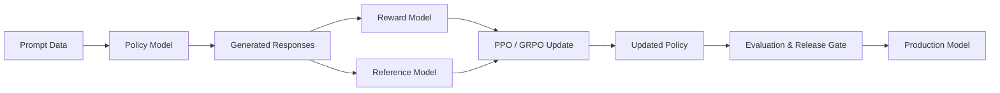

# 3. Research: GitHub repositories worth studying

The fastest path is to study a simple trainer first, then move toward full RLHF systems that coordinate models, data, rewards, and evaluation.

## Recommended repositories to study

### 1. TRL

Why it matters:
- Best entry point for reading real training code.
- Start with `SFTTrainer`, then study `DPOTrainer`, `RewardTrainer`, and `GRPOTrainer`.
- It shows how modern post-training pipelines are implemented on top of Transformers.

Links:
- Repository: https://github.com/huggingface/trl
- SFT docs: https://huggingface.co/docs/trl/main/sft_trainer
- DPO docs: https://huggingface.co/docs/trl/main/dpo_trainer

### 2. LLaMA-Factory

Why it matters:
- Useful for understanding end-to-end fine-tuning workflows.
- Helps connect configuration, dataset templates, preprocessing, training, and export.
- More complete workflow than writing every training step by hand.

Links:
- Repository: https://github.com/hiyouga/LLaMA-Factory

### 3. OpenRLHF

Why it matters:
- Best for understanding full RLHF architecture.
- Study how the actor model, reference model, reward model, and critic interact.
- Useful for learning how Ray schedules distributed tasks while vLLM generates responses.

Links:
- Repository: https://github.com/OpenRLHF/OpenRLHF
- Architecture docs: https://openrlhf.readthedocs.io/en/latest/

### 4. veRL

Why it matters:
- Helpful for understanding RL post-training internals.
- Study the PPO example and the separation between orchestration and computation.
- A useful model for scaling your own system design.

Links:
- Repository: https://github.com/verl-project/verl
- PPO architecture docs: https://verl.readthedocs.io/en/latest/examples/ppo_code_architecture.html

### 5. Microsoft LoRA

Why it matters:
- Shows how parameter-efficient fine-tuning works.
- Low-rank adaptation keeps the base model frozen while trainable matrices adapt the model.
- Essential for understanding how to fine-tune small models without updating every parameter.

Links:
- Repository: https://github.com/microsoft/LoRA
- Original paper: https://arxiv.org/abs/2106.09685

### 6. Trafilatura and Crawl4AI

Why it matters:
- Useful for web data ingestion and content extraction.
- Trafilatura is fast and lightweight for CPU/cloud-shell workloads.
- Crawl4AI is better for dynamic pages and structured markdown conversion.

Links:
- Trafilatura: https://github.com/adbar/trafilatura
- Crawl4AI: https://github.com/unclecode/crawl4ai

### 7. Ollama

Why it matters:
- Great for lightweight local serving of GGUF models.
- Shows how to serve models via an OpenAI-compatible API and swap model versions without downtime.

Links:
- Repository: https://github.com/ollama/ollama
- Documentation: https://ollama.com

### 8. Open WebUI

Why it matters:
- Useful reference for local chat applications with Ollama and RAG support.
- Helps understand prompt interception, filters, and chat pipeline wiring.

Links:
- Repository: https://github.com/open-webui/open-webui
- Documentation: https://docs.openwebui.com

### 9. Cloudflare Tunnels

Why it matters:
- Useful for exposing services running in cloud environments without exposing inbound ports.
- Helpful for routing FastAPI, Open WebUI, and Ollama securely over HTTPS.

Links:
- Repository: https://github.com/cloudflare/cloudflared
- Documentation: https://developers.cloudflare.com/cloudflare-one/connections/connect-networks/

## How the training and infrastructure architectures differ

| Framework / Tool | Best use in your project | Complexity |
| --- | --- | --- |
| TRL | Learn SFT, DPO, and GRPO by implementing experiments | Low to medium |
| LLaMA-Factory | Run configurable fine-tuning jobs and export models | Low to medium |
| OpenRLHF / veRL | Understand complete, scalable RLHF and PPO/GRPO orchestration | High |
| LoRA / PEFT | Parameter-efficient adaptation with a very small trainable subset | Low |
| Trafilatura | High-speed, lightweight text extraction on CPU or cloud shell | Very low |
| Crawl4AI | Deep Playwright scraping and conversion to structured markdown | Medium |
| Ollama | Fast GGUF serving and local inference | Low |
| Open WebUI | Chat interface with RAG and pipeline integration | Low to medium |
| Cloudflare | Public HTTPS tunneling from Cloud Shell or Codespaces | Low |

My recommendation is to start with TRL, use Trafilatura plus DuckDuckGo for scraping, deploy with Ollama for local serving, and leverage Cloudflare Tunnels for exposing the system from Cloud Shell or Codespaces.

# 4. Research papers: read these in the right order

These papers explain the progression from neural network internals to fine-tuning and reinforcement learning. Do not start with the most complex RL system paper. Begin by understanding the objective function and the basic training loop.

## Recommended reading order

1. Attention Is All You Need
   - Foundational Transformer paper.
   - Covers self-attention, token mixing, and the architecture that modern LLMs are built on.

2. The Annotated Transformer / The Illustrated Transformer
   - Useful for understanding the Transformer architecture in plain language.
   - Helps connect the math to implementation.

3. Karpathy's Zero-to-Hero series
   - Very practical and implementation-focused.
   - Helps build intuition for training dynamics, backpropagation, and model behavior.

4. LoRA: Low-Rank Adaptation of Large Language Models
   - Critical for parameter-efficient fine-tuning.
   - Explains why small trainable matrices can adapt large models.

5. LIMA: Less Is More for Alignment
   - Useful for understanding data quality and alignment tuning.
   - Helps make the case that a carefully curated small instruction set can work well.

6. InstructGPT
   - Essential for understanding the RLHF pipeline introduced for instruction tuning.
   - Explains preference data collection and reward modeling at a high level.

7. DPO: Direct Preference Optimization
   - Simplifies preference learning without a separate reward model during training.
   - A crucial paper for practical alignment research.

8. PPO and GRPO-related papers
   - Study PPO if you want the classic RLHF setup.
   - Study GRPO when you want an efficient group-based optimization method used by modern reasoning models.

9. DeepSeekMath / DeepSeek-R1-style GRPO work
   - Helpful for understanding verifiable reward design and rule-based RL in LLM post-training.

# 5. Milestone plan for your own repository

Organize the project into milestones (M0 through M6). Each milestone has a concrete deliverable, a set of concepts to understand, and an acceptance test. This keeps the project focused and production-ready.

## M0. Production foundation and infrastructure harness

### Build
- A reproducible developer environment using `uv` (`pyproject.toml` and deterministic `uv.lock`).
- DevContainer specification (`.devcontainer/devcontainer.json`) for environment parity across Mac, Linux, GitHub Codespaces, and Google Cloud Shell.
- Hardware and device abstraction layer (`core/hardware.py`) that auto-detects CUDA, Apple Silicon MPS, or CPU, setting precision (`bfloat16`/`float32`) and gradient accumulation accordingly.
- Strict data contracts using Pydantic V2 (`core/schemas.py`) for raw scraped documents, cleaned samples, ChatML training pairs, and evaluation reports.
- Configuration management with `pydantic-settings` (`core/config.py`) and `.env` validation.
- Sidecar bootstrap script (`scripts/bootstrap_m0.sh`) that installs and launches Ollama, pulls the baseline model (`qwen2.5:0.5b` or `smollm2:360m`), probes Ollama REST health, and verifies `cloudflared`.
- Fast automated test suite (`tests/test_m0.py`) and `ruff` linting harness.

### Understand
- Environment parity and containerized reproducibility.
- Package locking and fast dependency resolution with `uv`.
- Cross-platform hardware device strategies (CUDA vs MPS vs CPU thread tuning).
- Schema validation and data integrity contracts.
- Sidecar service orchestration (Ollama daemon and Cloudflare tunnels).

### Acceptance test
- Running `bash scripts/bootstrap_m0.sh && pytest tests/test_m0.py` passes 100% cleanly in under 10 seconds.
- Ollama is running and responding at `localhost:11434` with the baseline model pulled.
- Device strategy accurately detects the underlying host hardware.
- All Pydantic data schemas serialize and deserialize correctly.

## M1. Model internals from scratch

### Build
- A tiny autograd engine inspired by micrograd.
- A small neural network.
- A bigram language model.
- A minimal multi-head causal self-attention layer.

### Understand
- Computational graphs.
- Backpropagation.
- Cross-entropy.
- Logits and softmax.
- Gradient descent.
- Attention heads.
- Key/value caching basics.
- The Transformer forward pass.

### Acceptance test
- Explain and numerically verify a gradient update against finite differences.
- Train a small model and plot training and validation loss.

### Study
- Karpathy's Zero-to-Hero series.
- The Annotated Transformer.
- Attention Is All You Need.

## M2. Web ingestion and data quality

### Build
- A fast crawler and extractor using Trafilatura.
- DuckDuckGo-based search integration.
- Optional Crawl4AI for complex DOMs.
- MinHash + LSH fuzzy deduplication.
- Line-level repetition filtering.
- Provenance manifest storage with URL, timestamp, and SHA-256 hash.
- Train/test contamination detection.

### Understand
- HTML extraction heuristics.
- Boilerplate removal.
- Chunking and tokenization.
- Contamination between train and test sets.
- How poor synthetic web data can trigger model collapse.

### Acceptance test
- Every training example traces to a source URL and hash.
- Near-duplicates are filtered out when similarity exceeds 0.8.
- Held-out benchmark prompts remain uncontaminated.

## M3. Actual model fine-tuning with experience replay

### Build
- An SFT pipeline using Hugging Face TRL with `SFTTrainer`.
- PEFT and LoRA for lightweight models such as `Qwen/Qwen2.5-0.5B-Instruct` or `HuggingFaceTB/SmolLM2-360M-Instruct`.
- Experience replay buffer with 70% anchor baseline data and 30% newly scraped data.

### Understand
- Causal language-model loss.
- Label masking with `DataCollatorForCompletionOnlyLM`.
- Trainable parameters and optimizer states.
- CPU vs GPU precision trade-offs.
- Checkpointing.
- Model collapse mitigation.

### Acceptance test
- Train a baseline and a candidate with LoRA adapters.
- Save the checkpoint and configuration.
- Compare them on the same held-out domain questions.
- Confirm knowledge gain without losing conversational ability.

### Study
- Transformers.
- PEFT.
- TRL `SFTTrainer`.
- LoRA paper.
- LIMA.

## M4. Evaluation, citation verification, and autonomous release gate

### Build
- A fixed golden benchmark suite with 20 to 50 domain QA pairs.
- Automated citation faithfulness checks.
- Regression tests against base capabilities.
- Automated release gate decision logic.
- Rollback mechanism.

### Understand
- Held-out accuracy.
- Perplexity.
- Citation fidelity.
- Regression detection.
- Statistical uncertainty.
- LLM-as-a-judge scoring.
- Reward model limitations.

### Acceptance test
- The release gate rejects corrupted or underfit checkpoints.
- It records the failure diagnosis.
- It approves candidates only when they meet predefined quality thresholds without regression.

## M5. Preference learning and RL with verifiable rewards

### Build
- A preference dataset with chosen and rejected pairs.
- A Bradley-Terry pairwise reward model.
- Offline preference optimization with DPO using `DPOTrainer`.
- Online Group Relative Policy Optimization (GRPO) with `GRPOTrainer`.
- Rule-based rewards for citation accuracy, format adherence, and brevity.

### Understand
- Policies and implicit rewards.
- Log probabilities and advantages.
- Group normalization without a critic network.
- KL divergence penalties.
- Reward hacking and verbosity bias.

### Acceptance test
- Compare SFT, DPO, and GRPO on the same evaluation set.
- Verify that GRPO enforces citation correctness and formatting without making responses excessively long.

### Study
- InstructGPT.
- PPO.
- DPO.
- DeepSeekMath and DeepSeek-R1 style GRPO work.

## M6. End-to-end autonomous learning system with Cloudflare and Ollama

### Build
1. A FastAPI backend orchestrating search, retrieval, and chat streaming.
2. Local serving via Ollama with GGUF quantized models.
3. A chat UI using Open WebUI or a custom FastAPI frontend.
4. Cloudflare Tunnels to expose services over HTTPS without opening ports.
5. An asynchronous background research job queue.
6. An autonomous training worker that triggers SFT and LoRA updates when a new-data threshold is reached.
7. A zero-downtime hot-swap deployment pipeline that generates a `Modelfile` and runs `ollama create <model>:latest -f Modelfile` when a candidate passes the release gate.

### Understand
- Service boundaries.
- Asynchronous task queues.
- Model versioning.
- CI/CD for ML systems.
- Cloudflare zero-trust networking.
- Safe autonomous model promotion.

### Acceptance test
- Submit a query on an unseen topic.
- The system triggers background research and scraping.
- Data is cleaned and fine-tuned.
- The candidate passes the benchmark gate.
- The active Ollama model is hot-swapped.
- Subsequent chat queries return accurate, citation-backed responses with no downtime.

# 6. The RLHF architecture you should eventually understand

A conventional PPO-based RLHF pipeline is more complex than a standard fine-tuning workflow. These components play different roles:

- Policy model: the model being optimized.
- Reference model: a frozen model used to measure KL divergence and prevent drift.
- Reward model: estimates human or preference-based quality.
- Critic model: estimates value for PPO training.
- Data pipeline: sources prompts, preference pairs, and verification signals.
- Evaluation system: checks quality, safety, citation fidelity, and regressions.

A useful mental model is this:
- SFT teaches the model to imitate good responses.
- Preference optimization teaches it to prefer better outputs.
- RL with verifiable rewards teaches it to follow constraints and reason reliably.
- Evaluation ensures that gains do not come at the cost of regressions or reward hacking.

## Final recommendation

For this project, the most sensible production learning sequence is:
0. Start with M0: Establish the production infrastructure harness (`uv`, cross-platform hardware abstraction, Pydantic V2 data contracts, Ollama & Cloudflare sidecars).
1. Proceed with M1: Learn autograd and Transformer mechanics from scratch.
2. Build M2: Data ingestion, Trafilatura scraping, and MinHash deduplication.
3. Build M3: Fine-tune small models with LoRA and an experience replay buffer (70% anchor / 30% web).
4. Build M4: Fixed golden benchmark suite and automated citation verification gate.
5. Build M5: Preference optimization (DPO) and verifiable reward learning (GRPO).
6. Build M6: End-to-end autonomous serving with FastAPI, Open WebUI, and zero-downtime hot-swap.

This sequence keeps the project concrete, explainable, and testable while gradually building toward a full RLHF system.
